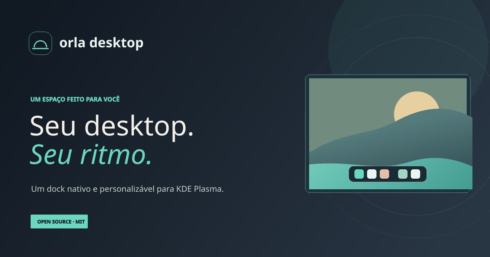

# Orla Desktop



**A personal dock for KDE Plasma, with a calm coastal identity and room to grow.**

Orla Dock is an open-source Plasma applet for pinning applications, switching between open windows, and keeping a few useful tools close by. It is an early alpha: the dock works today. The source checkout also has experimental components for an optional menu bar, launcher, and first Control Center slice; full integration, notification surfaces, and several integrations remain planned.

> [Project website](https://orla-desktop.sunlit-duck-7687.chatgpt.site) · [Português brasileiro](README.pt-BR.md) · [Roadmap](ROADMAP.md) · [Brand guide](docs/brand.md)

The source checkout includes an [experimental standalone launcher](launcher/README.md) for local applications and calculations, built separately with C++/Qt/KF6. A current local check on one Plasma 6.7.5/Wayland screen verified Ctrl+Alt+Meta+O activation, search, Down selection and Escape returning focus to the same test window. Application dispatch, real AI providers and multiple monitors remain unqualified. The Source includes [reversible Meta assignment to Orla Search](launcher/README.md), opt-in with recovery of the previous configuration; the focus baseline records readiness limits. The optional AI compatibility panel does not authenticate or generate responses; later experimental source adds an opt-in Ollama text panel whose real-provider behavior remains unqualified. See the [AI source validation](docs/validation/ai-provider-source.md).

[Menu Orla](bar/README.md) is the experimental optional bar applet. The source layout helper composes it with KDE Global Menu, spacer, native tray and clock widgets through a macOS-inspired top-bar preset. It requires **Plasma 6.7.5**, explicit service/monitor/panel choices and a reviewed plan. `layout disable` removes only the owned Orla bar; `layout restore` restores the original layout from verified backups. The independent dock remains available in dock-only mode. A local check with the unmodified helper passed apply, owned-bar disable, normal original-layout restore and reapply on one Plasma 6.7.5/Wayland screen at DPR 2. Other environments, multiple monitors and full bar acceptance remain open; see the [bar guide](bar/README.md) for commands and limits. Rapid Plasma shutdown/restart has previously exposed intermittent crashes; the startup-rate guard does not resolve that separate experimental risk. The launcher, bar and managed-layout helper are excluded from the published 0.2.5–0.2.10 assets, which remain unchanged.

The product direction is an optional Orla composition that can replace explicitly selected KDE panels while preserving a recoverable original layout. Dock Auto Hide is configured in Plasma's panel settings; the layout helper preserves the independent dock. The Source checkout now has an experimental shared bar Control Center and reversible Meta activation for Orla Search; complete native qualification and a marketplace of opt-in project modules remain roadmap work. Local project adapters are off by default; their current state-file integration is separate from a future plugin marketplace.

The release bundle includes an [experimental update-check CLI](docs/updates.md). It checks official stable/beta releases only when invoked, compares an explicit version, and reports network failures separately. Run it from the extracted bundle; the `.plasmoid` alone has no CLI or update UI. Caching and installation recovery remain planned.

The alpha prerelease ZIP includes the experimental local Steam inventory CLI. It reads bounded library metadata from explicitly supplied roots and reports partial/unknown states; it does not launch games, access an account or prove ownership. Dock search/favorites and real Steam validation remain planned. The 0.2.5 release assets remain unchanged and do not include it. The 0.2.6–0.2.10 ZIPs bundle this CLI; the standalone `.plasmoid` has no CLI. See the [Steam guide](docs/steam.md).

## What works today

Alpha 0.2.10 extends the experimental Control Center: an optional global dock button, off by default, with media and battery status, output volume/mute/device, screen brightness, Do Not Disturb and microphone mute. Each change counts only after the system service confirms it, and a missing service disables only its card. Native behavior was exercised on one Plasma 6.7.5/Wayland session; other environments and hardware remain unqualified. See the [Control Center guide](docs/control-center.md) and the [0.2.10 validation record](docs/validation/release-0.2.10.md).

The source-only [shared Control Center increment](docs/validation/shared-control-center-source.md) adds an optional right-side bar entry using the dock’s existing view and audio state. It stays off in the preset, refuses missing or ambiguous owners, and preserves the dock when removed. Installed-package identity, native positioning/focus and real audio still have separate qualification gates.


The Source checkout also builds an optional [Orla Plasma theme](docs/plasma-theme.md): a translucent, blurred top bar and rounded glass for Plasma popups, notifications and tooltips, following the system's light or dark colors. `scripts/plasma_theme.py apply` remembers the previous theme and `restore` switches back. An optional [Orla window decoration](docs/window-decoration.md) gives KDE windows macOS traffic lights on the left, a centered title and rounded top corners; `scripts/window_decoration.py apply`/`restore` switch it reversibly. `scripts/macos_look.py apply` applies both plus a macOS-style app switcher and minimize effect in one step, and `restore` undoes it all ([guide](docs/macos-look.md)).

Alpha 0.2.10 also includes an [experimental KDE calendar slice](docs/calendar.md). It enables KDE's existing PIM event plugin in the calendar model only while the popup is open and reports only states the plugin API can support without guessing. Disabling the model entry does not prove that KDE backend processes stopped. Its tests use synthetic events and do not access Akonadi, Google accounts or personal calendars.

- Pin, reorder, launch, and remove applications; switch to or minimize open windows. Open app menus with Menu or Shift+F10; Escape closes them.
- Start from Glass, Midnight or Paper and preview colors, opacity, spacing, corners, icon size and reduced motion. Apply saves; Cancel, Escape or closing settings discards the preview. Undo restores the previous applied appearance once per session.
- Use the clock, Pomodoro timer, KDE calendar view, and MPRIS media controls with player selection, track/artist text, and capability-aware playback buttons. An optional local in-dock notice marks the completion of a Pomodoro focus or break period; it is off by default and does not use KDE notifications.
- Enable the optional system battery widget in settings (off by default) to read the UPower aggregate; PeriGauge remains separate for peripherals.
- Read optional local snapshots from QuotaLantern, PeriGauge, and FalaTrace when those projects have written supported state files.
- Create and explicitly select manual profiles for pinned apps, appearance, widget order/visibility, calendar events and the current-desktop window filter. The Pomodoro remains shared.
- Keep the dock in a Plasma panel and configure its position and visibility through Plasma, including Auto Hide for edge-triggered reveal.
- Optionally show the Trash at the end of the dock, after its own divider, as in macOS (global setting in **Widgets**). It shows whether the trash is empty or full and opens it in the file manager; it never deletes or restores files ([capture](docs/screenshots/dock-trash/dark.png)).

The calendar reads the same calendar selection as KDE's calendar components without changing it. Changing that selection in KDE also changes KDE's clock/calendar. Orla does not connect Google Calendar by itself: use **Configure in KOrganizer** to add and authenticate the Google resource through KDE PIM, then enable synced events in the desired Orla profile. An empty day cannot distinguish no events from an unavailable or unconfigured KDE PIM backend; see the [calendar guide](docs/calendar.md).

Media controls share one native Plasma MPRIS model. They initially prefer Spotify when discovered and keep a manual player choice for the session. Play, Pause, Previous and Next respect the selected player’s capabilities; track and artist render as bounded plain text. A private D-Bus fixture qualified the native model with two synthetic players, not the real Spotify client or audio playback. Artwork, progress and opening the client remain planned.

System battery reads only UPower’s aggregate display device, every 30 seconds while enabled, with a five-second request timeout. A genuine 0% reading stays visible; absent or unavailable data has a neutral state. External power, charging and estimated time appear only when supplied. It does not control hardware or enumerate peripheral batteries. See [battery and media validation](docs/validation/battery-media-0.2.4.md) for test coverage and limits. Local project integrations read existing state files; they do not start the other apps or call their online APIs.

Appearance uses a separate override, preserving earlier theme/icon/motion preferences. Restore prepares those preferences for preview and requires Apply. Since 0.2.10, **Experimental JSON theme** accepts a local JSON file through **Import file…**, or pasted text in the `0.1-experimental` format. Import fills the editor; **Use in preview** previews ten tokens in memory, and **Apply** saves only the current profile's ordinary appearance. It does not install a theme package or save its declared metadata. The format and consumer remain experimental; see the [theme guide](docs/theme-format.md) for requirements and validation limits.

The [local Pomodoro notice](docs/local-events.md) is a separate opt-in preference in **Widgets**, global across profiles and off by default. It lasts up to eight seconds inside a reserved dock area. Only focus and break completion use it; HUD/island surfaces and KDE notification integration remain unimplemented. See the [0.2.7 validation record](docs/validation/local-events-0.2.7.md) for test and native limits.

## Use profiles

Open dock settings and choose **Perfis** (Profiles), alongside **Aparência** (Appearance), **Widgets** and **Contextos** (Contexts). **Criar Trabalho, Pessoal e Jogos** copies your saved preferences into Work, Personal and Games profiles while keeping **Preferências anteriores** (Previous preferences) active. Choose a profile and press **Usar perfil**; changing the selector alone does not activate it. To clone the saved active presentation, enter a unique name and press **Criar e usar**. Apply or cancel an appearance preview before creating or switching profiles.

In **Widgets**, visibility, order, calendar events and the window filter save immediately for the active profile; appearance Cancel does not undo them. Widget ordering requires a profile. Return to **Preferências anteriores** to use the original flat preferences. There is no automatic migration. See the [profile guide](docs/profiles.md) for limits and the [validation record](docs/validation/profiles-0.2.5.md) for the private KConfig/restart proof. The published alpha 0.2.8 adds the first experimental **Contexts** tab for explicitly associating the current Activity or virtual desktop with an existing managed profile. It does not switch either context or select profiles automatically; see the [Contexts guide](docs/contexts.md) and [0.2.8 validation](docs/validation/contexts-0.2.8.md). P2 remains partial, W1 is unstarted, and native session qualification remains open.

## Requirements

- KDE Plasma 6.7 or newer.
- Python 3.10 or newer for the packaging helper and local integrations.
- `kpackagetool6` for installation. PySide6 with QtCore/QtDBus, `busctl`, and a user D-Bus session enable local theme-file import. The local project integrations also use QtDBus and remain optional. Missing these dependencies does not block installing the dock; pasted themes still work.
- KOrganizer and the appropriate KDE PIM calendar resource for synchronized external calendars.

On a Fedora system that already has Plasma 6.7+, install the package tool. Add the optional integration dependencies if you want project widgets, then run `doctor` inside your desktop session:

```bash
sudo dnf install kf6-kpackage
# Optional local project integrations:
sudo dnf install python3-pyside6 systemd
```

The current validation baseline is Fedora 44, Plasma 6.7.5, Qt 6.11.2, and Wayland. Other distributions, Plasma versions, X11 sessions, and multi-monitor behavior still need validation.

## Install a release

These commands target the [0.2.10 alpha prerelease](https://github.com/caiolombello/orla-desktop/releases/tag/v0.2.10). Download its release `.zip`, verify its checksum using the published `SHA256SUMS`, and extract it. The bundle contains the helper and applet archive together:

```bash
cd ~/Downloads
sha256sum --ignore-missing -c SHA256SUMS
unzip orla-dock-0.2.10.zip
cd orla-dock-0.2.10
python3 scripts/orla.py doctor
python3 scripts/orla.py install orla-dock-0.2.10.plasmoid
```

Project integrations are off by default. To explicitly enable the bundled experimental adapters, add `--with-integrations` to the install command. Plain install/upgrade preserves any existing integration mapping and saved preferences without enabling new adapters. When its dependencies are available, the new helper registers theme-file import independently; its service starts only after you choose a file. `doctor` reports optional dependencies separately. A failed D-Bus refresh reports a warning while preserving the installed dock; reinstall retries the refresh. The helper does not need administrator access. After installation, add **Orla Dock** from Plasma's Add Widgets interface. Keep the extracted directory if you may want to run the helper again.

To build and install from a source checkout instead:

```bash
git clone https://github.com/caiolombello/orla-desktop.git
cd orla-desktop
python3 scripts/orla.py doctor
python3 scripts/orla.py build
python3 scripts/orla.py install dist/orla-dock-0.2.10.plasmoid
```

The CLI also accepts `build --output-dir DIR`. This changes only
the package destination; the default remains `PROJECT_ROOT/dist`. When the
installed CLI points to a protected source version, choose a writable directory:

```bash
orla build --output-dir "$HOME/.cache/orla/build"
```

Helpers from 0.2.9 and earlier ZIPs do not have this option.
The local CLI check on 14 October 2026 used the installed wrapper against a
protected source version and produced the expected 67-file applet in a writable
directory, preserving source files, desktop configuration and launcher process.

To check the local setup or remove Orla's managed files:

```bash
python3 scripts/orla.py doctor
python3 scripts/orla.py uninstall
```

Remove Orla Dock from any panels before uninstalling. The command removes the applet and its managed integration service while preserving Plasma's saved widget settings for a later reinstall. It does not ask for confirmation, so run it only when you intend to remove those files.

## Development

Run the portable tests and build check with Python:

```bash
python3 -m unittest discover -s tests -p 'test_integrations.py' -v
python3 -m unittest discover -s tests -p 'test_package_cli.py' -v
python3 scripts/orla.py build
```

QML interaction tests require a running graphical KDE session. Native panel behavior, Wayland focus, global menus, notifications, and multi-monitor behavior are not covered by portable CI; report the exact Plasma version and session type when filing an issue.

Calendar QML checks are the exception: run `python3 -B tests/run_calendar_tests.py` (and add `--style org.kde.desktop` for the KDE style). This stdlib supervisor starts Qt offscreen in a separate process with owned XDG directories and an unavailable session-bus endpoint. Do not combine `test_calendar` with graphical dock suites in one `unittest` process.

See [CONTRIBUTING.md](CONTRIBUTING.md) before opening a pull request. For security concerns, follow [SECURITY.md](SECURITY.md).

## Project status

Orla Desktop is an alpha project. The current component keeps the existing Plasma package identifier `org.caiodock.dock` and D-Bus service `org.caiodock.Integrations` to preserve existing installations and settings. The name shown to users is Orla Dock; these internal identifiers are compatibility details.

Manual dock profiles and widget organization are the partial P1/C1 increment shipped in 0.2.5. Version 0.2.6 added the first paste-only experimental theme consumer and bundled the experimental Steam CLI. The 0.2.7 ZIP carries that CLI forward and adds one opt-in in-dock Pomodoro focus-or-break completion notice. The 0.2.8 alpha release adds explicit profile associations for the current Activity or virtual desktop; P2 remains partial, W1 is unstarted, and native context behavior remains unqualified. The 0.2.9 alpha published the first optional Control Center slice; 0.2.10 adds direct audio, brightness, Do Not Disturb and microphone controls, a unified visual system, drag reordering, appearance presets, opt-in automatic profiles, virtual-desktop switching and an experimental add-on host. CC1 remains partial and native behavior is qualified only on one session. The native panel and system-notification behavior also remain unqualified. The system battery reader and player selection/control increment shipped in 0.2.4; the full B1/M1 milestones remain open for hardware and real-client qualification. Full native qualification of the optional macOS-inspired bar, shared bar Control Center, complete Raycast-like launcher integration, AI authentication/inference and selected-text workflow, HUD/island and broader notifications, Spotify artwork/progress/client opening, Steam dock integration, per-monitor context behavior, Activity switching, automatic updates, and fuller project integrations are roadmap items. A stable theme contract, gallery, public extension SDK, independently sold addons, and optional AI integrations are also planned.

See the [complete roadmap](ROADMAP.md) for sequencing, dependencies, and acceptance criteria, with companion proposals for [UX/UI](docs/UX_UI.md), [themes and extensions](docs/EXTENSIONS.md), [AI access and providers](docs/AI_INTEGRATIONS.md), and [developer experience](docs/DX.md). Declarative themes come before executable plugins; AI adapters use each provider's supported authorization route. The core remains useful without an Orla account, paid addon, or AI subscription. Marketplace checkout and the extension SDK have not been implemented.

## License

Orla Desktop is distributed under the [MIT License](LICENSE).
