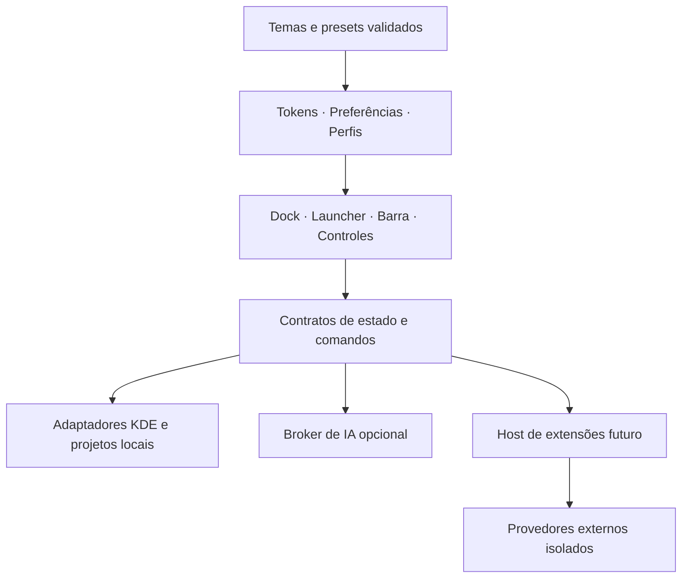

# Roadmap do Orla Desktop

Revisão: 13/10/2026. Base auditada: CaioDock 0.2.0, publicado como Orla Dock 0.2.1 alpha, Plasma 6.7.5, Qt 6.11.2, Fedora 44, Wayland. A publicação alpha inclui identidade, instalador, documentação e CI; os marcos abaixo continuam sujeitos aos respectivos critérios de aceite.

**Direção atual de UX:** oferecer uma composição Orla opcional inspirada no macOS que substitui apenas os painéis KDE explicitamente selecionados e mantém recuperação do layout original. Dock Auto Hide, fundo translúcido e popups ancorados são a direção visual. Meta isolada abre Orla Search nesta instalação local após configuração explícita e reversível; o projeto mantém essa atribuição opt-in. QuotaLantern, PeriGauge e demais projetos pertencem ao futuro catálogo de módulos opcionais, desativados por padrão; os adaptadores locais existentes não constituem um marketplace implementado.

**Histórico de validação anterior ao modo Meta:** o launcher compacto de `43905da` passou ativação por Ctrl+Alt+Meta+O, consulta, ↓ e Escape com retorno à mesma janela de teste em dois processos independentes, em uma tela Wayland. Isso não qualifica Enter/execução, provedores reais ou múltiplos monitores. Dock Auto Hide e popups separados do dock foram observados nesta máquina; o Menu Orla isolado passou hover, duas aberturas e ↓/Escape em DPR 2. O helper final sem modificações passou aplicar → desativar → restaurar normalmente o layout original → reaplicar em uma tela Plasma 6.7.5/Wayland com DPR 2, preservando o dock independente e verificando a ordem dos cinco módulos. O ciclo não mostrou novo crash, mas crashes intermitentes anteriores em desligamentos rápidos do Plasma não foram resolvidos pela proteção contra o limite de partidas. Outras telas/ambientes e o aceite completo continuam abertos. Os assets publicados 0.2.9 permanecem inalterados e não incluem launcher, barra ou helper de layout. Os checklists abaixo mantêm o aceite completo, incluindo trabalho ainda não implementado.

**Sistema visual instalado e em qualificação:** dock, barra e launcher da revisão visual de 13/10 foram instalados com backup. Em uma sessão Plasma 6.7.5/Wayland, HDMI-A-1, DPR 2, foram observados dock Auto Hide revelando/recolhendo, etiqueta flutuante, Central de Controle e configurações ancoradas com Escape, Menu Orla e retorno de foco do launcher após consulta/Escape. O contrato em [DESIGN_SYSTEM.md](docs/DESIGN_SYSTEM.md) unifica tokens, componentes e verificações de contraste; a galeria pública claro/escuro usa dados sintéticos. Passaram 19 suítes Fusion, QML completo nos dois estilos, barra nos dois estilos e seis CTests do launcher. As fixtures de áudio agora aguardam a confirmação/expiração real pelo prazo público, evitando timeouts artificiais durante o input KDE. Esquema claro nativo, múltiplos monitores, escala fracionária, mover o applet entre painéis, Enter/execução e provedores reais continuam sem qualificação nesta revisão. UX0, UX1 e DX2 permanecem parciais. Os assets publicados 0.2.9 permanecem inalterados.

**Busca por Windows/Meta instalada — prova delimitada de 13/10:** modo gerenciado com ação estável, instância única, atalho alternativo preservado e CLI `search-shortcut status/enable/disable/recover`. Passaram 19 testes da CLI, 23 casos de atalhos e os sete CTests em build permanente (97,17 s), com revisão independente. Em Plasma 6.7.5/Wayland, Qt 6.11.2, DPR observado 1,45, Meta abriu Orla, ↓ selecionou a fixture própria e Enter executou somente essa seleção; o processo permaneceu vivo, reabriu e Escape devolveu o foco. Atalho alternativo, supressão de Meta+O, reinício do serviço, restauração física do KRunner e reativação foram verificados. Os defaults anteriores foram preservados; fixtures e dispositivos temporários foram removidos. O teste real encontrou e corrigiu a saída automática por QuitLock após o job KIO, com regressão usando o `main` real. A digitação imediata antes do foco ainda precisa de qualificação: um probe sem pausa perdeu a primeira letra. Outros monitores, estado de atalho inibido, reinício do daemon e provedores reais continuam UNRUN; L0/L2 e UX0 seguem parciais.

**Encerramento das fixtures do launcher:** a falha pós-suíte do PR 45 foi
reproduzida em container; o core identificou limpeza tardia da thread de
`krunner_services`. A guarda Source passou a aguardar somente os workers
próprios, no prazo existente. Regressão causal e sete CTests passaram; não há
mudança no launcher instalado ou qualificação de seu encerramento nativo.
Nova CI e os gates de personalização continuam separados. Veja o
[registro](docs/validation/appearance-presets-source.md).

**Steam — navegação por teclado:** o teste Wayland do candidato instalado
encontrou Tab sendo inserido no campo de raízes. A correção Source define
Tab/Shift+Tab, pula ações indisponíveis e revela o controle focado após mudanças
do conteúdo. Regressões causais e capturas em 440/660 px passaram nos estilos
Fusion/KDE. O canary `c71ab6d` foi instalado e validado em Wayland: Localizar
encontrou uma raiz sem ler jogos; Carregar mostrou 12 jogos e zero avisos,
com Downloads inteiramente visível ao receber foco. Configuração Plasma,
dock e barra permaneceram iguais. Seleção de jogo, execução, cliente e matriz
de bibliotecas ainda estão abertos; S1 permanece parcial. Veja o
[registro](docs/validation/steam-root-discovery-source.md).

**Quatro presets de aparência — instalados com prova delimitada:** Essencial, Maré, Estúdio e Jogo
oferecem prévia optativa de aparência e widgets, com Aplicar/Cancelar/Desfazer
existentes. O estado aparece no botão, sem deslocar sua altura; a seleção antiga
é recusada após mudança de perfil ou cancelamento reentrante. Passaram 69 testes
relevantes por estilo, suíte final de presets 25/25, design e build. O dock
`944c0e7` foi instalado (67 arquivos); abertura passiva e orientação de perfil
foram observadas em Wayland, sem mudar configuração, barra, bancos ou launcher.
O canary gerenciado passou prévia, aplicação e reversão dos quatro conjuntos
por gestos reais, preservando apps e demais campos. Essencial, Maré e Jogo
completaram os ciclos com auto-hide. O primeiro lote de Estúdio exigiu um
painel temporariamente visível; o canary seguinte confirmou Aplicar, recolher,
revelar, reabrir e Desfazer com o auto-hide original. A largura mudou de 743
para 901 e voltou; Escape devolveu foco à janela própria. Um contraste com
movimentos idênticos isolou a cadência inadequada do helper de input, sem
alterar preferências do KWin. Configurações, bancos e pacotes foram preservados
e o perfil temporário foi removido. A regressão de fechar/reabrir/Desfazer
integra a suíte portátil; outras telas, fullscreen, acessibilidade e quantidade
de setters nativos continuam sem qualificação. C1/UX1/X1 seguem parciais.
Veja o [registro](docs/validation/appearance-presets-source.md).

**DX — saída de build explícita:** `build --output-dir DIR` permite empacotar
uma Source protegida em destino gravável, sem mudar origem ou permissões.
O default continua `PROJECT_ROOT/dist`. A recusa anterior da opção foi
reproduzida nos dois entrypoints; passaram 23 testes da CLI e um de release,
incluindo fixture readonly, determinismo e preservação de estado. A publicação
0.2.9 mantém seu helper anterior. A CLI local foi atualizada para `93e897a` e o
wrapper instalado empacotou os 67 arquivos em destino gravável, com hash igual
ao candidato. Source, configuração do desktop, dock, barra e launcher foram
preservados; não houve recarga do Plasma. A primeira tentativa recusou o
preflight por comparação de tipos no helper, antes de qualquer alteração;
a correção comparou o identificador textual exato do processo.

## Resultado esperado

Um ambiente KDE inspirado no macOS, com dock, barra superior, launcher inspirado no Raycast e notificações configuráveis, integração com os projetos do Caio e instalação acessível para outras pessoas. A identidade Orla continua própria, com uma interface bonita, consistente e personalizável. Temas, widgets, comandos e provedores de IA poderão ser ampliados pela comunidade; autores poderão distribuir addons gratuitos ou comerciais conforme os contratos e políticas abaixo. Caio decide as prioridades e valida o uso diário. Este documento define a sequência proposta; os números de versão são marcos, sem promessa de datas.

**Execução iniciada:** o incremento alpha 0.2.2 permite instalar/atualizar sem dependências opcionais das integrações, recuperar o serviço por reinstalação e abrir os menus dos aplicativos pelo teclado. Foram verificados 43 testes da base e o ciclo real de instalação em diretórios temporários, com D-Bus privado e dados sintéticos preservados. R1/R2 continuam parciais: painel real, vários monitores, uso diário e empacotamento do futuro launcher têm gates próprios. Consulte a [evidência da base](docs/validation/foundation-0.2.2.md). As versões abaixo continuam sendo marcos de aceite.

**Primeiro consumidor de tema publicado na alpha 0.2.6:** além do formato `0.1-experimental`, schema, exemplos e CLI, Aparência aceita JSON colado e oferece prévia reversível dos dez tokens. Aplicar salva somente a aparência normal do perfil atual. Não há leitura de arquivo, persistência de metadados, galeria, catálogo ou API estável. Assets públicos foram baixados anonimamente e coincidiram byte a byte com o commit-fonte `6c845ca363d5e6246ec61aa1b9da0af16f622340`; a CI do PR 14 passou no run 38109454140/job 114381787703. Isso não qualifica popup/foco nativo, acessibilidade, contraste, reinício ou instalação/upgrade real. O registro detalha os hashes e os limites. C1, X1 e DX2 continuam parciais. Consulte o [guia do formato](docs/theme-format.md) e a [validação do consumidor](docs/validation/theme-consumer-0.2.6.md).

**Aparência alpha 0.2.3:** editor com prévia temporária, Aplicar, Cancelar, Desfazer e restauração das preferências anteriores, em snapshot separado. Popup limitado ao orçamento da tela e campos acessíveis pelo teclado; 66 testes locais e revisão independente aprovados. Uma fixture com painel/KConfig privados comprovou Aplicar/Cancelar/restart de aparência por ações programáticas; isso não qualifica gesto humano nem foco/grab/layout do popup. Esse recibo histórico não cobre organização de widgets/perfis; importação/exportação continua pendente; C1/UX1 permanecem parciais. Consulte a [validação da aparência](docs/validation/appearance-0.2.3.md).

**Bateria e mídia alpha 0.2.4:** bateria do sistema opcional, desligada por padrão, lê somente o agregado UPower e preserva estados neutros/0% válido. Mídia compartilha um modelo MPRIS nativo, prefere Spotify inicialmente, mantém seleção manual por sessão e respeita capacidades por comando. Fixtures de bateria/mídia, leitura real agregada UPower e dois players sintéticos em D-Bus privado passaram; a regressão conjunta passou os 96 testes. B1/M1 continuam parciais: múltiplas baterias/UPS/transições reais, Spotify real/áudio, capa/progresso/abertura do cliente e interação humana no painel têm gates próprios. O launcher não integra esta release. Consulte a [validação](docs/validation/battery-media-0.2.4.md).

**Perfis manuais publicados na alpha 0.2.5:** o dock já oferece criação e seleção explícita, cópia das preferências salvas e retorno às preferências anteriores sem migração automática. Perfis guardam apps fixados, aparência, ordem/visibilidade dos sete widgets, eventos do calendário e filtro de janelas pela área atual. Pomodoro continua global na seleção. Revisão da implementação aprovada, 49 testes direcionados em Fusion/KDE e regressão KDE de 123 testes passaram. Snapshot nativo privado (metadata 0.2.4 com overlays de perfis, 26 arquivos congelados) comprovou Apply/Cancel/disco/restart e um ciclo próprio de remover/recriar. Não é qualificação da release inteira nem de popup/foco/gesto humano. P1/C1 continuam parciais; retomada do timer entre processos e escolha de barra/launcher/eventos permanecem abertas, assim como P2/W1. Consulte [uso](docs/profiles.md) e [validação](docs/validation/profiles-0.2.5.md).

**Publicação alpha 0.2.7:** a [prerelease 0.2.7](https://github.com/caiolombello/orla-desktop/releases/tag/v0.2.7) foi publicada em 11/10/2026 UTC, a partir do commit `9ca1792ee3e9c20ad770042d2d441aa1ae6efbce` (PR 16; CI run 38111731691 aprovado). Os downloads públicos anônimos do applet, ZIP e `SHA256SUMS` coincidem byte a byte com a build da release; veja [validação](docs/validation/local-events-0.2.7.md). Instalação/upgrade e admissão nativa não foram executados. O ZIP inclui a CLI Steam experimental; Menu Orla e launcher continuam excluídos. Assets 0.2.5/0.2.6 permanecem inalterados.

**Publicação alpha 0.2.9:** a [prerelease pública](https://github.com/caiolombello/orla-desktop/releases/tag/v0.2.9) foi publicada às 06:08:41 UTC (`latest=false`), a partir do Source `a377340b2a37555a57fc87360d45ed68c815ccda` (PR 22, merge `3c27fd01b2f3571b6d4eb71d68d8095f9b0bf85a`). CI run 38116955839/job 114403627560 passou às 06:06:55 UTC com 17 testes de bridge em 5.541 s; não executou a suíte QML do CC0 nem compilou o launcher C++. Verificação anônima confirmou os três assets e duas builds candidatas mais uma build exata idênticas (154 arquivos Source, 124 entradas ZIP, 38 do applet). Instalação e admissão nativa permanecem UNRUN. O ZIP inclui helpers `scripts/ai.py`/`tests/test_ai.py`, mas não launcher/bar. Consulte [validação](docs/validation/control-center-peripherals-0.2.9.md).

**Calendário KDE no Source atual:** a primeira fatia experimental carrega `pimevents` somente com o popup aberto e a preferência ativa, diferencia apenas metadados ausentes, eventos recebidos e lista vazia inconclusiva, e mantém a configuração como ação explícita no KOrganizer. Fixtures Source não carregam provider real nem acessam Akonadi, contas ou calendários. Google real, sincronização e estados do backend permanecem UNRUN; a alpha 0.2.9 publicada não mudou. Consulte o [guia](docs/calendar.md).

**Base histórica de texto da IA (PR 28):** o [PR 28](https://github.com/caiolombello/orla-desktop/pull/28) integrou contratos e parsers offline para respostas textuais de Ollama e OpenAI. A [CI](https://github.com/caiolombello/orla-desktop/actions/runs/38126133261) passou os 23 testes de texto e os cinco CTests do launcher. O entrypoint direto continua retornando `unsupported_transport`; naquela fatia, conexão, autenticação, geração, assinaturas e UI de texto estavam abertas. Os assets publicados 0.2.9 permanecem inalterados; veja a [validação Source](docs/validation/ai-provider-source.md).

**Fundações posteriores à alpha 0.2.9, somente no fonte:** o [PR 29](https://github.com/caiolombello/orla-desktop/pull/29) separou o runtime temporário dos helpers dos arquivos do launcher; a CI aprovada executou os cinco CTests em 48,52 s. O [PR 30](https://github.com/caiolombello/orla-desktop/pull/30) publicou o lifecycle de texto testado com conectores simulados e o verificador de pacote do launcher. Sua [CI](https://github.com/caiolombello/orla-desktop/actions/runs/38132537208) aprovou 69 testes dessas fundações e os cinco CTests em 49,35 s. O inventário do pacote continua uma declaração não verificada do chamador; a consulta delimitada de metadados do doctor está descrita abaixo, e coleta transitiva e instalação em usuário limpo continuam abertas. Não houve conexão ou geração de IA. Os assets públicos 0.2.9 permanecem inalterados; consulte o [launcher](launcher/README.md) e a [validação de IA](docs/validation/ai-provider-source.md).

**Fatia de texto da IA integrada nesta mudança Source:** depois do adaptador HTTPS privado do OpenAI integrado historicamente pelo [PR 34](https://github.com/caiolombello/orla-desktop/pull/34), que continua sem entrypoint, credenciais ou UI, esta mudança integra somente Ollama numérico em loopback ao painel do launcher. A pessoa informa `127.0.0.1` ou `::1`, porta, modelo, tarefa, texto e idioma, revisa destino/dados/custo desconhecido e consente por sessão; só **Gerar** executa. Há streaming, cancelamento, parcial revisável e cópia manual. A composição inicial passou build normal, seis CTests isolados e 90 testes Python (6 shim, 23 T1 e 61 T2; UI 10 e controller 12).

As treze correções do [PR 36](https://github.com/caiolombello/orla-desktop/pull/36) preservam timeout como falha, validam uso antes de publicá-lo, mostram uso desconhecido corretamente, cancelam ambas as IAs ao abrir Steam, limpam resultados anteriores antes de uma nova tentativa e encaminham o atalho com a janela ativa pela barreira dos três proprietários. Ao voltar à busca, as quatro rotas QML de execução ficam bloqueadas durante operação ou fechamento pendente, com estado de espera e digitação disponível. Falha de limpeza atualiza a UI uma vez por mudança e mantém a barreira até a recuperação. A finalização notifica os bindings antes de liberar o fechamento, bloqueando geração reentrante. Pedir saída passa a prevalecer sobre pedidos posteriores de ocultação até o fechamento único após a limpeza, inclusive quando todos os proprietários já estão prontos. O uso de tokens permanece privado até validar a resposta completa, a saída normal zero e a limpeza; bytes extras, erro de saída, cancelamento e timeout descartam os dados pendentes.

A composição anterior das oito correções passou build novo e os seis CTests: controller 25 e UI 27 em 24,75 s, dentro do limite preservado de 30 s. As seis correções anteriores tiveram composição aprovada com controller 24/UI 18. O novo teste Steam foi corrigido para reencontrar o controle após reconstrução do modelo; a cópia foi observada só no clipboard privado offscreen. A fixture do shim passou em Python 3.12.3 e 3.14.7 em harnesses próprios.

Os dois jobs hospedados passaram em `1f59e0c` e `57c2aa0`; o último reportou os seis CTests e pulou o diagnóstico GDB. Em `2c8b750`, a UI saiu com SIGSEGV depois das 17 entradas aprovadas; sua causa continua desconhecida. O workflow preserva a falha original e só captura GDB após falha. O run aprovado e a correção do novo teste não explicam esse SIGSEGV histórico. Os dois jobs também passaram em `28c5ef4`, com os seis CTests hospedados em 74,04 s e UI em 24,27 s. A composição das dez correções passou build novo de 40 passos e os seis CTests isolados em 75,925 s, com controller 27 e UI 27 (24,60 s, limite de 30 s). A revisão do controller aprovou o Source e preservou uma limitação de fixture: um desafio QML cooperativo adicional observou cancelamento não confirmado e falhou ao exigir confirmação; sua causa exata continua desconhecida, enquanto os desafios forced/timeout e os 27 testes normais passaram. A revisão independente da saída passou UI 27 e um desafio real de reentrada com os três helpers: quit pendente prevaleceu no caminho imediatamente pronto, houve um fechamento e o ciclo posterior sem quit permaneceu independente. Uma fixture anterior falhou por pressupor o prazo Steam errado, antes da verificação causal; a falha ficou preservada e a correção alterou somente o prazo exposto de teste em build próprio novo. CI da nova revisão e integração na branch principal continuam pendentes.

A última correção de uso passou sete regressões com helpers reais e retries, revisão independente com 34 entradas do controller e um desafio adicional de cinco entradas que distingue saída padrão fechada de processo concluído. A composição do código passou build novo de 40 passos e os seis CTests uma vez em 78,502 s: controller 34 e UI 27, com UI em 24,508 s dentro do limite de 30 s. As sete regressões falharam causalmente no código anterior após a limpeza dos processos próprios. Não houve falhas na validação final desta correção. Os dois jobs hospedados também passaram em `8d137cf`, com seis CTests em 78,72 s. A build local desse commit passou seis CTests em 79,47 s, mas não foi instalada: surgiram dois novos comentários antes do merge.

As duas correções seguintes preservam a primeira falha já observada quando cancelamento ou fechamento começam durante a limpeza e descartam todo stdout posterior ao primeiro erro de protocolo, mantendo só o parcial previamente aceito. Cancelamento anterior à falha mantém sua classificação original, inclusive antes de iniciar o processo. Dezessete regressões novas com helpers reais e retries foram adicionadas: quinze falharam causalmente no código anterior; os dois controles de cancelamento pré-início passaram. A composição final passou build novo de 40 passos e seis CTests uma vez em 81,147 s, com controller 51 e UI 27 (24,663 s, limite de 30 s). A revisão independente passou controller 51 e um desafio QML adicional de quatro entradas; uma falha anterior de setup ficou preservada antes de executar helpers, com seus oráculos causais `UNRUN`. O trace JSON desse desafio é `null` e não comprova ordem temporal; veja a validação delimitada.

Em `5aaf518`, o [run 38175193804](https://github.com/caiolombello/orla-desktop/actions/runs/38175193804) aprovou o job portátil, mas `launcher-behavior` terminou com SIGSEGV depois de 7 PASS, 0 FAIL e 1 skip esperado; os outros cinco CTests passaram. A causa permanece `UNKNOWN`, separada do crash histórico da UI. Um único diagnóstico GDB local saiu normalmente e não reproduziu o crash. O workflow agora seleciona somente um alvo falho allowlisted, priorizando behavior sobre UI, e preserva a falha original e os limites; essa ampliação do diagnóstico não corrige o crash. CI desta revisão e merge continuam pendentes.

**Canary local do launcher `5aaf518`:** build permanente de 40 passos e seis CTests passaram uma vez em 80,85 s. A atualização reversível trocou somente o caminho do executável no wrapper, com backup; o serviço ficou ativo/habilitado no KDE. Foram observados atalho, retorno do foco com Escape, painel de IA, rolagem por Tab, popup de tarefa, cálculo `2+2`, saída limpa por Ctrl+Q e reinício. Isso qualifica esses fluxos básicos nesta máquina; geração Ollama/modelo real, semântica, clipboard/acessibilidade nativos, matriz de telas, empacotamento relocável, distribuição/release e admissão completa permanecem abertos. A1 não está concluída. As capturas locais orientam o próximo ajuste de UX inspirado no macOS: launcher compacto, materiais/espaçamento consistentes e organização opcional dos indicadores. Os assets 0.2.9 permanecem inalterados. Loopback não comprova identidade Ollama, privacidade ou operação offline, pois o processo ouvinte pode encaminhar o texto.

**Eventos locais alpha 0.2.7 (histórico):** a release oferece um aviso local opcional, desligado por padrão, para conclusão de foco ou pausa do Pomodoro. Revisão independente aprovou as alterações delimitadas; verificações focadas e pacote sintético passaram. A publicação e a correspondência exata dos assets foram verificadas, mas instalação/upgrade e comportamento nativo não. O aviso não usa o serviço de notificações KDE; HUD/ilha e regras por perfil não estão incluídos. N1 permanece parcial; N2/N3 continuam abertos. O Source posterior acrescenta HUD de áudio opt-in por perfil com agrupamento e expiração; não altera esta release histórica. Consulte o [guia](docs/local-events.md) e a [validação](docs/validation/local-events-0.2.7.md).

**Publicação alpha 0.2.8:** a [prerelease pública](https://github.com/caiolombello/orla-desktop/releases/tag/v0.2.8) (marcada como prerelease, não `latest`) foi publicada em 11/10/2026 às 05:09:26 UTC (o PR foi mesclado às 05:08:31 UTC), a partir do commit `9e42decd42fc4a9a705dd48e6087b17aaca51d29` (PR 18, merge `c87930bc9881523a390ca492af1e0af6dfc328ca`). A CI do PR 18, run 38113776729/job 114394497503, passou às 05:08:09 UTC. Verificação anônima às 05:09:44 UTC encontrou HTTP 200 e correspondência exata da build nos três assets; veja os hashes em [validação](docs/validation/contexts-0.2.8.md). Duas builds candidatas e uma build do commit exato coincidiram: 139 arquivos Source, 113 entradas no ZIP e 35 no applet. Instalação/upgrade não foram executados e a admissão nativa permanece falsa. O ZIP mantém as CLIs Steam e de updates experimentais. Menu Orla e launcher continuam excluídos; os assets 0.2.5–0.2.7 permanecem históricos e inalterados.

Premissas: o dock continua utilizável sozinho; a barra superior, o launcher e seus módulos são opcionais; “ambiente” significa um perfil Trabalho, Pessoal ou Jogos, que pode ser associado a uma Activity do KDE ou a uma área de trabalho virtual. As duas associações serão configuradas separadamente. A primeira plataforma suportada continua sendo Plasma 6.7+ em Wayland; outras versões precisam de validação própria.

O planejamento cobre produto, experiência, arquitetura, distribuição, DX e comunidade. O sucesso será completar os fluxos descritos abaixo no painel real, preservando aplicativos, calendários, configurações e notificações já existentes. Menus globais, notificações, foco Wayland, isolamento de plugins e autorização de IA têm provas próprias antes da expansão.

| Documento | Uso |
|---|---|
| [UX/UI](docs/UX_UI.md) | Sistema visual, setup, editor, estados, acessibilidade, atenção e validação com pessoas |
| [Extensões e temas](docs/EXTENSIONS.md) | Categorias, permissões, SDK, distribuição, compatibilidade e addons pagos |
| [Integrações de IA](docs/AI_INTEGRATIONS.md) | APIs, SIWC/ChatGPT, Codex, Claude Code, OpenCode, modelos locais e limites por rota |
| [DX](docs/DX.md) | Fluxo atual, tooling proposto, mocks, galeria, contratos e contribuição sem API paga |
| [Contribuição](CONTRIBUTING.md) e [identidade](docs/brand.md) | Entrada atual para colaboradores e assets próprios do projeto |

Esses documentos especificam capacidades futuras. As releases públicas 0.2.5–0.2.9 não incluem SDK, runtime de plugins, catálogo, checkout ou integração de IA. O checkout de fonte contém uma fatia experimental de compatibilidade de provedores no launcher, integrada pelo [PR 20](https://github.com/caiolombello/orla-desktop/pull/20) e aprovada pela CI portátil; ela não implementa autenticação nem geração. O ZIP 0.2.9 inclui somente `scripts/ai.py` e `tests/test_ai.py`, sem painel do launcher. Repositório, landing e releases alpha já estão públicos; os novos marcos não equivalem a funcionalidades entregues.

## O que já existe e o que falta

Publicado significa que o incremento integra os assets indicados; Source significa código experimental no checkout. Prova nativa delimitada qualifica somente os fluxos, revisão e ambiente registrados, sem encerrar automaticamente o gate da área.

| Área | Entregas publicadas e incrementos Source | Lacuna a fechar |
|---|---|---|
| Aplicativos e janelas | Fixar apps, ativar/minimizar/restaurar, menu de contexto, reorganização pelo menu e entrada de arquivos `.desktop` | Arrastar para reorganizar, agrupamento opcional, teste prolongado no painel e em vários monitores |
| Personalização | Três temas, editor com prévia/Aplicar/Cancelar/desfazer e ordem/visibilidade por perfil; persistência em KConfig privado | Qualificar popup/foco/grab por gesto real, presets, exportação/importação e composição completa dos perfis |
| Spotify | Modelo MPRIS compartilhado, preferência inicial pelo Spotify, seleção manual, faixa/artista e controles por capacidade | Capa/progresso, abrir cliente e qualificar Spotify real/áudio com segundo player |
| Bateria | Widget opcional do agregado UPower, percentual/estado/energia/tempo quando informados; PeriGauge separado | Matriz real de notebook/desktop/múltiplas baterias/UPS/transições, alertas e uso humano no painel |
| Ambientes e áreas de trabalho | Perfis manuais e filtro de janelas; 0.2.8 publica associações explícitas de Activity/desktop a perfis existentes | Admissão nativa/KConfig da associação, seleção automática de perfil (P2 completo), escolha de superfícies e troca de contexto (W1) |
| Steam | CLI experimental no ZIP 0.2.8; provedor Source com busca, ação por ID e descoberta opcional de pastas conhecidas, sem leitura ao abrir o painel | Qualificar descoberta e ações no KDE real, distribuir o launcher e testar nativo/Flatpak/disco externo; instalação, conta e favoritos seguem abertos |
| Projetos próprios | Adaptadores locais para QuotaLantern, PeriGauge e estado salvo do FalaTrace | Validar os coletores reais, comunicar a idade da leitura e comprovar gravação ativa antes de indicá-la como ao vivo |
| Calendário | Calendário e acesso ao KOrganizer; leitura PIM lazy experimental no Source, com prontidão do backend desconhecida | Conectar Google pelo fluxo nativo e validar seleção, sincronização, fuso e recorrência |
| Notificações | Toast local opt-in 0.2.7 do Pomodoro; HUD de áudio Source opt-in por perfil, com confirmação, agrupamento e expiração | Ilha/HUD global, outros eventos, regras completas e qualificação nativa sem duplicar notificações/OSD do KDE |
| Barra superior | Menu Orla experimental somente no fonte: menu do sistema e nome do app ativo, Plasma 6.7.x | Qualificar ações/painel/foco, composição com Menu Global/relógio/bandeja nativos, preset reversível e Central de Controle |
| Launcher estilo Raycast | Componente experimental no fonte, com build separado; KRunner/Milou como fallback | Interface por teclado, comandos compartilhados, painel de ações e integração com perfis/projetos |
| Updates e distribuição | Repositório MIT, landing bilíngue, releases alpha e instalação do dock; launcher com nove CTests, bundle real verificado e calculadora Wayland isolada; instalação, recuperação e atualização/reversão de payload no fonte | Gestão completa de versões/ferramentas, migração do legado, autenticidade, distribuição qualificada, matriz nativa e UI/cache de updates |
| UX/UI e DX | Identidade Orla, temas, tokens/componentes compartilhados e galeria sintética no Source; documentação de contribuição e testes por ambiente | Completar estados/fluxos, editor/exportação, acessibilidade e qualificação nativa; onboarding e autoria guiada |
| Ecossistema | Contribuições ao código pelo GitHub | Formato declarativo, SDK, compatibilidade, catálogo e plugins com isolamento comprovado |
| IA | Detecção explícita de CLI e compatibilidade anônima do Codex (PR 20); contratos/parsers offline (PR 28), lifecycle com fakes (PR 30), adaptadores privados Ollama/OpenAI e integração operacional Ollama numérico nesta mudança Source com UI, streaming/cancelamento e fixtures privadas. O entrypoint T1/T2 direto continua `unsupported_transport`; OpenAI HTTPS permanece sem ligação operacional | Empacotar helpers de forma relocável e qualificar Ollama/modelo, semântica, clipboard/acessibilidade e uso nativo; credenciais/auth e backend API opt-in de A1 continuam abertos |

Evidência local: `package/metadata.json`, `package/contents/config/main.xml`, os componentes em `package/contents/ui/`, `package/contents/code/integrations.py`, `scripts/caiodock.py` e `tests/`. O recibo histórico do smoke nativo registra fixar/abrir/ativar/minimizar/restaurar em uma janela de teste nativa; isso ainda não comprova os fluxos prolongados no painel. O Google Agenda ainda não foi conectado, conforme informado pelo usuário. Os incrementos entregues e seus limites estão registrados acima; os checklists abaixo mantêm os critérios de aceite completos, incluindo funcionalidades ainda não implementadas.

**Recibo histórico — novas correções de fechamento e sinais (PR 36, somente fonte):** a recuperação da limpeza volta a mostrar o erro original da resposta; fechar o launcher bloqueia novos trabalhos nos painéis IA/Steam, preservando Cancelar e Voltar; cancelamento/timeout durante publicação deixam de virar falha do stdout. Regressões causais e revisões independentes cobrem os três casos. A composição local passou ALL40, seis CTests em 83,64 s (UI 30/26,404 s Qt; controller 53) e 93 testes Python. O teste dirigido da UI havia terminado com SIGSEGV após cinco assertions aprovadas; um único GDB não reproduziu, e a causa continua UNKNOWN. A tentativa inicial de composição falhou antes de Qt por TMPDIR privado ausente; criar somente esse diretório permitiu a execução corrigida. Esses resultados não explicam os crashes anteriores. CI e integração desta nova revisão permanecem pendentes; o launcher instalado segue no canary `5aaf518` e a admissão completa permanece aberta.

**Recibo histórico — launcher compacto e validação final da resposta de IA (PR 36, somente fonte):** o tamanho inicial passa a 660×420; entradas IA/Steam têm alvo mínimo de 40×40, e nomes/versões longos respeitam a largura do painel. O erro de um evento `failed` só é confirmado após EOF limpo e saída normal zero; eventos extras, bytes incompletos e saída não zero resultam em `invalid_helper_response`, preservando a intenção do primeiro cancelamento explícito. Três regressões falharam causalmente na base e passaram após a correção, com um controle válido. A combinação passou ALL40 e seis CTests uma vez em 84,38 s: UI 32/26,588 s Qt sob limite 30 s; controller 57/12,621 s Qt sob limite 40 s. Os 93 testes Python anteriores não foram repetidos: seus arquivos não mudaram. Revisões independentes aprovaram as mudanças de código. CI/merge e validação do layout compacto no KDE continuam pendentes; o instalado permanece `5aaf518`, os crashes históricos continuam UNKNOWN e os critérios completos do roadmap seguem abertos.

**Canary C1 — 13/10/2026:** criação de perfil corrigida para os quatro atalhos de apps padrão do KDE, preservando seus vínculos. O teste local passou criação, prévia passiva, Escape/Cancelar, Aplicar conjunto, Desfazer exato e persistência KConfig após recarga. O temporário foi removido e os valores anteriores restaurados. Export-copy após recarga, clipboard completo e foco permanecem sem qualificação; C1/X1 continuam parciais. [Evidência e limites](docs/validation/appearance-presets-source.md).

## Arquitetura proposta

| Componente | Responsabilidade | Configuração |
|---|---|---|
| Orla Dock | Apps, janelas, widgets e entrada para controles | Usável sozinho; posição e visibilidade pelo painel KDE |
| Launcher, nome provisório Orla Launcher | Busca, comandos, favoritos, detalhes e painel de ações por teclado | Janela própria opcional, independente do dock/barra; atalho configurável |
| Barra superior | Menu do sistema, menu global, status e acesso à Central de Controle | Painel KDE adicional opcional; cada módulo independente |
| Central de Controle | Volume, microfone, brilho, rede, Bluetooth, energia, mídia e Não perturbe | Acessível pela barra ou por um botão opcional no dock |
| Apresentação de eventos | Ilha, HUD e toasts com a mesma identidade visual | Cada apresentação ativável, com posição, monitor e regras próprias |
| Adaptadores de dados | KDE, MPRIS, UPower, projetos locais, Steam e releases | Ausência de uma integração mantém os demais módulos funcionando |
| Catálogo de comandos | Descrever as ações disponíveis e encaminhá-las ao provedor que possui o estado | Compartilhado pelos componentes; consulta separada de execução; contrato interno inicialmente experimental |
| Perfis | Aplicativos, aparência, widgets e visibilidade dos componentes | Seleção manual ou associação a contexto KDE |
| Sistema visual e preferências | Tokens, componentes acessíveis, rascunho, preview e migração de configuração | Compartilhado entre superfícies; preservar tema/layout atual |
| Host de extensões, futuro | Validar pacotes e mediar dados/ações por capacidades | Temas como dados; código externo só com isolamento provado |
| Adaptadores de IA, futuros | Auth oficial, modelo, geração, cancelamento e uso reportado | Broker de credenciais fora da UI; integrado ou por plugin qualificado |

O diagrama é uma proposta de fronteiras, não uma descrição de serviços já implementados. Manter inicialmente o layout de código atual e extrair módulos quando houver consumidores/testes; não introduzir infraestrutura de monorepo por antecipação. A bridge de caches não vira host genérico e plugins não importam QML no `plasmashell`. Contratos públicos têm versões distintas da versão do aplicativo.

Recomendação: reaproveitar inicialmente os widgets nativos de Menu Global e Bandeja do Sistema no painel superior; desenvolver o menu do sistema e a Central de Controle como componentes próprios. No Plasma 6.7.5, o modelo do Menu Global pertence ao applet compilado, cujo QML importa seu próprio módulo; reutilizar o widget evita pressupor um import público independente. Uma aparência totalmente uniforme desses dois widgets nativos fica para uma iteração posterior, após provar a compatibilidade. [Menu Global KDE 6.7.5](https://raw.githubusercontent.com/KDE/plasma-workspace/v6.7.5/applets/appmenu/qml/main.qml)

Imports privados e componentes ligados ao applet C++ precisam de adaptadores e testes por versão do Plasma, conforme a [orientação do KDE sobre plugins privados](https://develop.kde.org/docs/plasma/widget/c-api/). A bridge de caches externos permanece separada dos adaptadores de menus e controles do sistema em tempo real; estes devem acompanhar eventos dos serviços e confirmar o resultado das ações.

Instalar os componentes e oferecer uma prévia do layout antes de aplicá-lo. Um preset pode substituir somente os painéis KDE explicitamente selecionados, preservando os demais e guardando o layout original para restauração. Desativar remove apenas a composição Orla gerenciada; restaurar recupera o layout original.

## Sequência a seguir

| Marco | Resultado para o usuário | UX, comunidade, DX e IA em paralelo |
|---|---|---|
| 0.3 — Base confiável | Dock no painel real, instalação verificável e prova de launcher/barra/eventos | UX0, DX0/DX1; contrato e provas de IA A0; modelo de temas X1 começa pelo schema |
| 0.4 — Dock pessoal | Editor com prévia/desfazer, Spotify, bateria e comandos internos | UX1, X0/X1; validador/galeria DX2 e templates X2; A0 sem contexto automático |
| 0.5 — Contextos e launcher | Perfis, Activities/áreas, launcher por teclado | UX2; temas/templates X2, kit DX3; MVP de IA A1 e prova SIWC/Codex A2 opcionais |
| 0.6 — Barra superior opcional | Menu do sistema, menus compatíveis do app ativo e indicadores | UX3; import/updates de temas X3; A2/A3/A4 por gates próprios |
| 0.7 — Controles e integrações | Central de Controle, Steam, projetos e calendário qualificados | Widgets hospedados X4, contratos DX4; catálogo inicial de temas e venda externa COM2; IA A3/A4 |
| 0.8 — Apresentação de eventos | Ilha, HUD e toasts; notificações KDE após prova técnica | Galeria/atenção; A5 contextual limitado; experimentos de isolamento X5 sem liberar runtime irrestrito |
| 0.9 — Beta pública e updates | Atualização, recuperação, matriz de suporte e piloto | UX/DX acessíveis; preview de plugins X5/DX5 apenas após prova de isolamento; comunidade COM1/COM2 |
| 1.0 — Uso diário estável | Fluxos e recuperação aprovados nas plataformas anunciadas | Gates de produto/UX e formato de temas estável; IA/runtime opcionais qualificados por rota |
| Após os respectivos gates | SDK estável, catálogo de plugins e integrações IA comunitárias A6 | X5–X7/DX5; monetização de código com compatibilidade sustentada; checkout próprio COM3 como decisão separada |

A pesquisa dos riscos da barra, das notificações, do launcher, da autenticação IA e dos contratos começa em 0.3. As versões são janelas propostas; uma prova pode alterar abordagem/escopo. Confiança alta nos caminhos locais de mídia/energia, média nos componentes nativos novos e baixa no runtime de terceiros/notificações globais até a prova. Launcher, IA e plugins são trilhas opcionais e não bloqueiam melhorias delimitadas do dock. Não atribuir uma data ao SDK ou à loja antes de medir o trabalho e qualificar operação/isolamento.

### 0.3 — Tornar a base confiável

- [ ] **R1: validar no painel real.** Conferir menus/popups por clique real, teclado/Escape, foco, autohide, janela maximizada/fullscreen, sessão reiniciada e dois monitores com escalas diferentes. Verificar o filtro da área atual com janelas distribuídas entre áreas. Aceite: os controles permanecem acessíveis e os popups abrem/fecham sem deslocar o foco indevidamente.
- [ ] **R2: fechar instalação e dependências.** Detectar versões e módulos disponíveis, indicar integrações opcionais ausentes, definir instalação do helper Python/PySide6, do componente nativo opcional do launcher e desinstalação dos arquivos gerenciados. Aceite: instalar e atualizar em um usuário limpo preserva configurações e uma dependência opcional ausente não derruba o dock. O `.plasmoid` sozinho não deve ser anunciado como instalador do executável C++/Qt Quick.
- [ ] **R3: executar duas provas isoladas.** Demonstrar Menu Global com um app que exporta menus e testar apresentação global de eventos sintéticos em Wayland. Investigar a duplicação de notificações dentro de `plasmashell`, sem substituir o servidor da sessão. Aceite: registrar caminho viável, limitações e fallback para cada prova.
- [x] **R4: preparar desenvolvimento público — entregue na alpha 0.2.1.** Repositório aberto, CI dos testes portáteis, bundle reproduzível, checksums, landing e instruções bilíngues de instalação/contribuição. O pacote exclui caches, credenciais e arquivos da sessão. Os testes QML e de Wayland continuam dependendo do ambiente KDE compatível; a CI portátil não substitui R1.

Arquivos principais: `DockView.qml`, `DockPopup.qml`, `main.qml`, `scripts/orla.py`, o helper compatível `scripts/caiodock.py`, `tests/` e `.github/workflows/ci.yml`. R1/R2 são o ponto de partida; R3/L0/A0 podem ser pesquisados em paralelo. Preservar IDs legados até haver migração explícita.

### 0.4 — Personalizar e completar os widgets essenciais

- [ ] **C1: editor de aparência e organização.** Cores, destaque, opacidade, espaçamento, cantos, tamanho, animações reduzidas, arrastar apps/widgets com alternativa por teclado e restaurar padrão. Presets Essencial, Maré, Estúdio e Jogo; composição inspirada no macOS como opção editável. Aceite: prévia/Aplicar/Cancelar/desfazer funcionam; mudanças persistem após reiniciar e exportar/importar restaura a organização; arquivos inválidos não substituem a configuração válida. Desfoque real exige qualificação com o compositor.
- [ ] **M1: Spotify por MPRIS.** Escolha manual/automática do player, faixa/artista/capa, progresso e controles suportados; abrir o cliente. Aceite: Spotify real responde a play/pause/anterior/próxima, com segundo player aberto; capacidade não anunciada aparece desativada. O protocolo define capacidades e metadados, mas a implementação do cliente precisa ser testada. [MPRIS Player](https://specifications.freedesktop.org/mpris/latest/Player_Interface.html)
- [ ] **B1: bateria do sistema.** Usar o provedor nativo KDE/UPower para percentual, carregando/descarregando, energia externa e tempo estimado quando informado. Manter PeriGauge para periféricos, com estimativas e leitura antiga identificadas. Aceite: notebook, desktop sem bateria, múltiplas baterias e serviço indisponível têm estados corretos, sem dispositivos duplicados. [UPower Device](https://upower.freedesktop.org/docs/Device.html)

C1, M1 e B1 permanecem sem aceite completo: 0.2.4/0.2.5 entregam somente os incrementos delimitados acima. C1 depende de R1/R2; M1 e B1 podem avançar independentemente. Compartilhar os modelos de mídia e bateria com a futura barra e Central de Controle.

**A0.1 experimental no fonte:** o launcher separado tem painel de compatibilidade com clientes de IA, inicialmente desligados. Abrir o painel não inicia processos; ações explícitas consultam uma lista fixa e uma ação de consentimento separada testa apenas uma troca mínima do protocolo anônimo do Codex em versão reconhecida. Revisões Source independentes aprovaram o controlador e o helper; CTests, testes sintéticos e uma execução local delimitada estão descritos na [validação](docs/validation/ai-provider-source.md). A execução observada não qualifica autenticação, inferência, cobrança, clientes de terceiros, isolamento de namespace/rede ou comportamento nativo. A funcionalidade foi integrada ao Source pelo [PR 20](https://github.com/caiolombello/orla-desktop/pull/20) e passou a CI portátil; não tem versão/release próprio e não integra os assets públicos 0.2.8. A0 continua parcial. A fatia Ollama operacional integrada nesta mudança Source não conclui A1, que ainda exige backend API opt-in e os gates completos.

### 0.5 — Perfis, Activities e áreas de trabalho

- [ ] **P1: perfis manuais.** Trabalho, Pessoal, Jogos e perfis próprios com apps fixados, aparência, ordem/visibilidade dos widgets e escolha de dock/barra/launcher/eventos. Aceite: alternar e reiniciar restaura cada perfil; o Pomodoro continua com o prazo correto ao trocar de perfil.
- [ ] **P2: associação a contexto KDE.** A primeira fatia foi publicada na alpha 0.2.8: a aba Contextos associa explicitamente Activity e desktop atuais por ID estável a perfis gerenciados existentes, sem troca automática; a descoberta é somente leitura e as ações exigem intenção explícita. P2 segue parcial até qualificar a integração nativa e definir prioridade entre seleção manual, desktop, Activity e padrão. Aceite futuro: trocar contexto pelas ferramentas do KDE atualiza o perfil uma vez, sem ciclos; renomear/remover contexto não apaga o perfil.
- [ ] **W1: seletor de contexto.** Mostrar Activity e área atuais; permitir trocar por clique ou atalho, com resposta de erro se o serviço não estiver disponível. Diferenciar trocar o perfil e trocar o contexto do KDE. Aceite: nome e destaque acompanham a troca real, inclusive com comportamento por monitor qualificado.

`VirtualDesktopInfo` oferece observação ao QML; suas operações de ativação não são invocáveis pelo QML na versão auditada. A interface D-Bus do KWin tem `current` gravável, mas o comportamento por monitor precisa de prova específica. Não inventar um método QML de troca. [API VirtualDesktopInfo 6.7.5](https://raw.githubusercontent.com/KDE/plasma-workspace/v6.7.5/libtaskmanager/virtualdesktopinfo.h), [interface KWin 6.7.5](https://raw.githubusercontent.com/KDE/kwin/v6.7.5/src/org.kde.KWin.VirtualDesktopManager.xml)

P1 está parcialmente implementado no dock; falta escolher barra/launcher/eventos e qualificar os fluxos completos. A prova privada de seleção preservou o Pomodoro, mas resetou o timer antes do restart: retomada entre processos é UNRUN. P1 depende de C1. A primeira fatia de P2 foi publicada em 0.2.8, mas permanece parcial até prova nativa; W1 oferece seleção e troca de área com os aceites delimitados abaixo, ainda parcial. O filtro de janelas por Activity continua separado do filtro de área virtual existente.

### 0.6 — Barra superior modular inspirada no macOS

**Primeiro incremento Source aprovado:** o [Menu Orla](https://github.com/caiolombello/orla-desktop/blob/main/bar/README.md), applet separado `org.orla.bar` 0.1.0, oferece ícone próprio ou label sem ícone, nome do aplicativo ativo em texto simples limitado e ações explícitas de sobre o sistema, configurações, configuração do applet e sessão por capacidade. O nome fica preservado de `aboutToShow` até `closed`; app ativo sem nome usa “Aplicativo”, ausência usa “Área de trabalho”. A ponte privada de sessão é isolada por Loader para 6.7.x, com fonte/API verificados em 6.7.5; fora dessa faixa fica indisponível. Sair/reiniciar/desligar solicitam confirmação nativa, e retorno de dispatch não comprova resultado. Dez mocks passaram em Fusion/KDE; revisão independente repetiu dez em KDE e aprovou a publicação Source. Quatro componentes compilaram sem erros, sem instanciação nativa.

**Composição experimental no Source:** o preset [mac-inspired-topbar.json](layouts/mac-inspired-topbar.json) e a CLI `layout status/plan/apply/disable/restore` compõem Menu Orla, Menu Global, espaçador, bandeja e relógio KDE. Exigem Plasma 6.7.5, serviço verificado, conector do monitor e IDs explícitos dos painéis a substituir. O helper recusa remover o dock independente: `dock-plus-bar` cria a barra e `dock-only` usa `disable`, que remove somente a barra própria. `restore` recupera separadamente o layout original; `restore --recover` é para transações interrompidas. Não há modo `bar-only`, instalação automática dos applets ou tomada de atalho Meta. Consulte os [comandos e limites](bar/README.md).

**T1/T2 continuam parciais; T3/T4 permanecem abertos.** O applet isolado e o ciclo gerenciado aplicar/desativar/restaurar/reaplicar receberam prova nativa delimitada em uma tela, com código final sem modificações. Isso não encerra fluxos de sessão/confirmação, ações de menus de aplicativos reais, áudio/rede, outras escalas/ambientes ou dois monitores. A bandeja usa controles KDE nativos; uma Central de Controle própria compartilhada pela barra está aberta. Aplicativos recentes e o aceite completo dos marcos abaixo também permanecem pendentes. O componente e helper não integram os assets 0.2.5–0.2.9.

- [ ] **T1: painel superior opcional.** Habilitar barra, escolher monitor, altura, aparência, posição/ordem e visibilidade dos módulos. Aceite: apenas dock, dock + barra e barra com módulos selecionados funcionam; desativar remove apenas a barra Orla e preserva o dock; restaurar recupera o layout original verificado.
- [ ] **T2: menu do sistema à esquerda.** Equivalente funcional ao Apple Menu, com ícone configurável, sobre o sistema/Orla Desktop, configurações, aplicativos recentes, bloquear, suspender, sair, reiniciar e desligar. Usar os fluxos e confirmações nativos de sessão. Aceite: ações abrem o fluxo correto e não são executadas ao apenas navegar pelo menu.
- [ ] **T3: menus do aplicativo ativo.** File/Edit/View ou suas traduções reais, usando Menu Global do KDE inicialmente. Aceite: menus e ações acompanham o foco do app exportador; quando o app não exporta menus, mostrar nome do aplicativo e manter seus menus locais. Registrar a matriz de apps testados; não prometer menus globais para todo GTK/Electron/navegador.
- [ ] **T4: itens de status à direita.** Bandeja de apps, Wi-Fi/rede, Bluetooth, áudio, bateria, relógio, calendário e acesso aos eventos. Exibir/ocultar por item e oferecer overflow. Aceite: clique, menu de contexto e atualização de ícones reais funcionam, sem iniciar outro watcher concorrente de bandeja. [Status Notifier Item](https://specifications.freedesktop.org/status-notifier-item/latest/)

T1 depende de C1/P1; T2/T4 dependem de T1; T3 depende também de R3. Os módulos nativos preservam funcionalidade enquanto o visual próprio é qualificado.

### 0.7 — Central de Controle, Steam e projetos próprios

**Primeira fatia Steam publicada no ZIP 0.2.6:** `scripts/steam.py` consulta metadados em raízes fornecidas explicitamente e bibliotecas declaradas pelo índice. Não acessa conta/rede, inicia jogos ou comprova titularidade. Limites de arquivos/parser/worker/saída, estados parciais/desconhecidos e nomes obviamente semelhantes a caminhos têm tratamento explícito. Vinte testes sintéticos e revisão independente passaram; não houve leitura de bibliotecas pessoais. A interface do dock, detecção do cliente, favoritos/busca, handler e validação com dois jogos reais permanecem pendentes; S1 continua parcial. O Menu Orla e o launcher continuam fora do bundle. Consulte o [guia](docs/steam.md).

O PR 25 acrescenta ao Source experimental do launcher a descoberta Steam por bibliotecas explícitas e categorias, com revisão e cinco testes CTest. S1 permanece parcial; cliente/bibliotecas reais e admissão nativa estão UNRUN, e os assets públicos 0.2.9 permanecem inalterados.

A release 0.2.9 cobre apenas a entrada global opcional, cards de Som/mídia e Energia e três atalhos explícitos; abrir o popup pode ativar a leitura existente da bateria quando necessária, sem aplicar ajustes. A aprovação PeriGauge limita-se ao contrato/mock. Veja a [documentação](docs/validation/control-center-peripherals-0.2.9.md).

**CC1-A no Source atual:** o card de áudio experimental acrescenta volume de 0% a 100%, mudo explícito e seleção da saída padrão, com IDs de alvo preservados, sincronização externa, readback, timeout e rollback por card. O comportamento de áudio congelado em nove caminhos recebeu aprovação independente no round 4; o freeze Source/mock histórico tem dez caminhos e acrescenta o teste de contraste para cores próprias do Orla sem recolorir botões/ComboBox. Os assets 0.2.9 permanecem CC0 e não contêm esses controles. Módulo privado do Plasma-PA, Pulse/PipeWire, barramento, compositor, seat, hardware, popups nativos, instalação e painel real continuam UNRUN. Microfone, brilho e Não perturbe ainda mantêm CC1 parcial. Consulte o [guia](docs/control-center.md) e a [validação Source](docs/validation/control-center-audio-source.md).

- [ ] **CC0: Central de Controle de estado e atalhos.** A release 0.2.9 publicou botão global opcional com cards compartilhados de mídia/bateria e três atalhos explícitos às configurações KDE. CC0 segue parcial apesar da aprovação independente do Source; abertura real de KCM, popup/foco nativos, serviços e hardware não qualificados. Aceite completo exige estados independentes e acesso pelo dock sem a barra.
- [ ] **CC1: controles diretos básicos.** Cards de volume/saída de áudio, microfone/mudo, brilho quando disponível, mídia, bateria/energia e Não perturbe. Sincronizar com mudanças feitas fora do Orla. Aceite: valores refletem o KDE, hardware ausente desativa somente o card correspondente e cada alteração resulta de uma ação do usuário, confirmada pelo serviço.
- [ ] **CC2: conexões e energia.** Wi-Fi/rede, Bluetooth, perfil de energia e acesso às configurações detalhadas. Reusar serviços e os fluxos nativos de autenticação. Aceite: conectar/desconectar e trocar dispositivo respeita permissões; erro não fica com aparência de sucesso. HUD será conectado a esses controles na etapa seguinte.
- [ ] **S1: Steam local.** Detectar instalação nativa/Flatpak, bibliotecas e jogos instalados; favoritos, busca e abrir jogo pelo URI Steam; atalho para downloads. Aceite: testar dois jogos reais, biblioteca em outro disco, disco desmontado e Steam ausente. Os manifestos locais são um contrato a qualificar, não uma API pública estável; não confundir jogo instalado com titularidade de conta. [Bibliotecas Steam](https://help.steampowered.com/en/faqs/view/4BD4-4528-6B2E-8327)
- [ ] **I1: concluir QuotaLantern/PeriGauge/FalaTrace.** PeriGauge round 2 tem aprovação independente limitada ao Source/mock; o bridge rejeita flags `stale`/`hidden` malformadas com estado seguro. Leituras de cache real, serviço/daemon e hardware seguem UNRUN. Validar também percentuais de quota separados de custos e confirmar a sessão de gravação antes de indicar atividade FalaTrace ao vivo. I1 permanece parcial; custo tipado do QuotaLantern não é suportado e liveness do FalaTrace permanece `false`.
- [ ] **G1: qualificar Google Agenda pelo KDE.** A primeira fatia Source lazy e somente leitura já evita estados de prontidão inventados e direciona a configuração ao KOrganizer. Para concluir, conectar pelo KOrganizer/Akonadi, escolher os calendários existentes e testar evento real, recorrente, dia inteiro, fuso e ausência de rede. A seleção usada pelo plugin PIM é compartilhada com o relógio do KDE; alterá-la também muda o relógio, e o Orla não a escreve. Aceite: agenda do dock corresponde ao calendário sincronizado, sem configurar outra autenticação Google no dock.

CC0 depende de C1 e pode ser acessada pelo dock; CC1 depende de CC0 e dos modelos M1/B1; CC2 depende da qualificação dos adaptadores de rede/energia. T1 acrescenta a entrada pela barra. S1, I1 e G1 podem avançar em paralelo à barra. Alertas desses módulos entram no sistema de eventos seguinte. Áudio deve usar o serviço compatível com o Plasma-PA; em PipeWire, essa compatibilidade é oferecida por `pipewire-pulse`, não por uma suposta API D-Bus pública de volume do PipeWire. [pipewire-pulse](https://docs.pipewire.org/page_man_pipewire-pulse_1.html)

### 0.8 — Ilha, HUD e Toast

| Apresentação | Função | Exemplos |
|---|---|---|
| Ilha compacta / Dynamic Island | Estado contínuo que expande sob interação; centro superior ou posição escolhida | Música, Pomodoro, próxima reunião, gravação realmente confirmada |
| HUD | Feedback breve e repetido no mesmo indicador | Volume, brilho, microfone, mudança de perfil/área |
| Toast | Aviso temporário com ação quando aplicável | Fim de foco, bateria baixa, quota próxima do limite, atualização disponível |

- [ ] **N1: eventos próprios.** A release 0.2.7 entrega somente o toast local opcional do Pomodoro, com estado limitado e expiração; isso não conclui este gate. O Source posterior acrescenta HUD de áudio por perfil, com agrupamento/expiração e confirmação do estado observado. Faltam prioridades e regras gerais, outros eventos e qualificação nativa; esta fatia não entrega superfície global. Aceite: rajadas atualizam o mesmo HUD; estado contínuo não vira vários toasts; nenhuma apresentação rouba foco ou bloqueia cliques fora de sua área.
- [ ] **N2: superfície global Wayland.** Provar a ilha no topo mesmo quando a barra superior estiver desativada. Candidato: helper Qt Quick com LayerShellQt e controle por monitor; alternativa acoplada ao painel explicitamente identificada. Aceite: dois monitores, escala fracionária, fullscreen, troca de tela, suspensão e sessão bloqueada funcionam; ocultar conteúdos privados conforme a política escolhida. [LayerShellQt 6.7.5](https://raw.githubusercontent.com/KDE/layer-shell-qt/v6.7.5/README.md)
- [ ] **N3: notificações do sistema, após a prova R3.** Integrar a apresentação ao servidor do Plasma, preservando histórico, ações, urgência, substituição de mensagens e Não perturbe. Configurar regras para ilha/toast, posição, sons e apps. Aceite obrigatório: sem duplicação com os popups nativos, ações funcionais, histórico preservado e retorno ao visual nativo ao desativar o módulo.

O protocolo usa um único servidor de notificações por sessão. No Plasma 6.7.5, construir `NotificationsModel` chama a inicialização desse servidor; portanto, não é um cliente genérico para um helper externo espelhar mensagens. Compartilhar o modelo dentro de `plasmashell` é uma hipótese a testar. A política para suprimir só os popups duplicados, mantendo a central nativa, ainda precisa ser comprovada. [Desenho do protocolo](https://specifications.freedesktop.org/notification/latest/basic-design.html), [implementação KDE 6.7.5](https://raw.githubusercontent.com/KDE/plasma-workspace/v6.7.5/libnotificationmanager/notificationsmodel.cpp)

N1 pode começar após M1/B1/P1; N2 depende de R3; N3 depende da prova completa de autoridade e duplicação. Se N3 não for viável, entregar N1/N2 e conservar as notificações nativas do KDE, registrando a integração global como pendente.

Para eventos próprios, decidir um único caminho visual por evento. Antes de assumir HUDs globais de teclas de volume/brilho, comprovar uma fonte nativa de eventos e como evitar duplicação do OSD do Plasma; o primeiro HUD cobre ações da Central de Controle.

### 0.9 — Updates e beta pública

**Consulta experimental no código e no ZIP 0.2.6:** a [CLI de updates](docs/updates.md) compara uma versão informada com releases oficiais estáveis/beta, com respostas e processos de rede limitados. Dezessete testes offline e revisão independente passaram. Não detecta a versão da sessão nem instala pacotes; cache, preferências/interface no desktop e recuperação continuam pendentes. O ZIP 0.2.6 inclui `scripts/updates.py`; o `.plasmoid` sozinho não contém CLI nem UI de updates. U1/U2 permanecem abertos.

- [ ] **U1: avisos de versão.** Fonte oficial de releases do Orla, versão instalada/disponível, canal estável/beta, última consulta, cache e estado indisponível. Aceite: offline, falha e limite de consultas não parecem “já atualizado”; consultar não instala.
- [ ] **U2: atualizar com recuperação.** Download verificado, compatibilidade, cópia da configuração, instalação iniciada pelo usuário e retorno ao pacote anterior. Definir autenticidade dos artefatos e origem confiável antes de distribuir o updater. Aceite: pacote inválido é recusado e uma atualização interrompida preserva uma versão utilizável e os perfis.
- [ ] **U3: sistema e jogos.** Status quando houver provedor suportado e atalhos para Discover e downloads do Steam; indicar origem e necessidade de reiniciar quando informadas. As instalações seguem os fluxos dos gerenciadores existentes. Aceite: diferenciar atualização do Orla, do sistema e dos jogos, sem alegar progresso que o provedor não informa.
- [ ] **D1: publicar beta.** Repositório aberto, instruções, dependências, licença das contribuições reutilizadas, imagens, CI e releases. Separar o pacote QML do helper quando necessário; qualificar instalação via KDE Store antes de anunciar esse canal.

U1/U2 dependem de R2/R4 e de uma fonte de releases definida. Para updates de jogos, a autoridade continua sendo o cliente Steam. [Downloads e updates Steam](https://help.steampowered.com/en/faqs/view/71AB-698D-57EB-178C)

### Trilha opcional — Launcher inspirado no Raycast

**Incremento experimental no código:** `launcher/` oferece janela Qt Quick própria, busca por apps/cálculos, navegação e proteção contra seleção antiga. Build/CTest e revisão Source não encerram o aceite nativo. A verificação atual de `43905da` descrita no início comprova atalho, busca e Escape em uma tela; Enter/dispatch, outros monitores e integração completa continuam abertos. Meta é configurável pela CLI `search-shortcut`; a prova local de 13/10 está descrita abaixo. As releases 0.2.5–0.2.9 não incluem o launcher. Consulte o [guia do componente](launcher/README.md); L0/L2 continuam abertos.

**L2/UX2 — painel de ações completo (14/10):** Ações/Ctrl+K agora apresenta todas as ações anunciadas, sua origem, rolagem e foco visível. Doze ações sintéticas passaram por teclado/clique e callbacks antigos são recusados; oito CTests passaram nos estilos Fusion/KDE, com toda a cobertura preservada em duas suítes de interface. A atualização local do launcher preservou Meta, painéis e configurações. A prova Wayland inicial confirmou busca do Dolphin, menu real da calculadora e os dois Escapes com retorno à fixture própria. Uma nova prova com KWrite real, perfil XDG e D-Bus privados confirmou Meta → `1-1` → Ctrl+K/↓ → Escape do menu → Escape do launcher, retornando ao mesmo UUID em janela comum e fullscreen; dois marcadores distintos foram salvos uma vez no arquivo sintético após os retornos. Limpeza e guards protegidos ficaram exatos. Não encerra L0/L2/UX2, dispatch real, clipboard, perfil normal, T3 ou múltiplos monitores; avisos do KWrite são UNKNOWN. Autohide/popups do dock têm aceite separado, e R1/W1 permanecem parciais. Consulte as [capturas, verificação e próximos aceites](docs/validation/launcher-actions-source.md).

**Avaliação: faz sentido.** O dock e a barra oferecem acesso visual; o launcher oferece acesso rápido por teclado às mesmas funções. O maior valor específico é reunir os projetos e contextos do Caio: consultar quotas, abrir projetos, ver a agenda, controlar mídia e entrar no perfil Jogos. O Raycast serve de referência para busca, listas, atalhos e painel de ações, além de recursos posteriores como clipboard e snippets. [Raycast](https://www.raycast.com/), [interface List](https://developers.raycast.com/api-reference/user-interface/list)

| Opção | Benefício | Custo/limitação | Decisão proposta |
|---|---|---|---|
| KRunner atual, sem componente novo | Busca nativa já disponível | Não acrescenta a experiência própria nem os comandos dos projetos | Alternativa de menor esforço; manter disponível |
| Comandos Orla no KRunner | Comandos próprios com pouco trabalho de interface | Mantém aparência e interação do KRunner | Caminho de interoperabilidade e fallback |
| Interface Qt Quick própria sobre KRunner | Visual inspirado no Raycast, ações e detalhes próprios; reutiliza runners KDE | Exige aplicação/helper, empacotamento, foco e integração do modelo | Recomendada, condicionada à prova L0 |

A direção proposta é a terceira opção, com o mesmo catálogo de comandos podendo ser exposto ao KRunner tradicional por um provedor D-Bus. O KDE documenta provedores instaláveis e permite consumir a biblioteca de runners em outras aplicações. [Plugins KRunner](https://develop.kde.org/docs/plasma/krunner/), [metadados D-Bus](https://develop.kde.org/docs/plasma/krunner/metadata/)

Base técnica candidata: `KRunner::ResultsModel` e `RunnerManager`, via uma pequena integração C++/Qt Quick, sem pressupor um import QML público independente para essas classes. O modelo público oferece busca, estado de consulta e ações; o header foi conferido no KF6 6.30.0 instalado. Milou pode servir de referência, mas sua API/imports não são o contrato principal do componente. Isso acrescenta dependências e artefatos ao instalador R2. [ResultsModel KF6 6.30.0](https://raw.githubusercontent.com/KDE/krunner/v6.30.0/src/model/resultsmodel.h), [RunnerManager](https://api.kde.org/krunner-runnermanager.html)

Não confundir as interfaces: `org.kde.krunner.App.query()` abre/alimenta a janela existente e não retorna a lista agregada de resultados. O contrato `org.kde.krunner1` é implementado pelos provedores e chamado pelo KRunner; ele não é um serviço agregado de busca para outro frontend. [Interface do app Plasma 6.7.5](https://raw.githubusercontent.com/KDE/plasma-workspace/v6.7.5/krunner/dbus/org.kde.krunner.App.xml), [contrato de provedores KF6 6.30.0](https://raw.githubusercontent.com/KDE/krunner/v6.30.0/src/data/org.kde.krunner1.xml)

- [ ] **L0 — 0.3: provar busca, atalho e foco.** Em experimento isolado, consumir o modelo público, consultar aplicativos/cálculos, abrir pelo atalho no Wayland e navegar/fechar por teclado. Aceite: a janela recebe foco após o gesto do usuário, volta ao app anterior ao fechar, não disputa o atalho existente do KRunner e descarta resultados da consulta anterior. Medir tempo de abertura/primeiro resultado para definir o orçamento do MVP. Candidato a atalho: KGlobalAccel, com validação do caminho de ativação. [KGlobalAccel](https://api.kde.org/kglobalaccel.html)
- [ ] **L1 — 0.4: criar catálogo inicial de comandos.** Começar por consultar quotas/baterias/estado salvo de gravação, abrir projetos configurados, preferências e controles existentes. Definir identificadores, nomes/aliases PT/EN, argumentos, capacidades, estados de erro/indisponível e provedor dono do estado; manter as leituras passivas. Aceite: pesquisar só lista resultados; Enter/clique executa apenas a seleção atual, e provedor ausente desativa seu comando. O catálogo é interno/experimental; um SDK público só será definido após validar os consumidores.
- [ ] **L2 — 0.5: entregar o MVP do launcher.** Campo de busca, lista categorizada, favoritos/aliases, painel de ações, detalhes curtos, teclado e tema comum ao Orla Dock. Primeiro escopo: aplicativos, cálculos/conversões via runners instalados e comandos L1. Aceite: abrir por atalho/botão, selecionar por teclado, executar a ação correta apesar de resultados assíncronos, fechar com Escape e funcionar com dock/barra desativados. Usar estado próprio; histórico persistente opcional, sem importar o histórico do KRunner automaticamente. L2 depende de L0/L1 e C1; P1 acrescenta a preferência visual por perfil, sem bloquear o núcleo do launcher.
- [ ] **L3 — 0.5 a 0.7: ampliar os comandos com os módulos prontos.** Perfis/áreas após P1/P2/W1; Spotify após M1; jogos após S1; agenda após G1; controles após CC1/CC2. Reutilizar o provedor que possui o estado, incluindo a escolha da instância/perfil ativo quando houver vários docks. Aceite: ações pelo launcher e pelo dock produzem o mesmo estado real, sem criar segundo Pomodoro ou escrever diretamente na configuração de outro componente. Publicar também um provedor KRunner dos comandos qualificados.
- [ ] **L4 — após o MVP: arquivos, clipboard e quicklinks.** Arquivos pelo provedor/indexação KDE que o usuário habilitou; clipboard pela integração qualificada com Klipper; quicklinks configurados pelo usuário. Aceite: índice ausente tem indicação correta; clipboard só aparece quando habilitado, respeita exclusões/limpeza e não é copiado para um segundo histórico por padrão. Não ligar nova indexação extensa durante instalação.
- [ ] **L5 — após validar o uso: snippets e automações.** Primeiro snippets com inserção explícita/cópia; expansão global e colagem automática precisam de prova por aplicativo no Wayland. Scripts exigem escopo, confirmação e isolamento próprios. IA e temas têm as trilhas antecipadas A0–A6/X0–X7 abaixo; runtime de terceiros continua dependente de X5. Esses recursos não são requisito do MVP de busca. Revisar prioridade ao concluir L2/L3, sem comprometer uma data para automação global.

Compatibilidade com extensões `@raycast/api` não está incluída: a plataforma do Raycast fornece runtime e componentes React/Node/TypeScript próprios. Reaproveitar uma extensão exigiria portá-la; reproduzir o runtime/SDK seria outra iniciativa. [Raycast Developer API](https://developers.raycast.com/)

Estado atual: frontend experimental e prova delimitada de atalho/foco em uma tela; isso não encerra L0/L2. O MVP distribuído depende da instalação em R2, execução correta com resultados assíncronos e qualificação dos ambientes anunciados. Meta/Orla Search exige configuração explícita, preservação e restauração do atalho anterior e prova própria: Meta abre somente Orla, consulta/↓/Enter executa uma fixture atual, Escape retorna ao app anterior e desativar recupera a atribuição anterior. A atribuição e esse fluxo passaram na instalação local de 13/10; L0/L2 continuam abertos para distribuição, ambientes e latência/foco completos.

### Trilha contínua — UX/UI e acessibilidade

O produto deve parecer uma família de componentes, com uma linguagem costeira discreta, hierarquia clara e temas que continuam legíveis sobre qualquer wallpaper. Preferências de monitor, perfil, módulo e provedor aparecem no contexto correto. Personalização tem prévia e reversão; setup é curto e dispensável. Referência completa em [UX_UI.md](docs/UX_UI.md).

- [ ] **UX0 — 0.3: inventário e previsibilidade.** Galeria de estados existentes: vazio, erro, loading, dado antigo, textos longos, integração ausente, tema claro/escuro e foco. Aceite: localizar e recuperar falhas pelos fluxos de teclado/mouse no painel, documentando os limites atuais.
- [ ] **UX1 — 0.4: sistema visual e editor.** Tokens semânticos, componentes compartilhados, preview, desfazer, temas opacos de fallback e movimento reduzido. Aceite: C1 completo, contraste e foco conferidos, sem mudança irreversível nos painéis anteriores; exportação sem segredos/dados de integração.
- [ ] **UX2 — 0.5: setup, perfis e launcher.** Oferecer só dock/dock + barra/dock + launcher/montar depois; explicar perfil versus Activity/desktop. Aceite: concluir setup sem conta ou IA, desfazer layout, operar launcher por teclado e entender origem/estado do resultado.
- [ ] **UX3 — 0.6–1.0: qualificar a família.** Barra, controles, notificações, temas/extensões e IA usam os mesmos padrões de foco, densidade, estado e recuperação. Aceite: cada superfície passa pelos gates abaixo; nenhum módulo opcional rouba foco ou impede usar o núcleo.

| Gate transversal | Evidência antes de anunciar suporte |
|---|---|
| Interface bonita e legível | Tokens consistentes, alinhamento/overflow, ícones com fallback e captura da galeria em Vidro/Meia-noite/Papel/Plasma |
| Acessibilidade | Teclado, leitor de tela, contraste, foco visível, movimento reduzido e informação além da cor; fluxo observado no Plasma |
| Escala e telas | 100%, 125%, 150%, 200%, dois monitores e nomes/idiomas longos; ações continuam alcançáveis |
| Reversibilidade | Preview/Cancelar/desfazer, troca de perfil, reinício, import inválido e rollback sem perda de configuração |
| Atenção e privacidade | Sem duplicação de OSD/toast KDE na matriz qualificada; sem conteúdo privado na tela bloqueada ou logs |
| Desempenho | Baseline de repouso e interação por máquina/versão; alvo proposto de primeiro resultado local do launcher até 150 ms p95, sem apresentá-lo como medição atual |

Validar com pessoas que usam KDE customizado, notebook, desktop, múltiplos monitores e recursos de acessibilidade. Cenários: instalar, escolher preset, desfazer, alternar perfil, encontrar comando, remover tema, negar permissão e inspecionar o que seria enviado à IA. Ainda não há pesquisa de usabilidade nem baseline com novos contribuidores. Medir conclusão, erros/recuperação e tempo até resultado útil; adoção, vendas e tempo dentro do app não substituem tarefa concluída. Telemetria permanece desligada por padrão.

### Trilha de ecossistema — Temas, widgets, plugins e addons

Começar por dados declarativos, depois contratos de dados/ações com UI renderizada pelo Orla. Temas não contêm QML/JavaScript nem recursos remotos executáveis. Plugins não recebem shell/D-Bus genérico, segredo de API nem import de UI no `plasmashell`. Manifesto, assinatura e outro PID não provam isolamento. [Arquitetura e gates X0–X7](docs/EXTENSIONS.md)

| ID | Entrega | Gate principal |
|---|---|---|
| **X0** | Personalização nativa, 0.4 | C1/UX1 reversíveis e acessíveis |
| **X1** | Formato de temas/presets, 0.4–0.5 | Primeiro consumidor por colagem e prévia experimental existem; completar schema/compatibilidade, importação segura de arquivo e corpus de consumidores; sem executar código |
| **X2** | SDK de conteúdo e autoria, 0.4–0.5 | Template, validador, preview e pacote reproduzível; nova pessoa cria tema sem conhecer o núcleo |
| **X3** | Distribuição de temas, 0.6–0.7 | Origem, licença, compatibilidade, instalação/rollback e revogação local claros |
| **X4** | Widgets hospedados, 0.7 | Adaptadores internos têm detalhes e estados na aba Widgets, com ativação por perfil e defaults desligados; leitura granular por módulo implementada; faltam pacotes externos e catálogo; executar provedor comunitário depende de X5 |
| **X5** | Host de código externo, preview 0.9+ | Isolamento real de arquivos/rede/barramento, broker por capacidade, timeout/cancelamento e revisão independente |
| **X6** | Provedores de IA | Adaptadores internos seguem A0/A1; terceiros dependem de X5 e A6 |
| **X7** | Catálogo e economia por classe | Temas após X1–X3; código externo após X5/compatibilidade; pagamentos próprios fora do caminho crítico |

Publicar catálogo inicialmente como metadados com autor, licença, capturas, fonte, versão, intervalo de compatibilidade, permissões e preço quando aplicável. Considerar KNewStuff/KDE Store depois de qualificar formato/categoria/KF6; não tratar esse canal como sandbox. Instalação manual continua documentada. Update que pede novas capacidades exige consentimento, e negar mantém uma versão utilizável quando seguro.

SDK, protocolo do host, formato de tema e versão do addon são contratos diferentes. Publicar primeiro como experimental; mudanças incompatíveis exigem versão/migração. Antes de declarar estável, testar consumidores reais e definir janela de suporte/depreciação. Não vender compatibilidade estável enquanto o contrato ainda for experimental. Se o isolamento falhar em uma plataforma, limitar essa plataforma à classe declarativa em vez de liberar código irrestrito.

### Trilha de IA — Usar APIs e acessos oficiais do usuário

IA permanece opcional e começa no launcher com texto que a pessoa escolhe e revisa antes de copiar. Contexto de calendário/projeto e ações vêm depois. Um provedor selecionado não recebe clipboard, arquivos ou agenda automaticamente. API, assinatura e cliente instalado são formas distintas de acesso. [Especificação e gates A0–A6](docs/AI_INTEGRATIONS.md)

| ID | Entrega | Condição de saída |
|---|---|---|
| **A0** | Contrato, cofre e estados UX, 0.3–0.4 | Mocks/offline, versão/rota explícitas, privacidade, cancelamento e provas oficiais de auth |
| **A1** | MVP de texto por backend local + API, 0.5 | A0/L2, streaming, timeout, resposta parcial e custo desconhecido tratados; CI sem API paga |
| **A2** | SIWC/ChatGPT + adaptador Codex, 0.5–0.6 | Elegibilidade, fluxo oficial, refresh/revogação e versão experimental testados; acesso ao plano sem paywall |
| **A3** | Anthropic API e backends adicionais, 0.6–0.7 | API/nuvem autorizada, matriz de capacidades e cobrança distinta de assinatura |
| **A4** | OpenCode local e abertura do Claude Code, 0.6–0.7 | Servidor autenticado/cwd/sessão selecionados; cliente original e permissões preservados |
| **A5** | Contexto e ações consentidos, 0.7–0.9 | Comandos qualificados, prévia de dados, confirmação do efeito e falhas sem execução duplicada |
| **A6** | Provedores comunitários | X5, broker de credenciais, revisão dos termos por rota e compatibilidade sustentada |

A OpenAI documenta SIWC para planos elegíveis em parceiros open source; a integração real do Orla ainda precisa ser qualificada. Seu uso não pode ficar condicionado à compra de um addon, nem revender/compartilhar cotas. A Anthropic permite uso do cliente Claude Code original pelo usuário, mas direciona integração embutida de terceiros para API/nuvem autorizada. A proposta distingue essas rotas e não extrai sessões privadas. [SIWC](https://developers.openai.com/siwc/quickstart), [termos SIWC](https://openai.com/policies/sign-in-with-chatgpt-terms/), [regras Claude](https://code.claude.com/docs/en/legal-and-compliance#authentication-and-credential-use)

O Codex app-server está experimental na versão local inspecionada; OpenCode fornece servidor/SDK documentados; modelos locais precisam de matriz de capacidade. Nenhuma assinatura foi conectada ou chamada paga executada nesta revisão. Revalidar tudo ao implementar; mock e login bem-sucedido não provam elegibilidade, cobrança ou permissões de ferramenta.

### Trilha de DX e colaboração

Um primeiro tema, bug reproduzível ou tradução deve ser possível sem API paga ou conhecimento de toda a base. O fluxo atual usa Python/testes portáteis; ferramentas como `orla-ext create/check/dev/pack` são propostas futuras, não comandos disponíveis. Referência e critérios detalhados em [DX.md](docs/DX.md).

| ID | Janela proposta | Entrega verificável |
|---|---|---|
| **DX0** | 0.3 | Comandos/dependências e limites da CI conferidos por nova pessoa; triagem clara |
| **DX1** | 0.3–0.4 | Fronteiras internas, fixtures sintéticas, erros e estados sem serviço real |
| **DX2** | 0.4–0.5 | Preview de tema por colagem sem código/API foi iniciado; galeria de estados, autoria guiada e qualificação nativa continuam pendentes |
| **DX3** | 0.5 | Kit de autoria com validador, templates, empacotamento e exemplos testados |
| **DX4** | 0.7–0.9 | Contrato experimental de dados/ações, mocks e matriz host/SDK/protocolo/addon |
| **DX5** | Após X5 | Runtime de terceiros e ferramentas de compatibilidade/isolamento, revisão e revogação |

- [ ] **COM0 — 0.3–0.4: organizar portas de entrada.** Separar issues por área/ambiente, oferecer tarefas pequenas de docs, tradução, acessibilidade, temas e fixtures com aceite explícito. Aceite: caminhos de contribuição públicos, exemplos sintéticos e reprodução sem segredos; nenhum contribuinte precisa pagar IA.
- [ ] **COM1 — 0.5–0.9: criar ciclo de comunidade.** Propor mudanças de contrato/permissão por RFC; documentar decisões, autoria e releases. Caio mantém prioridade/release inicialmente; aceitar responsáveis por módulo conforme colaboração real, sem inventar equipe ou SLA. Aceite: primeira contribuição externa guiada, revisão/reprodução e crédito público; medir fricções e ajustar o guia.
- [ ] **COM2 — 0.7 em diante: addons e venda externa.** Publicar temas gratuitos de referência e permitir autores distribuírem/venderem pacotes compatíveis em seus canais, com licença, preço, origem e suporte explícitos. Aceite: formato estabilizado para a classe vendida, catálogo com divulgação transparente, instalação/remoção/rollback e permissão de redistribuição quando necessária. Código comercial depende de X5 e contrato estável. Core MIT continua útil sem conta ou pagamento; assinaturas/cotas de IA não viram produto de revenda.
- [ ] **COM3 — futura, fora do 1.0: avaliar marketplace transacional.** Somente se adoção e demanda justificarem: decidir operação, moderação, entrega de licença, comissões, suporte, cobrança e obrigações aplicáveis. Aceite: responsáveis e viabilidade definidos antes de checkout. O roadmap não escolhe gateway, comissão ou metas de receita. Venda externa de temas não depende de uma loja operada pelo Orla.

Contribuições ao núcleo seguem MIT; um addon distribuído separadamente declara sua própria licença. Catálogo não concede direitos sobre assets de terceiros. Caso um addon comercial toque SIWC/uso de assinatura, resolver elegibilidade antes de ofertar; não assumir que a licença MIT do host autoriza qualquer integração comercial. Doações, patrocínio e suporte são possibilidades a validar, sem promessa de sustentabilidade já demonstrada.

### 1.0 — Critérios de conclusão

- [ ] Instalação, upgrade, desinstalação e recuperação aprovados em usuário limpo na versão KDE suportada.
- [ ] Dock sozinho e dock com barra superior aprovados; módulos opcionais desligados não deixam itens ou serviços ativos sem necessidade.
- [ ] Launcher opcional aprovado com atalho, teclado, foco, resultados assíncronos e comandos disponíveis, inclusive sem dock/barra; a trilha posterior L4/L5 é qualificada separadamente e não bloqueia a estabilidade do MVP.
- [ ] Configuração, perfis, atalhos e áreas de trabalho persistem; trocar contexto não perde o Pomodoro ou altera janelas sem uma ação explícita.
- [ ] Spotify, bateria, Steam, calendário e projetos próprios testados com dados reais e estados indisponíveis.
- [ ] Ações de menus/status/controles funcionam com teclado e mouse; escala, overflow e dois monitores não escondem controles essenciais.
- [ ] Política de notificações qualificada; limitação global restante identificada na release, caso N3 seja adiado.
- [ ] Piloto de sete dias de uso diário com Caio: registrar popups que falham, cliques sem resposta, perda de configuração, duplicação de avisos e consumo em repouso. Critério proposto: zero falhas que bloqueiem o uso ou percam configuração. Medir consumo antes/depois para fixar o orçamento, sem inventar um valor inicial.
- [ ] UX0–UX3 qualificados nas superfícies entregues; presets reversíveis, acessibilidade e galeria de estados conferidas nas escalas anunciadas.
- [ ] Formato de temas/presets estável e versionado; autoria/licença, validação, instalação/remoção e rollback; pessoa externa consegue criar um tema pelo guia.
- [ ] DX portátil reproduzível, limites nativos explícitos, exemplos sem conta/API paga e contribuição externa exercitada.
- [ ] Qualquer IA distribuída tem auth/rota, privacidade, cancelamento e desconexão comprovados. Cliente/rota ainda experimental aparece assim; não bloquear 1.0 do dock por um provedor não qualificado.
- [ ] Plugins executáveis, se distribuídos, passam X5/DX5 e revisão independente; caso contrário, release anuncia suporte apenas ao ecossistema declarativo. Loja própria, computer use e paridade com extensões Raycast não são requisitos de 1.0.

## Verificação e decisões ainda abertas

Os testes existentes podem ser executados com `python3 -m unittest discover -s tests -v`; integração D-Bus com `python3 tests/dbus_smoke.py`; tarefas/janelas nativas com `python3 tests/native_smoke.py`; pacote com `python3 scripts/caiodock.py build`. Os testes de perfis já existentes têm comandos em CONTRIBUTING.md. Os mocks do Menu Orla têm instruções em CONTRIBUTING.md. Esses comandos não substituem a validação de barra/notificações no painel real. Cada entrega deve atualizar o checklist correspondente após a verificação.

Decisões propostas: manter o layout atual como padrão; oferecer preset inspirado no macOS; usar ícone configurável no menu do sistema e identidade própria nos assets distribuídos; integrar mídia local antes de Web APIs. Manter 0.2 sem mudanças continua sendo opção para uso básico, mas deixa sem resposta os contextos, a barra e as notificações pedidos. O painel KDE modular é a opção recomendada porque aproveita funções existentes e permite desativar componentes individualmente.

| Decisão pendente | Quando resolver | Caminho inicial |
|---|---|---|
| Supressão dos popups nativos sem perda de histórico/ações | Prova R3, antes de N3 | Preservar servidor Plasma; adiar integração global se a prova falhar |
| Ativação de área por monitor e associação de perfis | Antes de P2/W1 | IDs estáveis e prova na versão suportada |
| Caminho de instalação do helper e canal público | R2/D1, antes de U2 | `.plasmoid` + instalador explícito; avaliar pacote de distribuição |
| Fonte confiável, canal e autenticidade dos updates | Antes de U1/U2 | Releases oficiais; instalação iniciada pelo usuário |
| Aparência totalmente própria de menu global/systray | Após T3/T4 | Widgets nativos primeiro; validar APIs e licenças antes de adaptar |
| Atalho/foco, instalação e consumo do launcher próprio | L0/R2, antes de L2 | Qt Quick + API pública KRunner; manter KRunner tradicional como fallback |
| Dono do estado e instância ativa para comandos compartilhados | L1, antes de L3 | Encaminhar ao provedor ativo; evitar estado duplicado entre componentes |
| Isolamento disponível por distribuição e capacidade | Experimento X5, antes de código comunitário | Host/broker e restrições impostas pelo SO; manter somente dados quando não puder provar |
| Versões e janela de suporte de SDK/temas | X1/X2/DX4, antes de estabilidade ou venda da classe | Consumidores reais, schema e migração; não confundir versão do app com contrato |
| SIWC e addons comerciais que envolvem IA | A2/COM2, antes de oferta | Uso do plano gratuito e local; confirmar elegibilidade da integração comercial específica |
| Responsáveis pelo catálogo, moderação e chaves | X3/X7, antes do canal correspondente | Catálogo simples/manual primeiro, operação transparente e revogação demonstrada |
| Escopo de marketplace e modelo financeiro | COM3, após demanda | Venda externa por autor; sem checkout próprio no caminho crítico |

Spotify Web API, playlists remotas e Steam Web API/achievements ficam para uma extensão opcional, se houver necessidade após o uso local. A distribuição pública do Spotify Web API exige avaliar OAuth e as regras vigentes: o modo de desenvolvimento atualmente exige Premium do proprietário e limita usuários autenticados, o que impede tratar esse caminho como integração pública irrestrita. [Quota modes Spotify](https://developer.spotify.com/documentation/web-api/concepts/quota-modes)

Revisar prioridades ao concluir cada marco ou invalidar uma prova técnica. A métrica é o fluxo real funcionando, com dados corretos e módulos opcionais preservados; publicar um pacote sozinho não encerra a validação. Registrar baseline de UX/DX antes de otimizar: primeiro uso bem-sucedido, recuperar falha/desfazer, tempo até primeiro teste/tema e incompatibilidades. Os números atuais de usuários, colaboradores, receita e retenção são desconhecidos; não usá-los como evidência de demanda.

## Próxima execução em incrementos

**Prontidão de foco medida em 13/10:** o [baseline de 15 tentativas](docs/validation/launcher-focus-baseline.md)
registrou mediana/máximo de 15,15/23,50 ms até o callback de atividade com foco
nas 11 reaberturas e 56,87/84,84 ms nas quatro primeiras apresentações. As três
tentativas sem intervalo dividiram a consulta entre a janela anterior e Orla;
a emissão inicial precedeu o callback do atalho. As reaberturas a 50/100/500 ms
passaram três vezes por intervalo e três novos processos passaram a 500 ms.
A ativação foi preservada após revisão independente; nenhum ganho de latência
foi anunciado. Isso conclui a medição delimitada, mantendo L0/L2 e UX0 parciais.
**Central compartilhada S1 no Source:** a entrada direita opcional encaminha
para a mesma view/estado do dock, com dono único, fechamento completo antes de
trocar host, cancelamento de áudio, release exato e guardas de reentrada/foco.
O módulo permanece desligado no preset. A [validação Source](docs/validation/shared-control-center-source.md)
separa a composição offscreen dos próximos gates de pacote ativo,
âncora/foco e áudio na sessão real. CC0/CC1/T1 continuam parciais. A prontidão
da busca em outros ambientes permanece como gate de qualificação.

**Atualização da composição — aplicada localmente em 13/10:** a versão local já contém o
Source S1 e o helper acrescentou a entrada direita ao painel existente. Antes
do update, o banco `after` divergia da configuração por uma mudança no tamanho
do diálogo de configuração da barra; o helper recusava restaurar esse arquivo
antigo. A fatia acrescentou `plan-update` e `update` para adicionar a Central,
guardando o estado atual para rollback e mantendo o primeiro backup imutável. Alterações em pins,
perfis ou outras configurações nunca se tornam autorização para um restore
original por terem sido capturadas durante um update. Passaram 177 testes de
layout (124 antigos, 41 de transação e 12 do script), 20 da CLI/pacote, o teste
de release e o design check. A revisão independente passou 21 regressões e
aprovou o Source congelado; corrigiu-se a projeção Unicode que poderia ocultar
uma alteração externa. O plano nativo somente leitura foi gerado para a barra
existente, preservando os cinco IDs. A aplicação nativa confirmou o recibo v2,
os cinco IDs e os arquivos originais de recuperação; o launcher e os atalhos
permaneceram preservados. Observação temporária confirmou registro canônico,
dono único e view/estado idênticos nas duas entradas, com zero escritas de áudio.
Os roteiros iniciais não qualificaram abertura. A atribuição da janela do painel
a um `Window` QML foi reproduzida como falha com hosts C++ e corrigida para
`QtObject`; 57 testes passaram em cada um dos dois estilos. A [validação](docs/validation/shared-control-center-source.md)
distingue essa regressão offscreen da prova nativa posterior: abrir/Tab/Escape
e foco de retorno passaram pela barra e pela dock retrátil em uma tela com
escala 2, com âncora/transient parent corretos e zero escritas de áudio. O teste
da dock incluiu pressão na borda antes do hover confirmado. Uma prova separada
confirmou mudo e volume pela interface com readback real, restauração exata e
Escape/foco de retorno. A instrumentação temporária foi removida; os pacotes
finais mantêm o fix e a composição atual. Em 14/10 a transferência expôs
sobreposição de QObjects e fechamento da nova abertura. A correção passou 61
testes em cada estilo e foi instalada: a sessão espera a destruição efetiva do
backend e a inatividade do diálogo, além do fechamento/invisibilidade, antes
de mudar host. A nova prova passou dock → barra → dock com popup aberto,
preservou a dock ao desativar a entrada direita e confirmou release da abertura
da barra. Zero setters/retries e áudio real inalterado; configuração e recuperação
preservadas. O [registro](docs/validation/shared-control-center-source.md)
distingue essas provas da retirada do probe. Checkbox nativo, seleção de saída,
transferência com áudio pendente e outros ambientes mantêm gates separados.

**Barra — encaixe instalado em 14/10:** o painel de 32 pontos aloca 24 aos
applets. O Source `800a9c8` limita os controles à altura disponível e adapta o
padding, mantendo preferência de 28/32 e o ícone do menu de 20. Passaram 33
testes da barra e sete de composição em cada estilo, com galeria claro/escuro.
Na sessão Wayland, os dois botões mediram 32 × 24; o clique na borda inferior
abriu cada popup e Escape fechou ambos. Após ↓/Escape no menu, o KWin voltou à
janela própria. Só os dois arquivos da barra ficaram atualizados, com
configurações, dock, launcher e recuperação preservados. Preferência compacta,
entrada por teclado/anel de foco nativos, fontes ampliadas e outras telas
continuam sem qualificação nativa. Veja o mesmo registro de validação.

**Seletor de áreas W1 — incremento Source:** a aba Contextos permite selecionar
um ID observado e acionar Trocar área. Seleção e navegação são passivas; uma
resposta aceita só confirma após readback no owner capturado e convergência do
modelo. O estado transitório mantém perfis, associações e Pomodoro independentes.
Passaram 43 testes em cada estilo, sete guards e build; a revisão independente
reproduziu e corrigiu cancelamento reentrante e confirmação tardia sem depender
da ordem dos listeners. O adaptador exato passou quatro casos com o módulo KDE
real em D-Bus privado, incluindo ausência de troca e mudança/perda de owner.
A [validação Source](docs/validation/desktop-switch-source.md) inclui capturas
claro/escuro e distingue esse resultado de KWin/TaskManager, gesto/foco e escopo
por monitor na sessão real, ainda UNRUN. W1 permanece parcial e não habilita
automação de perfis ou um novo atalho global.

**W1 nativo — parcial:** `97c913f` instalado; seleção passiva e troca por mouse
passaram com KWin/TaskManager reais. A área atual foi conferida ao reabrir,
inclusive após atalho KDE. A área temporária foi removida e a original restaurada.
O primeiro roteiro de teclado com menu aberto não trocou. Uma regressão Source
identificou o foco tomado pelo Menu KDE e passou com `popup.focus: false`:
45 testes por estilo, sete guards, design check, galeria e build. O fluxo corrigido
passou também na sessão real após instalar `6a205d6`: abertura por mouse,
Down/Enter, um Tab e Space trocaram a área; KWin/TaskManager convergiram e a UI
mostrou o destino ao reabrir. Uma cópia anterior de `kwinrc`, com hash igual ao
preflight, permitiu remover somente a seção de tiling da área temporária e
restaurar bytes e modo exatos. A conferência confirmou configurações protegidas,
applets, barra, launcher e bancos preservados. O segundo ensaio teve cópia
integral antes da criação e restauração exata depois. Foco completo, exact-once
e monitores mantêm seus gates próprios.

**W1 — uma solicitação por ação e Escape em B:** em 2026-10-14, Tab a partir
da aba Contextos chegou ao seletor; Down/Enter manteve A e um Tab chegou ao
botão, com envelopes dos anéis dentro do viewport. Space gerou exatamente um
Set validado pelo monitor D-Bus restrito; KWin/TaskManager convergiram para B,
sem mudança de owner ou mensagem inválida. Após um clique na janela própria
em B e a reabertura de Configurações, Escape devolveu o foco à mesma janela.
A troca havia deixado o desktop do Plasma ativo: retorno automático após a
troca e reentrada no dock por teclado continuam abertos. O observer QML
expirou antes do Space, portanto callbacks e estado QML posteriores são
UNKNOWN neste corpus; a contagem e os modelos foram observados separadamente.
A área temporária foi removida, os bytes/modo de `kwinrc` restaurados pela
remoção de um único bloco de tiling próprio e os probes retirados. Configurações,
pacotes de produção, layout, launcher e recuperação foram preservados.
O [registro de validação](docs/validation/desktop-switch-source.md) mantém as
primeiras falhas e distingue esses aceites de monitores, Activity,
indisponibilidade e atalho global Orla, ainda sem qualificação. W1 segue parcial.

Os cinco incrementos abaixo priorizam uma experiência básica verificável. Não substituem o backlog nem encerram os gates completos; Spotify/Steam/bateria, Google Agenda, updates, ilha/toasts, IA oficial, plugins e marketplace mantêm seus critérios acima.

**Aparência portátil C1/X1 — incremento Source:** exportação do estado salvo por
whitelist e importação colada com prévia de aparência, ordem e visibilidade dos
sete widgets. Aplicar/Desfazer usam uma escrita conjunta no perfil gerenciado;
Cancelar/Escape descartam a prévia. As preferências anteriores exportam e orientam
criar/escolher perfil para importar, sem migração automática. No checkout
integrado passaram 129 de 130 testes por estilo, com um skip de TaskManager/display;
sete guards, design check, galeria e build passaram. A revisão independente
qualificou a guarda pré-write com zero escritas após cancelamento. O
[registro](docs/validation/appearance-presets-source.md) inclui capturas sintéticas
e separa Source de KConfig/foco nativos. Arquivo, apps fixados, legacy/reorder e
catálogo seguem pendentes; C1/X1 não estão concluídos. `768697f` foi instalado
localmente; abertura e exportação por Tab/Space nas preferências anteriores
passaram, com configuração, barra, launcher e bancos preservados. A importação
em perfil gerenciado, clipboard e foco nativos mantêm qualificação separada.

| Ordem / incremento | Resultado e dependências | Aceite delimitado |
|---|---|---|
| 1. Composição visual instalada — R1/UX0 | Qualificar esta revisão no painel; depende da revisão e instalação reversível do Source preparado | Abrir/fechar cada popup por clique/Escape, foco visível, claro/escuro, movimento reduzido, autohide sob hover/fullscreen e configuração preservada. Registrar tela/escala/revisão; ambientes não disponíveis permanecem UNRUN. |
| 2. Windows/Meta → busca — L0/L2 | Atribuição, recuperação, fluxo básico e baseline delimitado de primeira tecla registrados; aceite completo aberto | Expandir prontidão em monitores/escala, cargas e atalho inibido antes de anunciar orçamento. Digitação sem intervalo ainda perde caracteres para a janela anterior; qualquer otimização exige comparação. Manter consulta atual, execução explícita, Escape/foco e recuperação. IA/Steam não são dependências. |
| 3. Central de Controle na barra — CC0/CC1-A/T1 | Mesmos modelos acessíveis pela barra ou dock, entradas opcionais e dono do estado definido | Abrir não escreve; volume/mudo/saída mostram readback/falha; segunda entrada não cria backend concorrente; desativar barra preserva dock. Áudio real tem prova própria; microfone/brilho/rede são fatias posteriores. |
| 4. Seletor de área virtual — W1 | Mostrar e trocar a área atual, distinguindo contexto e perfil; depende de prova D-Bus KWin versionada | Clique/atalho troca uma vez e acompanha mudanças externas; indisponibilidade explícita; contexto não apaga perfil. Automação P2 espera decisão de precedência manual/Activity/desktop. |
| 5. Aparência portátil — C1/X1 | Exportar/importar aparência, ordem e visibilidade com preview/reversão; depende do schema experimental existente | Exportação sem segredos, eventos ou caminhos privados; import inválido não escreve; Cancelar/Aplicar/desfazer/restart preservam perfil. Catálogo declarativo segue após a prova; código externo continua condicionado a X5. |

Cada incremento registra resultado, evidência, limitação e decisão de continuidade. UX0/UX1/DX2 continuam parciais até seus critérios completos. Provas de provedores/hardware ausentes permanecem UNRUN. Não iniciar checkout, SDK estável ou código de terceiros apenas para completar uma lista de recursos.

**Próximo lote — ampliar R1/UX0 e seguir a integração da barra:** o fluxo de
Estúdio após mudança de largura passou no painel retrátil em uma tela. A
reabertura reposicionou o popup 79 pontos para a esquerda; os alvos de input
precisam ser medidos novamente. O contraste de cadência qualificou o roteiro,
sem atribuir retrospectivamente uma causa aos cliques do primeiro canary nem
alterar o produto para contornar o teste. Conferir fullscreen, teclado/foco nas
demais superfícies e as telas/escalas disponíveis; as indisponíveis permanecem
UNRUN. A transferência da Central e a retirada de sua entrada direita passaram
no aceite delimitado acima. O encaixe dos dois controles na altura útil da barra
também passou. A contagem de uma solicitação W1 e Escape após reabertura em B
agora têm prova delimitada; retorno automático após a troca e outros monitores
continuam abertos. O painel **Ações** do launcher (L2/UX2) foi instalado com
todas as ações anunciadas, origem e navegação em 440/660 pontos; reutiliza os
tickets e a barreira de fechamento. Meta, menu real e dois níveis de Escape
receberam a [prova delimitada](docs/validation/launcher-actions-source.md).
A continuidade Meta → busca/Ações → Escape passou com KWrite próprio comum
e fullscreen, incluindo input salvo exatamente uma vez após cada retorno.
Os dois probes seguintes confirmaram autohide configurado e conservação do
estado, mas não qualificaram a revelação; suas causas permanecem UNKNOWN.
Uma nova prova, após diagnóstico Source da borda, confirmou a dock revelada
sobre KWrite maximizado, clique na Central, Escape com retorno ao mesmo UUID,
marcador salvo uma vez e ocultação ao afastar o ponteiro. `hidden` no KWin e
capturas concordaram, sem mudança de configuração ou produto. Em fullscreen
o painel permaneceu oculto, compatível com a política de bordas de clientes
do KWin; revelar nesse cenário como desejado ainda está aberto. Os demais
popups, esquema claro, escalas e monitores mantêm seus aceites separados.
Consulte a [prova da dock e Central](docs/validation/shared-control-center-source.md).
Aliases de aplicativos com ID estável foram entregues no Source `4cf638f` e
instalados localmente: adicionar, renomear/remover, alvos indisponíveis, leitura
passiva e resolução exata. A interface mantém o sistema visual e recusa intents
antigos. Os oito CTests da versão final passaram nos dois estilos; KF6 6.31 tem
composição privada qualificada com a ressalva do contexto `--init`. O fluxo de
aliases por gestos reais no Wayland já passou consulta de nomes iguais,
editor centralizado, Escape sem gravação e Salvar pelo mouse com A=0/B=0.
A nova rodada confirmou consulta após reinício em um perfil temporário com
os dados próprios copiados e retorno de foco com dois marcadores salvos.
Nessa rodada, um único Enter fechou o launcher, mas A=0/B=0; o resultado foi
preservado. O Source `dd02b7b` corrigiu a saída durante trabalho assíncrono e foi
instalado, preservando configurações, layout e Meta/atalhos. Sete casos de
regressão no `main` real e os oito CTests passaram em Fusion e KDE. A prova
posterior com perfil privado confirmou um Enter com A=1/B=0 apesar do nome
igual de B, edição/renomeação, alvo ausente sem fallback, remoção e três saídas
zero com retorno de foco ao mesmo KWrite e marcadores salvos. A limpeza e os
guards protegidos ficaram exatos. A rodada intermediária com falha de
acompanhamento permanece parcial; o supervisor foi corrigido e verificado
antes de começar a nova prova, sem replay. Perfil pessoal, esquema claro,
acessibilidade, outras escalas e monitores mantêm seus aceites separados.
Favoritos de aplicativos agora estão implementados no Source experimental:
Ações/Ctrl+K permite fixar ou remover; a busca vazia oferece os IDs salvos
após reinício e o manager **Apps e aliases** mantém os dois grupos
independentes. O arquivo próprio guarda até 16 IDs, sem migração ou escrita
no arquivo de aliases. Os nove CTests passaram com Fusion em 106,643 s e KDE
em 110,889 s; revisões externas, homônimos, alvos ausentes, intents antigos,
persistência e foco/rolagem em 440/660 px receberam testes delimitados.
A galeria sintética dos dois esquemas foi revisada, e a build permanente
passou os nove testes nos dois estilos e foi instalada com os atalhos e
configurações preservados. Em Wayland, perfis próprios confirmaram fixação
por UI, reinício, Enter A=1/B=0 com homônimo, recusa de alvo ausente e remoção
pelo mouse. Os dois ensaios terminaram parciais por limites de tempo; uma
sessão nova com os dados vazios removidos pela UI confirmou reabertura,
preferências, Escape/saída zero e retorno de foco com marcador salvo. É uma
união delimitada, sem uma execução completa única; perfil pessoal, atalhos,
outras escalas/monitores e comandos internos mantêm seus aceites. L2/UX2
permanecem parciais. Consulte o [uso e as capturas](launcher/README.md).
O botão **Abrir** também passou a exigir disponibilidade da seleção, após
o ensaio revelar seu estado visual incorreto. Testes de clique/Enter e os
nove CTests passaram nos dois estilos; o novo estado visual foi revisado
na galeria, sem promovê-lo a uma nova prova Wayland.

Consulte a [validação Source](docs/validation/launcher-aliases-source.md)
e a [primeira prova nativa](docs/validation/launcher-aliases-native.md).
Seleção de saída e os demais controles
de hardware continuam provas próprias; o dono do estado de áudio permanece
na dock.

**R2 — diagnóstico delimitado no fonte (14/10):** `launcher/package.py doctor`
consulta sete caminhos conhecidos e três recursos opcionais para Fedora
44/x86_64. Ausência conhecida e informação inconclusiva têm estados e saídas
distintos; opcionais não bloqueiam o núcleo. Os 24 testes passaram com mocks;
a leitura real encontrou os dez itens e preservou os arquivos protegidos e o
banco RPM. Esse resultado é de arquivos/metadados, sem carregar bibliotecas,
verificar integridade/assinaturas ou produzir inventário transitivo. Build,
verify, schema e payload permaneceram iguais naquela revisão. O incremento
seguinte acrescenta staging e helpers relocáveis; dependências em execução,
instalação/atualização/remoção em usuário limpo e artifact hospedado mantêm
seus aceites. Consulte o
[comando e seus limites](launcher/README.md#diagnóstico-de-arquivos-e-metadados--experimental).

**R2 — staging e helpers relocáveis no fonte (14/10):** build/instalação CMake
usam `bin/../libexec` com os cinco scripts de IA/Steam e licença. Overrides
explícitos continuam preservados, inclusive caches antigos. O builder passa
a schema 0.3 com oito membros e mantém verificação estrita dos cinco membros
legados de 0.2. Passaram 28 testes Python, relocação com o `main` real e helpers
sintéticos nos dois estilos, nove CTests em Fusion/KDE, staging com bytes/modos
conferidos e build Ninja Multi-Config. A falha inicial dos testes Steam por
inferirem o caminho da UI pelo helper foi preservada e corrigida com recursos
QRC, sem alterar a UI ou seus assertions/watchdogs. O caminho original de
compilação ficou indisponível durante a prova dirigida de relocação.
Isso fecha o staging desta fatia; inventário transitivo/ABI, usuário limpo,
remoção e artifact hospedado seguem abertos. Não há release binário anunciado,
e R2 não está concluído. Consulte os [comandos e limites](launcher/README.md#staging-e-pacote-de-dados--experimental).

**R2 — inventário direto de staging e host no fonte (14/10):**
`launcher/package.py inventory --stage <prefixo-absoluto>` valida os sete
arquivos relocáveis antes de consultar os caminhos fixos do host. O relatório
experimental separado apresenta hashes, modos, metadados RPM e tags dinâmicas
diretas de ELF, sem resolver ou executar dependências. Leitura ancorada em
descritores e conferências finais recusam troca de pasta/arquivo; ausência
inicial e observação inconclusiva mantêm estados distintos. Passaram 56 testes
do pacote e regressões causais, com revisão independente. A coleta real encontrou
14 itens necessários e três opcionais em 0,214 s e preservou 1.518 arquivos/247
diretórios protegidos e o banco RPM. Não houve recarga da sessão ou geração IA.
O próximo incremento define resolução transitiva e política de caminhos/ABI;
imports QML, proveniência do Python, instalação/atualização/remoção em usuário
limpo e artifact hospedado mantêm gates próprios. O inventário exigido pelo
builder continua `caller_assertion_unverified`, R2 permanece parcial e os assets
públicos permanecem inalterados. Consulte o
[comando e cobertura](launcher/README.md#inventário-direto-de-staging-e-arquivos-do-host--experimental).

**R2 — política de grafo de catálogo no fonte (14/10):** o módulo interno
`launcher/inventory_policy.py` resolve uma projeção finita de dependências
fornecidas. Preserva ocorrências e ciclos, trata aliases e contradições como
estados explícitos, propaga incerteza por raiz e prioriza partes necessárias
antes das opcionais. Limites produzem fronteiras incompletas; uma ausência no
catálogo não é declarada ausência no host. Passaram 22 testes offline e os
56 testes existentes do pacote; a nova suíte entra na CI portátil. Regressões
causais cobrem aliases, contexto compartilhado e declarações canônicas que
antes podiam produzir uma conclusão incorreta. Host transitivo, loader, ABI
e lifecycle permanecem `UNRUN` nessa prova. A sequência é ligar o coletor real
delimitado, entregar o ciclo de instalação/atualização/remoção em usuário limpo
e retomar os fluxos visíveis de busca/mídia. Inventário direto 0.1 e arquivos
0.2/0.3 permanecem iguais; R2 continua parcial. Consulte a
[política e seus limites](launcher/README.md#política-de-grafo-sobre-catálogo-fornecido--experimental).

**R2 — catálogo transitivo observado no host (14/10):** o comando
`launcher/package.py inventory-transitive --stage <prefixo-absoluto>` agora
coleta dependências por caminhos e descritores delimitados, preserva aliases
brutos/cadeias, confere staging antes do host e revê identidades/ausências no
final. Passaram 30 testes novos, 22 de política e os 56 do pacote, com revisão
independente. A coleta real registrou 126 nós e 533 ligações em 4,573 s,
preservando 1.524 arquivos e 247 diretórios protegidos. O resultado permaneceu
`unknown`: um candidato ausente no catálogo restrito, dois arquivos recusados
pelo parser e quatro consultas RPM inconclusivas, além de contexto de busca e
flags conservadoramente não interpretados. Isso não é falha nativa comprovada.
Loader, ABI, imports QML, Python e runtime continuam `UNRUN`; o relatório não
promove o inventário declarado do builder. A instalação e sessão atuais não
mudaram. R2 segue parcial. A próxima entrega é o fluxo utilizável de
instalar/atualizar/reverter/remover em perfil limpo, depois Meta e mídia.
Consulte o [comando e limites](launcher/README.md#catálogo-observado-de-dependências-transitivas--experimental).

**R2 — primeira instalação gerenciada no fonte (14/10):** `orla.py launcher`
oferece instalar um ZIP schema 0.3 com SHA/commit explícitos, consultar, abrir
manualmente e remover. Wrappers e entrada no menu usam ferramentas verificadas
que funcionam sem checkout; configurações, favoritos, aliases e histórico são
preservados. Estado parcial mantém causa e propriedade, e a publicação não
substitui destinos preexistentes. Passaram 26 testes de instalação, 56 do pacote
e 23 da CLI, mais o fluxo público sintético com checkout ausente. Runtime segue
`unverified`; a instalação principal do PC não mudou. O incremento seguinte
qualificou o download real e um fluxo delimitado em perfil limpo. Recuperação,
atualização, reversão e serviço/Meta opcionais seguem pendentes. R2 permanece parcial. Consulte o
[fluxo e limites](launcher/README.md#instalação-explícita-para-usuário-novo--experimental-no-fonte).

**R2 — bundle real da CI e prova delimitada em perfil limpo (14/10):** a execução
[38660941244](https://github.com/caiolombello/orla-desktop/actions/runs/38660941244)
passou os dois jobs, incluindo os nove CTests, produção → verificação → smoke,
e publicou o [artifact Fedora44/x86_64](https://github.com/caiolombello/orla-desktop/actions/runs/38660941244/artifacts/11939071577),
retido por sete dias. Os seis arquivos baixados foram verificados: ZIP schema
0.3 com sete arquivos de payload, bootstrap independente, inventário declarado,
observações, descritor e checksums. O produtor vincula fonte rastreado limpo,
HEAD/commit, bootstrap e staging, com conferência conjunta das observações;
`caller_assertion_unverified` e os UNKNOWN do catálogo permanecem iguais.
Passaram 97 testes locais de bundle/pacote/instalação. Após o smoke de filesystem,
o download foi instalado em perfil isolado e abriu em Wayland/Fusion, escala
1,45: `2-1` exibiu `1`, com captura própria conferida; Escape encerrou com código
zero. A remoção independente preservou dados sintéticos e oito configurações/
wrappers protegidos, sem alterar a instalação principal. A prova pertence ao
artifact do commit de merge `176960241ce9be9abc97efb02d6330d04d1e93d8` e não
qualifica Meta/serviço, abertura de aplicativos, outras telas/estilos ou ABI
geral. Seus metadados anteriores continuam `unverified`/Native `UNRUN`.
Autenticidade, atualização, reversão e recuperação mantêm seus gates;
R2 permanece parcial. Consulte o
[fluxo e limites](launcher/README.md#bundle-acoplado-da-ci--experimental-no-fonte).

**R2 — recuperar uma finalização de instalação interrompida (14/10):**
`recover --finish-install` no bootstrap novo/CLI conclui somente a limpeza de
uma instalação integralmente publicada que ficou pendente. Confere os arquivos,
recibos e journals; preserva a primeira causa e os registros originais em um
banco privado imutável antes de limpar os nomes ativos. Retoma interrupções de
limpeza quando o banco e o restante permanecem exatos. Ferramentas, wrappers,
menu, versão e recibos instalados não são substituídos. Instalações parciais,
marcadores ausentes, remoção pendente, drift e banco incompleto são recusados,
preservando evidência. Não é recuperação geral de crash ou de falta de energia.
Passaram 40 testes de instalação/CLI (13 de recuperação), 56 do pacote e 15 do
bundle. A compatibilidade foi verificada também com o ZIP real e o instalador
anterior da execução 38660941244: 12 arquivos gerenciados exatos, bootstrap
ausente, consulta/remoção pelo controlador original e dados sintéticos
preservados. Nenhum ELF/helper/display/bus foi executado nessa prova;
`runtime` continua `unverified` e a instalação principal não mudou.
Recuperação de outros estados e serviço/Meta opcionais mantêm seus gates;
R2 permanece parcial. Consulte o
[comando e limites](launcher/README.md#recuperação-da-finalização--experimental-no-fonte).

**R2/U2 — atualizar o payload e voltar ao predecessor (14/10):** `update ZIP
--sha256 --commit`, `rollback` e `recover --rollback-update` no bootstrap novo/CLI
fazem A→B→A em instalação própria, preservando ferramentas, wrappers, menu e
recibos anteriores. Um banco imutável e uma barreira compreendida pelos
gerenciadores antigos vinculam as duas versões; a recuperação sempre retorna
A, conferindo ambos os lados. Passaram 52 testes de instalação/CLI, 56 do pacote
e 15 do bundle, incluindo 11 provas de atualização/reversão e interrupções.
O ciclo público com dois bundles reais das execuções 38660941244/38663711018
passou em perfis isolados com os gerenciadores anteriores `92c28e8` e `ade321b`:
consulta B, reversão A, recuperação sem alteração e remoção pelo controlador
original, com arquivos/dados/recibos/histórico preservados. São builds 0.2.9
distintas, não uma nova release. A prova opera arquivos e gerenciadores, sem
executar ELF/helper/display/bus; não amplia o aceite nativo nem altera a
instalação principal. A etapa admite uma transação e retém o outro payload após
remoção ativa; encadeamento, limpeza dos retidos, atualização das ferramentas,
migração do legado e serviço/Meta seguem pendentes. Exige launcher e comandos
antigos inativos durante a troca; não atesta parada de processos, autenticidade
ou recuperação geral de falta de energia. R2/U2 continuam parciais. Consulte o
[fluxo e limites](launcher/README.md#atualização-de-payload-e-reversão--experimental-no-fonte).

**R2/U2 — prova nativa delimitada da atualização (14/10):** o bootstrap
independente da [CI 38666552092](https://github.com/caiolombello/orla-desktop/actions/runs/38666552092)
atualizou A→B em perfil isolado. O wrapper anterior abriu o ELF B; `2-1` mostrou
`1` pela Calculadora do KRunner e Escape encerrou com código zero. A reversão
restaurou o seletor e os arquivos A, consultados pelo controlador original.
Sua remoção ativa preservou versão retida, banco, recibos e dados sintéticos;
oito configurações/wrappers protegidos ficaram exatos. Captura própria conferida
em Wayland/Fusion, uma saída/escala 1,45. A não foi reaberta após a reversão.
Serviço/Meta, execução de apps, outros ambientes e os demais gates R2/U2 seguem
abertos; instalação principal e metadados publicados permaneceram iguais.

**R2/L0 — sessão de busca pelo atalho no fonte (14/10):** o comando explícito
`launcherctl session` abre a versão selecionada com os modos gerenciado e
inicialmente oculto existentes. O bootstrap novo oferece a mesma opção para
instalações cujas ferramentas anteriores foram preservadas; a CLI Orla também
encaminha `launcher session`. Guardas de pendência/integridade, abertura manual
e arquivos compartilhados continuam iguais. Passaram 128 testes de
instalação/CLI/pacote/bundle, incluindo cinco casos novos com exec capturado.
Em prova nativa separada, o bootstrap da
[CI 38668551212](https://github.com/caiolombello/orla-desktop/actions/runs/38668551212)
abriu o payload B anterior em perfil isolado: Ctrl+Alt+Meta+O abriu/focou duas
vezes sem clique, `2-1` mostrou `1`, Escape ocultou mantendo processo/registro,
a reabertura usou o mesmo processo e Ctrl+Q encerrou com código zero. O serviço
anterior foi restaurado; nove arquivos protegidos e a semântica dos atalhos
ficaram exatos. A primeira tentativa inconclusiva do observador foi preservada;
a nova exigiu uma leitura válida de janela oculta dentro do prazo. Captura
própria conferida em Wayland/Fusion, uma saída/escala 1,45. Novo ELF da CI,
Meta isolada, execução de apps, outros ambientes, serviço público e migração
do legado seguem abertos. A instalação principal permanece no launcher anterior;
R2/L0 continuam parciais. Veja o [fluxo](launcher/README.md#sessão-de-busca-pelo-atalho--experimental-no-fonte).

**R2/L0 — serviço opcional no fonte (15/10):** `launcherctl service
enable/status/disable` configura e retira somente a unidade própria, por escolha
explícita, com controlador independente do checkout, readback do systemd e
preservação da primeira falha. A instalação continua inerte; versões antigas de
ferramentas e serviço legado não são adotados. Uma barreira bloqueia mutações de
payload também no bootstrap anterior, até a retirada confirmada do serviço.
Passaram 143 testes portáteis, incluindo 14 de serviço, e a prova de compatibilidade
com o bootstrap anterior. Em unidade inerte própria no systemd 259, argumentos
especiais e limpeza de `failed` foram observados; o registro preserva o erro da
primeira prova e um erro auxiliar de limpeza da segunda, que terminou sem unidade
residual e sem alterar launcher/configurações anteriores. A primeira tentativa
pública com o bundle do CI instalou e recusou a ativação antes de iniciar o ELF;
o serviço foi retirado e o legado restaurado. O diagnóstico real confirmou que a
enumeração de links do systemd não inclui esse diretório de dados. A correção
revalida o link próprio após reload, com regressões de recusa indevida e drift;
a falha inicial e o erro separado do roteiro de input permanecem registrados.
A nova tentativa com o bundle corrigido passou o ciclo público instalado:
Meta abriu com foco, `2-1` mostrou `1`, Escape ocultou mantendo o processo e
Ctrl+Alt+Meta+O reabriu com foco; desativar e reativar também passaram. Em uma
saída Wayland com escala 1,45, a segunda ativação ficou residente/oculta na
instalação principal, com backups legados e 127 arquivos anteriores preservados.
Input, janela de teste e inibidor temporários foram liberados; a captura foi
revisada. Novo login, execução de aplicativos, migração pública genérica, outros
ambientes e os demais gates R2/L0 continuam abertos. Veja o
[fluxo e limites](launcher/README.md#serviço-opcional-de-busca--experimental-no-fonte).

**UX1 — Aparência progressiva, incremento de 15/10:** presets, temas e controles
de forma/movimento vêm antes de cores e JSON, recolhidos em “Ajustes avançados”.
Tab pula os campos ocultos; Space/Enter expandem; recolher devolve o foco ao botão.
Cores inválidas e JSON pendente mantêm a correção acessível. O JSON de tema também
pode ser limpo quando bloqueia uma importação portátil, preservando a última prévia.
Não foram criadas preferências nem alterados os formatos salvos ou a geometria.
Os testes relacionados passaram nos dois estilos Qt, com uma exclusão Wayland por
estilo; design check e galeria clara/escura passaram. Duas falhas mais amplas de
diálogo/áudio offscreen também foram reproduzidas no código anterior e não foram
marcadas como PASS. O applet foi instalado localmente e o Plasma recarregado uma vez:
após estabilizar, IDs, configuração, bancos e launcher permaneceram preservados.
A inspeção inicial antes de os monitores serem associados ficou registrada como
falha, seguida de observação somente de leitura; não houve segunda instalação.
A prova seguinte no popup instalado passou com teclas físicas: Space/Enter,
Tab até a primeira cor, JSON inválido retido com retorno de foco e Aplicar
bloqueado, Escape, reabertura recolhida e Cancelar. Abertura e seleção inicial de
foco usaram AT-SPI; isso não qualifica abertura por ponteiro ou foco espontâneo.
Acessibilidade temporária foi restaurada, quatro arquivos de configuração
mantiveram seus hashes e os dois serviços mantiveram PID/estado/invocation. Uma
leitura separada confirmou os 132 arquivos/modos protegidos. As tentativas
anteriores de ponteiro/seletores ficaram preservadas, sem mudanças no código do
produto. Os dois checks da CI passaram no código `77a7b85`. Consulte
[o registro e as capturas](docs/validation/appearance-0.2.3.md#installed-popup-keyboard-followup--15-october-2026).

**UX1 — seletor compacto de presets, incremento de 15/10:** “Presets e aparência
portátil” começa recolhido, com nomes e estado da prévia visíveis. A identidade é
derivada da prévia atual; não se inventa um preset salvo. O perfil legado mantém
“Ir para Perfis” sem migração implícita. Erro ou importação pendente revelam os dois
grupos; uma prévia válida pode recolher, conservando status e foco. No orçamento
de 420 px, a configuração gerenciada já mostra os três temas básicos mais cedo;
os controles comuns ainda podem exigir rolagem. A legenda curta “· Prévia” evita
o corte encontrado no teste estreito de 350 px, sem alterar medidas ou fontes.
Passaram 85 testes e houve um skip Wayland em cada estilo Fusion/KDE, sete guardas
de design e a galeria de 62 PNGs; oito estados sintéticos estão publicados em
claro/escuro. O applet foi instalado com backup e um único stop/start do Plasma;
inventário, launcher e os 132 arquivos/modos protegidos permaneceram exatos.
No popup legado instalado, a visita delimitada confirmou expansão/recolhimento,
Tab até o link de Perfis, Escape, reset ao reabrir e Cancelar, usando abertura/foco
explícitos por AT-SPI e teclas físicas. A segunda Tab até os temas não foi
qualificada; suas tentativas e falhas de seletores permanecem registradas.
Não há aceite de ponteiro, foco espontâneo, pixels nativos ou importação/seleção
gerenciada na sessão real. Consulte o [registro e capturas](docs/validation/appearance-0.2.3.md#compact-preset-chooser--15-october-2026).

**C1/UX1 — ordenar widgets por arraste, incremento de 15/10:** perfis gerenciados
agora têm alças na aba Widgets, com destino visível e um commit guardado ao soltar.
Não há gravação durante o movimento. Setas, visibilidade e prévia de Aparência
continuam independentes. Clique, destino original, soltura fora, Escape,
importação, readonly ou troca de perfil/revisão não gravam uma ordem antiga. O
foco volta à alça reconstruída somente se o gesto ainda o possui. O teste KDE
revelou que soltar durante a animação de fechamento ainda podia salvar; a edição
agora cancela o gesto antes da animação terminar. As duas falhas iniciais foram
preservadas e a regressão passou. A suíte final teve 100 aprovações e um skip
Wayland em cada estilo Fusion/KDE, além de sete guardas e 70 PNGs de galeria.
Cinco casos também entram na CI portátil pelo fixture existente de Settings.
Oito capturas claras/escuras em 350/420 px mostram alças, rótulos e destino, sem
alterar fontes, alvos ou orçamento. A instalação inicial passou com backup e um
único stop/start; inventário, launcher e 132 arquivos/modos protegidos ficaram
iguais. Isso ainda não prova arraste físico no popup instalado. Consulte
[o registro e as capturas](docs/validation/profiles-0.2.5.md#widget-grip-reordering--15-october-2026).

**Diagnóstico posterior de C1/UX1:** um pacote privado, alterado apenas pelas
sondas em `DockView.qml`, recebeu arrastes reais com a dock temporariamente
sempre visível. A tentativa final reutilizou o perfil sintético deixado por
tentativas falhas e reportou troca/reversão e retorno ao legado. Não foram
guardados todos os documentos intermediários, e somente o indicador reverso tem
uma amostra fresca de destino válida. Essa evidência permanece instrumentada;
contagem de gravações continua sendo evidência offscreen. A limpeza posterior
falhou e deixou o Plasma parado. Uma recuperação separada devolveu o desktop,
removeu somente a chave própria e confirmou sua ausência no runtime/disco, mapa
de configuração original, pacote real, inventário, 132 hashes protegidos e
launcher preservados. As falhas anteriores permanecem registradas.

Os dois jobs do PR 75 passaram em `7c65859`. A falha anterior do PR 74 continua
preservada: um experimento privado com o ELF KRunner 6.31 demonstrou que finalizar
os workers entre `quit()` e as conexões tardias de limpeza produz o mesmo erro de
destruição em 500 ms. Isso prova um mecanismo suficiente, sem reconstruir a ordem
real da CI anterior. Nenhuma correção de framework, ampliação de prazo ou remoção
da guarda foi adotada. A correção no proprietário do framework exige build e
regressão próprias.

**Entrada nativa de C1/UX1 — 15/10:** no pacote real, uma nova visita revelou a
dock em autohide, abriu Settings por um clique de ponteiro virtual nas coordenadas
acessíveis atuais, fechou com Escape e confirmou o recolhimento. A observação
usou getters do KWin, sem instrumentar o applet. O diagnóstico corrigiu limitações
do roteiro de input: geometria real do painel, contatos de borda distintos e
movimentos relativos observáveis. As tentativas anteriores e seus timeouts
permanecem registradas. Configuração, pacote, processo Plasma, launcher e 132
hashes protegidos ficaram iguais; dispositivos e observador foram removidos e
a acessibilidade foi restaurada. Nenhum perfil foi criado e não houve mudança
no produto. Consulte a [prova delimitada](docs/validation/profiles-0.2.5.md#production-pointer-entry--15-october-2026).

Uma visita adicional selecionou Widgets por clique e mediu as sete alças
desativadas do legado. Só a primeira estava visível; a geometria do viewport
não foi exposta pela acessibilidade. Escape, recolhimento e ausência posterior
dos controles do popup foram verificados, sem mudar a configuração.

**Acessibilidade e foco das linhas — instalados:** a inspeção seguinte encontrou
o painel de rolagem, mas as linhas não tinham grupos acessíveis e o foco em uma
opção podia deixar parte da linha cortada. A correção nomeia o viewport existente,
agrupa cada widget e revela a linha inteira ao focar checkbox ou setas. Passaram
63 testes e um skip por estilo Fusion/KDE, sete guardas e design sem problemas;
as oito capturas de widgets permaneceram iguais em pixels. `aad9ca1` foi instalado
com backup e uma recarga controlada, preservando o mapa de configuração,
inventário, arquivos/modos protegidos e launcher. Em Wayland, depois do foco
público no relógio, Tab focou Pomodoro e as duas linhas completas ficaram dentro
do viewport real nomeado. Escape, ausência dos cabeçalhos do popup e recolhimento
passaram. Perfis novos, arraste/reversão e demais caminhos de teclado continuam
abertos. O diagnóstico também
passou a usar os cabeçalhos do popup para abertura/fechamento, pois a aba Widgets
fica selecionada ao reabrir e não contém o botão Cancelar de Aparência.

**Arraste de widgets qualificado no pacote instalado — 15/10:** um episódio
novo criou um único perfil pela interface, revelou e mediu as duas linhas
completas e realizou um arraste de ida e outro de volta. O documento completo
mudou somente a ordem do primeiro par e a reversão recuperou inclusive os bytes
originais. A seleção de legado preservou o registro; Escape e recolhimento
passaram. A limpeza removeu só a chave temporária com uma recarga controlada e
confirmou o mapa original inteiro, ausência da chave em disco/runtime, pacote,
inventário, arquivos/modos protegidos e launcher. O pacote estava sem
instrumentação e em autohide normal, numa saída Wayland com escala fracionária.
A tentativa anterior falhou antes de ack/arraste por ler o valor vazio anterior;
o perfil apareceu depois e foi removido em recuperação independente verificada.
Essa falha permanece registrada. A nova espera pela gravação esperada passou
dez casos simulados; os dois checks hospedados passaram no Source `f2a1086`.
[Prova e limites](docs/validation/profiles-0.2.5.md#production-managed-profile-drag-and-reversal--15-october-2026).

**C1/UX1 — recuperação necessária ao arraste de apps (15/10):** o
pré-requisito de recuperação foi reproduzido e corrigido: no TaskManager real,
recarregar `launcherList` deixava os apps abertos visualmente invertidos após
uma recusa. A reconciliação agora segue o perfil atual e adia recargas durante
um movimento nativo. Passaram o teste causal, troca reentrante de perfil,
movimento seguinte, janelas duplicadas e posições de apps não fixados em KWin
isolado. A correção foi instalada com backup e uma recarga, preservando os 67
arquivos/modos esperados, configuração, inventário e launcher; bloqueio automático
continua desativado. O teste nativo reproduzível integra `tests/native/`.
Essa prova de recuperação é distinta da prova do gesto abaixo. A suíte
offscreen encontrou uma falha de popup também reproduzida na base anterior;
não é uma suíte inteiramente aprovada. [Provas e limites](docs/validation/profiles-0.2.5.md#running-app-order-recovery--15-october-2026).
Indicador mantido, contagem nativa de setters, renderização do
WidgetStrip e retorno de foco externo continuam sem qualificação neste fluxo.
A Tab legado→temas e a avaliação visual nativa também seguem abertas. C1, UX1 e
DX2 continuam parciais; os demais gates do roadmap permanecem ativos. Consulte
[evidência, recuperação e limites](docs/validation/profiles-0.2.5.md#production-managed-profile-drag-and-reversal--15-october-2026).

**C1/UX1 — arrastar apps na dock (15/10):** o gesto está no fonte, com uma linha
fina de inserção nos temas claro e escuro. Pressionar e atravessar ícones não
ativa apps, não move o modelo e não grava configurações; uma soltura válida salva
uma vez, inclusive no legado. Escape, saída e retorno à dock, mudança de revisão
e perda de foco cancelam. O ícone movido preserva o foco existente sem tomar um
foco mais novo. Um movimento concorrente foi reproduzido e agora recusa a
publicação e restaura a ordem salva. Passaram 12 casos de eventos Qt em KWin
isolado, a regressão de recuperação e o caso concorrente publicados em
`tests/native/task_order.py`; 48 testes e um skip por estilo Fusion/KDE, sete
guardas, design sem problemas, galeria e build. A regressão completa ainda tem a
mesma falha offscreen de popup da base anterior. O contrato visual foi registrado
no design system para futuras contribuições de pessoas e IAs. A versão de 68
arquivos foi instalada com backup e uma recarga; configuração, inventário,
arquivos protegidos e launcher foram preservados, com bloqueio automático
desativado.
[Provas, capturas e limites](docs/validation/profiles-0.2.5.md#app-tile-dragging--15-october-2026).

**C1/UX1 — arraste no painel instalado (15/10):** uma prova com a versão de 68
arquivos confirmou por input físico a troca dos dois primeiros apps fixados e
o retorno à ordem original no modo legado, com sete apps. A dock revelou na
borda e recolheu ao afastar o ponteiro. O mapa completo de configuração,
inventário, pacotes e arquivos protegidos ficaram iguais; os recursos
temporários foram liberados, sem gravação de recuperação. As duas tentativas
anteriores permanecem registradas como falhas do teste: tipo de sequência Qt e
leitura durante uma gravação assíncrona. O teste final aceita esperar apenas
pelos dois mapas completos predefinidos, com prazo limitado. Isso não qualifica
foco/Escape, contagem de setters nativos ou ausência de execução de apps.
[Evidência e limites](docs/validation/profiles-0.2.5.md#installed-legacy-app-drag-and-reversal--15-october-2026).

**CC0/UX0 — reabrir a Central de Controle (15/10):** a falha offscreen foi
isolada: `Window.active` pode continuar verdadeiro para um diálogo oculto cuja
família transitiva contém a janela com foco. A Session verifica agora o item
que ainda recebe teclado e preserva a barreira enquanto ele existe. As duas
regressões causais passaram após falharem na base; as quatro suítes de dock,
roteamento e ciclo de vida passaram 91 entradas por estilo Fusion/KDE
(88 aprovadas, três skips). Design, sete guardas, galeria claro/escuro e build
passaram. O pacote foi instalado com backup e uma recarga, preservando o mapa
de configuração, inventário, atalhos, arquivos protegidos e launcher. Dois
ciclos reais de abrir/Escape passaram, revelando a dock pela borda antes de
cada clique. A dock recolheu ao final e o KWin voltou a indicar o UUID inicial;
configuração e recursos foram preservados. Transferência entre hosts, identidade
independente de quem recebe teclado e outras telas continuam abertas.
[Diagnóstico e validação](docs/validation/shared-control-center-source.md#hidden-dialog-keyboard-ownership--15-october-2026).

**C1/UX1 — overflow e eventos, prova isolada (15/10):** quatro casos novos
passaram no DockView/TaskManager real em KWin próprio: soltura válida com viewport
pré-rolado, destino parcialmente cortado, app coberto pelo corpo do aviso e aviso
que chega durante o gesto. O último cancela antes de novo movimento e não rearma
ao remover o aviso. Observadores contínuos verificam a estrutura do modelo; o
oráculo compara o documento inteiro de perfis e permite apenas a troca esperada
no perfil ativo. Três alterações propositalmente incorretas em cópias privadas
foram detectadas. Não houve mudança de produto, instalação ou recarga; os episódios
preservaram a sessão real e encerraram seus processos próprios. Isso não qualifica
overflow físico no painel, rolagem por input, autoscroll ou outras telas.
[Provas e limites](docs/validation/profiles-0.2.5.md#scrolled-app-viewport-and-event-exclusion--15-october-2026).

**UX0/CC0 — foco após fechar e duas entradas da Central (15/10):** uma falha
reproduzida offscreen e em Wayland fazia Configurações roubar foco de um controle
escolhido durante o fechamento. A correção preserva esse foco e invalida callbacks
de abertura/âncora/host antigos, respeitando o cancelamento da Central. Passaram
92 entradas por estilo Fusion/KDE (89 aprovadas, três skips), design, sete guardas,
galeria e build. Em fixture Wayland, dock → barra → dock passou com o diálogo
antigo visível no pedido, fechamento e saída real do teclado antes da troca de
host, sem trocar popup/view/estado de áudio. O áudio dessa fixture é sintético.
A correção foi instalada com backup e uma recarga, preservando configuração e
launcher. No painel real passaram três cliques, três mudanças de foco por Tab,
Escape e recolhimento, com configuração, papéis da barra e recursos preservados.
Isso qualifica rehosting público; identidade exata do teclado e ciclo de backend
na sessão instalada continuam separados. Falhas anteriores da fixture/leitor e a
limpeza independente permanecem registradas.
[Provas e limites](docs/validation/shared-control-center-source.md#newer-host-focus-after-native-popup-close--15-october-2026).

**CC1-A/CC0 — áudio real em fixture isolada (15/10):** o teste nativo agora é
reproduzível no repositório, com KWin, D-Bus e servidor PipeWire próprios e duas
saídas sintéticas. O backend real do Plasma confirmou volume; a troca dock →
barra cancelou o pedido pendente antes de fechar, leu o efeito tardio sem HUD e
confirmou uma nova alteração uma única vez. Dock → barra → dock manteve a view
e o estado de áudio; três QObjects de backend foram destruídos, sem sobreposição
dos backends publicados. Fusion/KDE passaram, assim como 76 regressões por estilo,
design e sete guardas. Uma cópia privada sem o cancelamento prévio foi recusada
pelo teste. Nenhum código de produto foi alterado ou reinstalado. A prova usa
protocolo real com descritores sintéticos, sem certificar hardware ou o painel
instalado. O runner e os limites estão no [guia de validação](docs/validation/shared-control-center-source.md#native-audio-pending-transfer--15-october-2026).

**Próximo aceite de C1/UX1/CC0:** operação de áudio pendente e ciclo de backend
na Central instalada, Aplicar/Cancelar da configuração nativa do módulo da barra,
overflow e cancelamento no painel real, monitores adicionais e mudanças de contexto. Os marcos
continuam parciais e o goal mantém o roadmap completo, incluindo integrações
opcionais, ecossistema, distribuição e IA.

**CC0/T1 — entrada opcional da dock na sessão instalada (15/10):** a opção global
foi desativada pela interface; a Central continuou acessível pela barra, com Tab
e Escape, enquanto o botão da dock permaneceu ausente. Reativar pelo mesmo
checkbox e fechar/reabrir preservou a escolha. Doze observações durante o uso
pela barra confirmaram o estado desativado. Ao final, configuração completa,
pacotes, papéis da barra, bancos de layout e launcher ficaram iguais; a dock
terminou recolhida e os recursos temporários foram liberados. Passaram 17 casos
sintéticos de configuração e 12 de admissão do clique. Três tentativas anteriores
do teste e uma recuperação independente de preferência permanecem registradas;
as correções foram no leitor e no roteiro, sem alterar ou reinstalar o produto.
Isso qualifica a opção da dock nesta sessão; Aplicar/Cancelar da barra e
persistência após reinício continuam abertos.
[Sequência, evidência e limites](docs/validation/shared-control-center-source.md#installed-optional-dock-entry--15-october-2026).

**UX1/X4/DX1 — descobrir módulos opcionais (15/10):** QuotaLantern, PeriGauge e
FalaTrace agora têm **Sobre** na mesma lista de Widgets, com finalidade,
classificação experimental, requisitos e estado. Abrir detalhes é passivo; o
checkbox existente continua controlando o widget real e a visibilidade do perfil.
Desativado prevalece sobre cache antigo ou erro; leituras ausentes, inválidas,
desatualizadas e indisponíveis são distintas. FalaTrace continua indicando estado
salvo. A interface explicita que a ponte ainda lê os três caches em conjunto.
Não há catálogo remoto, extração de plugins ou revogação granular nesta entrega.

A revisão encontrou e reproduziu detalhes fora do viewport e interferência na
área de arraste. As duas regressões passaram após corrigir a revelação depois do
layout e manter hit-test/midpoint/indicador no cabeçalho. Passaram 130 entradas
Fusion (126 aprovadas, quatro skips), 36 de módulos/perfis/widgets no estilo KDE
(35 aprovadas, um skip) e 30 da interface isoladamente no KDE (27 aprovadas, três
skips), além de design, sete guardas, build e galeria claro/escuro de 350/420 px.
A sequência completa KDE mantém uma falha de seleção de saída de áudio, reproduzida
na base anterior completa e ausente na suíte de interface isolada; permanece
registrada como pendência de ordem dos testes, sem alterar o áudio nesta fatia.
As capturas são sintéticas: [escuro](docs/screenshots/local-modules/modules-dark-disabled-350.png)
e [claro](docs/screenshots/local-modules/modules-light-disabled-420.png). A regra
visual também foi acrescentada ao design system. A versão de 69 arquivos foi
instalada com backup e uma recarga, preservando configuração completa, painéis,
papéis da barra, launcher e bancos de recuperação; bloqueio automático continua
desativado. A interação dos novos detalhes na sessão instalada ainda é UNRUN.
Extração dos módulos, contrato comunitário, distribuição e os demais gates do
roadmap continuam abertos.

**CC0 — observação do menu nativo da barra (15/10):** o leitor inicial não via
um QMenu que o KWin ainda mostrava. A recuperação independente capturou a raiz
por eventos do app próprio, confirmou o item Configurar e seu foco, e fechou por
Escape sem ativar ações. Ausência final no KWin, configuração e recursos foram
conferidos; as falhas anteriores ficaram preservadas, incluindo a indicação
incorreta de limpeza visual do primeiro roteiro. Isso não qualifica
Aplicar/Cancelar nem a persistência da barra após reinício.
[Diagnóstico e limites](docs/validation/shared-control-center-source.md#native-bar-context-menu-observation--15-october-2026).

## Prontidão e recomendação de execução

- **Modelo/esforço:** `gpt-6.1-sol`, `medium`, para R1/R2 e as funcionalidades delimitadas; há código existente e testes que tornam o resultado verificável.
- **Maior dificuldade/decisões abertas:** ciclo de notificações, menus globais, desktops por monitor, foco Wayland, isolamento externo, ciclo de autorização IA e política de compatibilidade. R3/L0/A0/X5 resolvem essas incertezas antes da expansão correspondente. Usar `high` em provas nativas, contratos e autorização quando exigirem investigação; ferramentas/formatos já definidos podem seguir com `medium`.
- **Aumentar o esforço:** manter somente `gpt-6.1-sol`, conforme escolha explícita do usuário, e usar `high` se uma prova reproduzível revelar conflito D-Bus/foco, isolamento ou divergência de protocolo que exija investigação. Diagnosticar ambiente/versão antes; outra família de modelo exige nova escolha explícita do usuário.
- **Pronto para execução:** os incrementos acima e as provas isoladas estão definidos com resultado, escopo, dependências e validação. N3, SDK estável, código externo, SIWC e marketplace têm gates próprios ainda pendentes; isso não impede começar a base. Recomenda-se revisar a arquitetura em Plan antes de cada expansão com escolhas abertas; a sessão atual não mudou de modo. As prereleases 0.2.5, 0.2.6, 0.2.7, 0.2.8 e 0.2.9 estão publicadas com os incrementos delimitados acima. O Menu Orla tem aprovação experimental Source separada e permanece fora desses assets. Publicação não encerra os gates nativos ou futuros.

**Registro histórico da etapa de IA:** publicação de started interrompida por cancelamento/timeout usa o finalizador existente; erros válidos recebem mensagens úteis e fixas. A composição revisada passou build novo de 40 passos, seis CTests em 90,697 s e 116 testes Python. CI da nova revisão, canary compacto, provedores reais e aceite completo continuam abertos.

**X4/DX4 — leitura seletiva dos módulos locais (15/10):** a dock agora envia
somente os IDs efetivamente visíveis no perfil/contexto para `SnapshotFor(as)`
(schema 2). Lista vazia não resolve home nem abre caches; seleção inválida é
recusada antes da leitura. A chamada legada schema 1 foi preservada para outros
consumidores, e a dock nova não faz fallback a ela. Desativar limpa os dados
imediatamente; chamadas já enviadas podem terminar, mas gerações revogadas não
publicam sucesso nem erro, inclusive ao voltar ao mesmo perfil. O estado portátil
separa a regra de seleção do transporte KDE. Requisitos e capturas dos detalhes
foram atualizados sem novos toggles ou alterações de teclado/foco/layout.

Passaram 128 entradas Fusion (124 aprovadas, quatro skips), 48 de estado,
módulos, perfis, widgets e periféricos no estilo KDE (47 aprovadas, um skip),
e as 62 entradas do comando portátil de temas/presets/módulos/estado. Os testes
incluem barramento privado com QStringList real, compatibilidade legada,
seleção vazia/inválida, spy de caminho lido, ABA, off/on e callbacks reentrantes.
A revisão reproduziu uma conclusão duplicada que podia perder a chamada seguinte;
o teste falhou antes e passou após marcar a operação como em conclusão. Design,
sete guardas, build e quatro capturas claro/escuro de 350/420 px passaram.
O smoke QML privado agora ativa a ponte explicitamente e aguarda seu início
assíncrono. Nenhum teste lê caches pessoais ou chama provedores.

A matriz KDE completa com áudio não foi repetida: a falha de ordem já reproduzida
na base anterior permanece registrada. O launcher não mudou nem foi recompilado
nesta fatia. Extração em pacotes, catálogo/SDK/runtime comunitário e validação
física da nova seleção no painel continuam abertos; leitura seletiva não é uma
barreira de permissão contra clientes locais que chamem a interface legada.
A versão de 70 arquivos foi instalada com backup durável e uma única recarga,
sem alterações no mapa completo de configuração, inventário de painéis, papéis
da barra, launcher e bancos protegidos. Uma leitura independente confirmou essas
invariantes e o bloqueio automático desativado. A prova de protocolo continua
sendo do barramento privado; não houve interação física nem leitura de caches
pessoais para qualificar a nova seleção na sessão instalada.

**T1/CC0 — configuração instalada da barra (15/10):** o menu de contexto da
Central de Controle abriu a página nativa correta em Plasma 6.7.5/Wayland,
com as duas opções de papel correspondentes e Aplicar desabilitado. A visita
por ponteiro não passou: os seletores do helper confundiram coordenadas locais,
frames da barra/desktop e a categoria Aparência com a UI do dock. Uma recuperação
separada confirmou o Cancelar via acessibilidade e a remoção da janela, sem editar
opções da barra. A leitura imediata do mapa era igual ao original; a conferência
posterior detectou somente DialogWidth=810 e DialogHeight=630 no ConfigDialog
desse applet. Os demais campos, pacotes, launcher e bancos foram preservados.
O mapa final não é idêntico e a correlação dimensional segue não qualificada,
sem arredondamento ou reescrita do baseline. Falhas e recuperações continuam
separadas no [registro](docs/validation/shared-control-center-source.md#installed-bar-configuration-opening-and-accessible-cancel--15-october-2026).
Clique de Cancelar, Apply/off-on, coordenadas na escala fracionária e foco/seat
continuam abertos. A auditoria visual prioriza organizar BarSettings em Conteúdo,
Aparência e personalização recolhível, explicando os quatro efeitos do preset e
as dependências entre nome/ícone, sem alterar defaults ou aliases de configuração.

**T1 — organização visual de BarSettings (Source, 15/10):** implementados módulos
Conteúdo da barra e Aparência, personalização do menu e ajuda recolhidas, resumo
dos quatro efeitos do preset e estados desabilitados que preservam preferências.
A rolagem mantém o foco visível em 320 × 240 e revela a ajuda expandida quando
cabe; recolher devolve o foco ao controle da seção sem reutilizar um alvo antigo.
Passaram 39 testes em Fusion e 39 no estilo KDE, incluindo seis novos de
apresentação com controles Qt reais. Design check e sete guardas passaram;
oito capturas claro/escuro foram revistas. O contrato visual e a galeria agora
cobrem essa página para futuras contribuições de pessoas e IAs. Veja o
[registro e capturas](docs/validation/shared-control-center-source.md#bar-settings-presentation--15-october-2026).
A barra foi instalada depois dessa validação, com backup durável e uma recarga
controlada. Uma leitura independente confirmou os 14 arquivos iguais ao Source,
dock de 70 arquivos preservada, papéis/inventário, launcher e bancos intactos.
O mapa continua igual ao original mais os dois campos de tamanho já registrados
(810/630), sem adotar essa diferença como baseline original nem qualificá-la como
correlação geométrica. Bloqueio automático desativado; zero reinícios automáticos.
A nova página foi observada na janela nativa, e uma recuperação independente
acionou Cancelar uma vez e confirmou seu fechamento com preservação estrita.
Os testes completos não concluíram: houve uma recusa na classificação da janela
e duas exceções `ValueError` com causa ainda não qualificada. Os resultados foram
preservados e as superfícies remanescentes foram fechadas em recuperações
separadas. A jornada completa em uma única tentativa, Cancelar com
edições, Aplicar/persistência e foco/seat continuam abertos.
[Registro e limites](docs/validation/shared-control-center-source.md#bar-settings-package-installed--15-october-2026).

**P2 — próxima vertical: perfil automático por contexto.** A implementação será
opcional por instância, desligada por padrão, com precedência Activity → área de
trabalho → perfil padrão gerenciado escolhido. Os dois contextos precisam estar
prontos; indisponibilidade mantém o perfil atual. Uma escolha manual prevalece
até o próximo par confirmado de IDs, mesmo após renomeação ou reconexão; retomar
explicitamente também poderá liberar o automático. Ao reiniciar com a opção
habilitada, a observação completa poderá retomar a regra.

A troca deve aguardar edição, arraste, popups em fechamento, transferência da
Central e pedidos de áudio, então recalcular somente o contexto mais recente.
Não deve fechar rascunhos nem trocar a Activity/área KDE. Antes da única escrita,
revalidar contexto, associação, perfil e intenção manual. Essa política está
definida; automação, controles de opt-in e jornada nativa ainda não estão
implementados. O comportamento atual continua sendo associação explícita.

O primeiro pré-requisito de Source acrescenta uma guarda opcional à seleção de
perfil, executada depois da transição e imediatamente antes da escrita. Recusa,
exceção ou revisão alterada preservam a escolha/edição mais recente, inclusive
uma troca que vai e volta ao mesmo perfil. Uma seleção sem mudança também valida
a guarda e não grava. O contrato mantém os callers de três argumentos e está
documentado em [profiles.md](docs/profiles.md#experimental-internal-selection-contract).
Esse incremento não foi instalado na sessão; o controlador automático e seus
bloqueios de interação continuam sendo os próximos passos de P2.
Os seis casos novos recusam a versão anterior e passam na nova. As suítes afetadas
passaram em Fusion e KDE: 124 aprovações e um skip de TaskManager por estilo;
design check, sete guardas de design e build passaram. São provas com configuração
Qt sintética; a galeria foi renderizada e revista nos dois esquemas. Essas provas
não qualificam automação, KConfig ou foco na sessão nativa.

**X1/X2 — pré-requisito da importação de tema por arquivo:** o consumidor de
prévia/aplicação já existe, mas o pacote QML não distribui um leitor de arquivo.
O seletor fornece URL; não fornece bytes validados. A próxima implementação deve
usar uma fronteira temática estreita e independente das integrações opcionais,
reutilizar o parser limitado/UTF-8 estrito e qualificar o ciclo seletor/popup no
Wayland antes de afirmar suporte. Colagem permanece disponível; nenhum leitor,
SDK, catálogo ou runtime foi acrescentado por essa análise.
