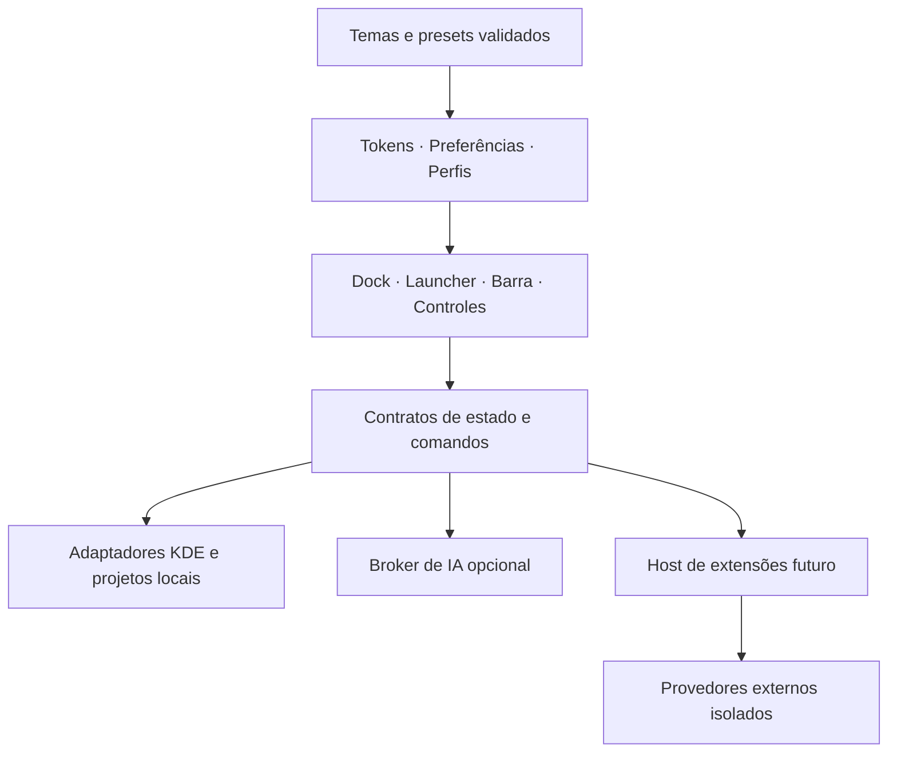

# Roadmap do Orla Desktop

Revisão: 11/10/2026. Base auditada: CaioDock 0.2.0, publicado como Orla Dock 0.2.1 alpha, Plasma 6.7.5, Qt 6.11.2, Fedora 44, Wayland. A publicação alpha inclui identidade, instalador, documentação e CI; os marcos abaixo continuam sujeitos aos respectivos critérios de aceite.

## Resultado esperado

Um ambiente KDE inspirado no macOS, com dock, barra superior, launcher inspirado no Raycast e notificações configuráveis, integração com os projetos do Caio e instalação acessível para outras pessoas. A identidade Orla continua própria, com uma interface bonita, consistente e personalizável. Temas, widgets, comandos e provedores de IA poderão ser ampliados pela comunidade; autores poderão distribuir addons gratuitos ou comerciais conforme os contratos e políticas abaixo. Caio decide as prioridades e valida o uso diário. Este documento define a sequência proposta; os números de versão são marcos, sem promessa de datas.

**Execução iniciada:** o incremento alpha 0.2.2 permite instalar/atualizar sem dependências opcionais das integrações, recuperar o serviço por reinstalação e abrir os menus dos aplicativos pelo teclado. Foram verificados 43 testes da base e o ciclo real de instalação em diretórios temporários, com D-Bus privado e dados sintéticos preservados. R1/R2 continuam parciais: painel real, vários monitores, uso diário e empacotamento do futuro launcher têm gates próprios. Consulte a [evidência da base](docs/validation/foundation-0.2.2.md). As versões abaixo continuam sendo marcos de aceite.

**Primeiro consumidor de tema publicado na alpha 0.2.6:** além do formato `0.1-experimental`, schema, exemplos e CLI, Aparência aceita JSON colado e oferece prévia reversível dos dez tokens. Aplicar salva somente a aparência normal do perfil atual. Não há leitura de arquivo, persistência de metadados, galeria, catálogo ou API estável. Assets públicos foram baixados anonimamente e coincidiram byte a byte com o commit-fonte `6c845ca363d5e6246ec61aa1b9da0af16f622340`; a CI do PR 14 passou no run 38109454140/job 114381787703. Isso não qualifica popup/foco nativo, acessibilidade, contraste, reinício ou instalação/upgrade real. O registro detalha os hashes e os limites. C1, X1 e DX2 continuam parciais. Consulte o [guia do formato](docs/theme-format.md) e a [validação do consumidor](docs/validation/theme-consumer-0.2.6.md).

**Aparência alpha 0.2.3:** editor com prévia temporária, Aplicar, Cancelar, Desfazer e restauração das preferências anteriores, em snapshot separado. Popup limitado ao orçamento da tela e campos acessíveis pelo teclado; 66 testes locais e revisão independente aprovados. Uma fixture com painel/KConfig privados comprovou Aplicar/Cancelar/restart de aparência por ações programáticas; isso não qualifica gesto humano nem foco/grab/layout do popup. Esse recibo histórico não cobre organização de widgets/perfis; importação/exportação continua pendente; C1/UX1 permanecem parciais. Consulte a [validação da aparência](docs/validation/appearance-0.2.3.md).

**Bateria e mídia alpha 0.2.4:** bateria do sistema opcional, desligada por padrão, lê somente o agregado UPower e preserva estados neutros/0% válido. Mídia compartilha um modelo MPRIS nativo, prefere Spotify inicialmente, mantém seleção manual por sessão e respeita capacidades por comando. Fixtures de bateria/mídia, leitura real agregada UPower e dois players sintéticos em D-Bus privado passaram; a regressão conjunta passou os 96 testes. B1/M1 continuam parciais: múltiplas baterias/UPS/transições reais, Spotify real/áudio, capa/progresso/abertura do cliente e interação humana no painel têm gates próprios. O launcher não integra esta release. Consulte a [validação](docs/validation/battery-media-0.2.4.md).

**Perfis manuais publicados na alpha 0.2.5:** o dock já oferece criação e seleção explícita, cópia das preferências salvas e retorno às preferências anteriores sem migração automática. Perfis guardam apps fixados, aparência, ordem/visibilidade dos sete widgets, eventos do calendário e filtro de janelas pela área atual. Pomodoro continua global na seleção. Revisão da implementação aprovada, 49 testes direcionados em Fusion/KDE e regressão KDE de 123 testes passaram. Snapshot nativo privado (metadata 0.2.4 com overlays de perfis, 26 arquivos congelados) comprovou Apply/Cancel/disco/restart e um ciclo próprio de remover/recriar. Não é qualificação da release inteira nem de popup/foco/gesto humano. P1/C1 continuam parciais; retomada do timer entre processos e escolha de barra/launcher/eventos permanecem abertas, assim como P2/W1. Consulte [uso](docs/profiles.md) e [validação](docs/validation/profiles-0.2.5.md).

**Publicação alpha 0.2.7:** a [prerelease 0.2.7](https://github.com/caiolombello/orla-desktop/releases/tag/v0.2.7) foi publicada em 11/10/2026 UTC, a partir do commit `9ca1792ee3e9c20ad770042d2d441aa1ae6efbce` (PR 16; CI run 38111731691 aprovado). Os downloads públicos anônimos do applet, ZIP e `SHA256SUMS` coincidem byte a byte com a build da release; veja [validação](docs/validation/local-events-0.2.7.md). Instalação/upgrade e admissão nativa não foram executados. O ZIP inclui a CLI Steam experimental; Menu Orla e launcher continuam excluídos. Assets 0.2.5/0.2.6 permanecem inalterados.

**Publicação alpha 0.2.9:** a [prerelease pública](https://github.com/caiolombello/orla-desktop/releases/tag/v0.2.9) foi publicada às 06:08:41 UTC (`latest=false`), a partir do Source `a377340b2a37555a57fc87360d45ed68c815ccda` (PR 22, merge `3c27fd01b2f3571b6d4eb71d68d8095f9b0bf85a`). CI run 38116955839/job 114403627560 passou às 06:06:55 UTC com 17 testes de bridge em 5.541 s; não executou a suíte QML do CC0 nem compilou o launcher C++. Verificação anônima confirmou os três assets e duas builds candidatas mais uma build exata idênticas (154 arquivos Source, 124 entradas ZIP, 38 do applet). Instalação e admissão nativa permanecem UNRUN. O ZIP inclui helpers `scripts/ai.py`/`tests/test_ai.py`, mas não launcher/bar. Consulte [validação](docs/validation/control-center-peripherals-0.2.9.md).

**Calendário KDE no Source atual:** a primeira fatia experimental carrega `pimevents` somente com o popup aberto e a preferência ativa, diferencia apenas metadados ausentes, eventos recebidos e lista vazia inconclusiva, e mantém a configuração como ação explícita no KOrganizer. Fixtures Source não carregam provider real nem acessam Akonadi, contas ou calendários. Google real, sincronização e estados do backend permanecem UNRUN; a alpha 0.2.9 publicada não mudou. Consulte o [guia](docs/calendar.md).

**Base histórica de texto da IA (PR 28):** o [PR 28](https://github.com/caiolombello/orla-desktop/pull/28) integrou contratos e parsers offline para respostas textuais de Ollama e OpenAI. A [CI](https://github.com/caiolombello/orla-desktop/actions/runs/38126133261) passou os 23 testes de texto e os cinco CTests do launcher. O entrypoint direto continua retornando `unsupported_transport`; naquela fatia, conexão, autenticação, geração, assinaturas e UI de texto estavam abertas. Os assets publicados 0.2.9 permanecem inalterados; veja a [validação Source](docs/validation/ai-provider-source.md).

**Fundações posteriores à alpha 0.2.9, somente no fonte:** o [PR 29](https://github.com/caiolombello/orla-desktop/pull/29) separou o runtime temporário dos helpers dos arquivos do launcher; a CI aprovada executou os cinco CTests em 48,52 s. O [PR 30](https://github.com/caiolombello/orla-desktop/pull/30) publicou o lifecycle de texto testado com conectores simulados e o verificador de pacote do launcher. Sua [CI](https://github.com/caiolombello/orla-desktop/actions/runs/38132537208) aprovou 69 testes dessas fundações e os cinco CTests em 49,35 s. O inventário do pacote continua uma declaração não verificada do chamador; coleta de dependências, `doctor` e instalação do launcher ainda estão abertos. Não houve conexão ou geração de IA. Os assets públicos 0.2.9 permanecem inalterados; consulte o [launcher](launcher/README.md) e a [validação de IA](docs/validation/ai-provider-source.md).

**Fatia de texto da IA integrada nesta mudança Source:** depois do adaptador HTTPS privado do OpenAI integrado historicamente pelo [PR 34](https://github.com/caiolombello/orla-desktop/pull/34), que continua sem entrypoint, credenciais ou UI, esta mudança integra somente Ollama numérico em loopback ao painel do launcher. A pessoa informa `127.0.0.1` ou `::1`, porta, modelo, tarefa, texto e idioma, revisa destino/dados/custo desconhecido e consente por sessão; só **Gerar** executa. Há streaming, cancelamento, parcial revisável e cópia manual. A composição inicial passou build normal, seis CTests isolados e 90 testes Python (6 shim, 23 T1 e 61 T2; UI 10 e controller 12).

As dez correções do [PR 36](https://github.com/caiolombello/orla-desktop/pull/36) preservam timeout como falha, validam uso antes de publicá-lo, mostram uso desconhecido corretamente, cancelam ambas as IAs ao abrir Steam, limpam resultados anteriores antes de uma nova tentativa e encaminham o atalho com a janela ativa pela barreira dos três proprietários. Ao voltar à busca, as quatro rotas QML de execução ficam bloqueadas durante operação ou fechamento pendente, com estado de espera e digitação disponível. Falha de limpeza atualiza a UI uma vez por mudança e mantém a barreira até a recuperação. A finalização notifica os bindings antes de liberar o fechamento, bloqueando geração reentrante. Pedir saída passa a prevalecer sobre pedidos posteriores de ocultação até o fechamento único após a limpeza, inclusive quando todos os proprietários já estão prontos.

A composição anterior das oito correções passou build novo e os seis CTests: controller 25 e UI 27 em 24,75 s, dentro do limite preservado de 30 s. As seis correções anteriores tiveram composição aprovada com controller 24/UI 18. O novo teste Steam foi corrigido para reencontrar o controle após reconstrução do modelo; a cópia foi observada só no clipboard privado offscreen. A fixture do shim passou em Python 3.12.3 e 3.14.7 em harnesses próprios.

Os dois jobs hospedados passaram em `1f59e0c` e `57c2aa0`; o último reportou os seis CTests e pulou o diagnóstico GDB. Em `2c8b750`, a UI saiu com SIGSEGV depois das 17 entradas aprovadas; sua causa continua desconhecida. O workflow preserva a falha original e só captura GDB após falha. O run aprovado e a correção do novo teste não explicam esse SIGSEGV histórico. Os dois jobs também passaram em `28c5ef4`, com os seis CTests hospedados em 74,04 s e UI em 24,27 s. A composição das dez correções passou build novo de 40 passos e os seis CTests isolados em 75,925 s, com controller 27 e UI 27 (24,60 s, limite de 30 s). A revisão do controller aprovou o Source e preservou uma limitação de fixture: um desafio QML cooperativo adicional observou cancelamento não confirmado e falhou ao exigir confirmação; sua causa exata continua desconhecida, enquanto os desafios forced/timeout e os 27 testes normais passaram. A revisão independente da saída passou UI 27 e um desafio real de reentrada com os três helpers: quit pendente prevaleceu no caminho imediatamente pronto, houve um fechamento e o ciclo posterior sem quit permaneceu independente. Uma fixture anterior falhou por pressupor o prazo Steam errado, antes da verificação causal; a falha ficou preservada e a correção alterou somente o prazo exposto de teste em build próprio novo. CI da nova revisão e integração na branch principal continuam pendentes.

A instalação existente do launcher baseada no Source 32 continua sem a nova UI de texto. Ollama/modelo real, semântica, clipboard/acessibilidade nativos, empacotamento relocável, instalação, release e admissão permanecem `UNRUN`; A1 não está concluída. Os assets 0.2.9 permanecem inalterados. Loopback não comprova identidade Ollama, privacidade ou operação offline, pois o processo ouvinte pode encaminhar o texto.

**Eventos locais alpha 0.2.7 (histórico):** a release oferece um aviso local opcional, desligado por padrão, para conclusão de foco ou pausa do Pomodoro. Revisão independente aprovou as alterações delimitadas; verificações focadas e pacote sintético passaram. A publicação e a correspondência exata dos assets foram verificadas, mas instalação/upgrade e comportamento nativo não. O aviso não usa o serviço de notificações KDE; HUD/ilha e regras por perfil não estão incluídos. N1 permanece parcial; N2/N3 continuam abertos. Consulte o [guia](docs/local-events.md) e a [validação](docs/validation/local-events-0.2.7.md).

**Publicação alpha 0.2.8:** a [prerelease pública](https://github.com/caiolombello/orla-desktop/releases/tag/v0.2.8) (marcada como prerelease, não `latest`) foi publicada em 11/10/2026 às 05:09:26 UTC (o PR foi mesclado às 05:08:31 UTC), a partir do commit `9e42decd42fc4a9a705dd48e6087b17aaca51d29` (PR 18, merge `c87930bc9881523a390ca492af1e0af6dfc328ca`). A CI do PR 18, run 38113776729/job 114394497503, passou às 05:08:09 UTC. Verificação anônima às 05:09:44 UTC encontrou HTTP 200 e correspondência exata da build nos três assets; veja os hashes em [validação](docs/validation/contexts-0.2.8.md). Duas builds candidatas e uma build do commit exato coincidiram: 139 arquivos Source, 113 entradas no ZIP e 35 no applet. Instalação/upgrade não foram executados e a admissão nativa permanece falsa. O ZIP mantém as CLIs Steam e de updates experimentais. Menu Orla e launcher continuam excluídos; os assets 0.2.5–0.2.7 permanecem históricos e inalterados.

Premissas: o dock continua utilizável sozinho; a barra superior, o launcher e seus módulos são opcionais; “ambiente” significa um perfil Trabalho, Pessoal ou Jogos, que pode ser associado a uma Activity do KDE ou a uma área de trabalho virtual. As duas associações serão configuradas separadamente. A primeira plataforma suportada continua sendo Plasma 6.7+ em Wayland; outras versões precisam de validação própria.

O planejamento cobre produto, experiência, arquitetura, distribuição, DX e comunidade. O sucesso será completar os fluxos descritos abaixo no painel real, preservando aplicativos, calendários, configurações e notificações já existentes. Menus globais, notificações, foco Wayland, isolamento de plugins e autorização de IA têm provas próprias antes da expansão.

| Documento | Uso |
|---|---|
| [UX/UI](docs/UX_UI.md) | Sistema visual, setup, editor, estados, acessibilidade, atenção e validação com pessoas |
| [Extensões e temas](docs/EXTENSIONS.md) | Categorias, permissões, SDK, distribuição, compatibilidade e addons pagos |
| [Integrações de IA](docs/AI_INTEGRATIONS.md) | APIs, SIWC/ChatGPT, Codex, Claude Code, OpenCode, modelos locais e limites por rota |
| [DX](docs/DX.md) | Fluxo atual, tooling proposto, mocks, galeria, contratos e contribuição sem API paga |
| [Contribuição](CONTRIBUTING.md) e [identidade](docs/brand.md) | Entrada atual para colaboradores e assets próprios do projeto |

Esses documentos especificam capacidades futuras. As releases públicas 0.2.5–0.2.9 não incluem SDK, runtime de plugins, catálogo, checkout ou integração de IA. O checkout de fonte contém uma fatia experimental de compatibilidade de provedores no launcher, integrada pelo [PR 20](https://github.com/caiolombello/orla-desktop/pull/20) e aprovada pela CI portátil; ela não implementa autenticação nem geração. O ZIP 0.2.9 inclui somente `scripts/ai.py` e `tests/test_ai.py`, sem painel do launcher. Repositório, landing e releases alpha já estão públicos; os novos marcos não equivalem a funcionalidades entregues.

## O que já existe e o que falta

| Área | Publicado e disponível no fonte | Lacuna a fechar |
|---|---|---|
| Aplicativos e janelas | Fixar apps, ativar/minimizar/restaurar, menu de contexto, reorganização pelo menu e entrada de arquivos `.desktop` | Arrastar para reorganizar, agrupamento opcional, teste prolongado no painel e em vários monitores |
| Personalização | Três temas, editor com prévia/Aplicar/Cancelar/desfazer e ordem/visibilidade por perfil; persistência em KConfig privado | Qualificar popup/foco/grab por gesto real, presets, exportação/importação e composição completa dos perfis |
| Spotify | Modelo MPRIS compartilhado, preferência inicial pelo Spotify, seleção manual, faixa/artista e controles por capacidade | Capa/progresso, abrir cliente e qualificar Spotify real/áudio com segundo player |
| Bateria | Widget opcional do agregado UPower, percentual/estado/energia/tempo quando informados; PeriGauge separado | Matriz real de notebook/desktop/múltiplas baterias/UPS/transições, alertas e uso humano no painel |
| Ambientes e áreas de trabalho | Perfis manuais e filtro de janelas; 0.2.8 publica associações explícitas de Activity/desktop a perfis existentes | Admissão nativa/KConfig da associação, seleção automática de perfil (P2 completo), escolha de superfícies e troca de contexto (W1) |
| Steam | CLI experimental no ZIP 0.2.8 e provedor do launcher somente no fonte (PR 25), com raízes explícitas, busca e ação limitada por ID; conta/conexão desconhecidas | Distribuir o launcher, qualificar abertura pelo cliente e dados reais nativo/Flatpak/disco externo; detecção de instalação e favoritos |
| Projetos próprios | Adaptadores locais para QuotaLantern, PeriGauge e estado salvo do FalaTrace | Validar os coletores reais, comunicar a idade da leitura e comprovar gravação ativa antes de indicá-la como ao vivo |
| Calendário | Calendário e agenda pelo plugin PIM do KDE; acesso ao KOrganizer | Conectar Google pelo fluxo nativo e validar seleção, sincronização, fuso e recorrência |
| Notificações | Avisos internos e toast local opt-in 0.2.7 para conclusão de foco ou pausa do Pomodoro | Ilha compacta, HUD, outros eventos, regras por perfil e integração qualificada com notificações do KDE |
| Barra superior | Menu Orla experimental somente no fonte: menu do sistema e nome do app ativo, Plasma 6.7.x | Qualificar ações/painel/foco, composição com Menu Global/relógio/bandeja nativos, preset reversível e Central de Controle |
| Launcher estilo Raycast | Componente experimental no fonte, com build separado; KRunner/Milou como fallback | Interface por teclado, comandos compartilhados, painel de ações e integração com perfis/projetos |
| Updates e distribuição | Repositório MIT, landing bilíngue, releases alpha e instalação do dock; CI compila o launcher e executa cinco CTests (PR 26). Verificador de pacote do launcher somente no fonte (PR 30), com inventário ainda declarado pelo chamador | Coleta factual de dependências, build e distribuição do launcher, matriz nativa, UI/cache de updates, autenticidade e retorno à versão anterior |
| UX/UI e DX | Identidade Orla, três temas, documentação de contribuição e testes separados por ambiente | Tokens, galeria de estados, preview/desfazer, acessibilidade, onboarding e tooling de autoria |
| Ecossistema | Contribuições ao código pelo GitHub | Formato declarativo, SDK, compatibilidade, catálogo e plugins com isolamento comprovado |
| IA | Detecção explícita de CLI e compatibilidade anônima do Codex (PR 20); contratos/parsers offline (PR 28), lifecycle com fakes (PR 30), adaptadores privados Ollama/OpenAI e integração operacional Ollama numérico nesta mudança Source com UI, streaming/cancelamento e fixtures privadas. O entrypoint T1/T2 direto continua `unsupported_transport`; OpenAI HTTPS permanece sem ligação operacional | Empacotar helpers de forma relocável e qualificar Ollama/modelo, semântica, clipboard/acessibilidade e uso nativo; credenciais/auth e backend API opt-in de A1 continuam abertos |

Evidência local: `package/metadata.json`, `package/contents/config/main.xml`, os componentes em `package/contents/ui/`, `package/contents/code/integrations.py`, `scripts/caiodock.py` e `tests/`. O recibo histórico do smoke nativo registra fixar/abrir/ativar/minimizar/restaurar em uma janela de teste nativa; isso ainda não comprova os fluxos prolongados no painel. O Google Agenda ainda não foi conectado, conforme informado pelo usuário. Os incrementos entregues e seus limites estão registrados acima; os checklists abaixo mantêm os critérios de aceite completos, incluindo funcionalidades ainda não implementadas.

## Arquitetura proposta

| Componente | Responsabilidade | Configuração |
|---|---|---|
| Orla Dock | Apps, janelas, widgets e entrada para controles | Usável sozinho; posição e visibilidade pelo painel KDE |
| Launcher, nome provisório Orla Launcher | Busca, comandos, favoritos, detalhes e painel de ações por teclado | Janela própria opcional, independente do dock/barra; atalho configurável |
| Barra superior | Menu do sistema, menu global, status e acesso à Central de Controle | Painel KDE adicional opcional; cada módulo independente |
| Central de Controle | Volume, microfone, brilho, rede, Bluetooth, energia, mídia e Não perturbe | Acessível pela barra ou por um botão opcional no dock |
| Apresentação de eventos | Ilha, HUD e toasts com a mesma identidade visual | Cada apresentação ativável, com posição, monitor e regras próprias |
| Adaptadores de dados | KDE, MPRIS, UPower, projetos locais, Steam e releases | Ausência de uma integração mantém os demais módulos funcionando |
| Catálogo de comandos | Descrever as ações disponíveis e encaminhá-las ao provedor que possui o estado | Compartilhado pelos componentes; consulta separada de execução; contrato interno inicialmente experimental |
| Perfis | Aplicativos, aparência, widgets e visibilidade dos componentes | Seleção manual ou associação a contexto KDE |
| Sistema visual e preferências | Tokens, componentes acessíveis, rascunho, preview e migração de configuração | Compartilhado entre superfícies; preservar tema/layout atual |
| Host de extensões, futuro | Validar pacotes e mediar dados/ações por capacidades | Temas como dados; código externo só com isolamento provado |
| Adaptadores de IA, futuros | Auth oficial, modelo, geração, cancelamento e uso reportado | Broker de credenciais fora da UI; integrado ou por plugin qualificado |

O diagrama é uma proposta de fronteiras, não uma descrição de serviços já implementados. Manter inicialmente o layout de código atual e extrair módulos quando houver consumidores/testes; não introduzir infraestrutura de monorepo por antecipação. A bridge de caches não vira host genérico e plugins não importam QML no `plasmashell`. Contratos públicos têm versões distintas da versão do aplicativo.

Recomendação: reaproveitar inicialmente os widgets nativos de Menu Global e Bandeja do Sistema no painel superior; desenvolver o menu do sistema e a Central de Controle como componentes próprios. No Plasma 6.7.5, o modelo do Menu Global pertence ao applet compilado, cujo QML importa seu próprio módulo; reutilizar o widget evita pressupor um import público independente. Uma aparência totalmente uniforme desses dois widgets nativos fica para uma iteração posterior, após provar a compatibilidade. [Menu Global KDE 6.7.5](https://raw.githubusercontent.com/KDE/plasma-workspace/v6.7.5/applets/appmenu/qml/main.qml)

Imports privados e componentes ligados ao applet C++ precisam de adaptadores e testes por versão do Plasma, conforme a [orientação do KDE sobre plugins privados](https://develop.kde.org/docs/plasma/widget/c-api/). A bridge de caches externos permanece separada dos adaptadores de menus e controles do sistema em tempo real; estes devem acompanhar eventos dos serviços e confirmar o resultado das ações.

Instalar os componentes e oferecer uma prévia do layout antes de aplicá-lo. A aplicação de um preset deve criar apenas os painéis do Orla Desktop e permitir desfazê-los, preservando os painéis atuais.

## Sequência a seguir

| Marco | Resultado para o usuário | UX, comunidade, DX e IA em paralelo |
|---|---|---|
| 0.3 — Base confiável | Dock no painel real, instalação verificável e prova de launcher/barra/eventos | UX0, DX0/DX1; contrato e provas de IA A0; modelo de temas X1 começa pelo schema |
| 0.4 — Dock pessoal | Editor com prévia/desfazer, Spotify, bateria e comandos internos | UX1, X0/X1; validador/galeria DX2 e templates X2; A0 sem contexto automático |
| 0.5 — Contextos e launcher | Perfis, Activities/áreas, launcher por teclado | UX2; temas/templates X2, kit DX3; MVP de IA A1 e prova SIWC/Codex A2 opcionais |
| 0.6 — Barra superior opcional | Menu do sistema, menus compatíveis do app ativo e indicadores | UX3; import/updates de temas X3; A2/A3/A4 por gates próprios |
| 0.7 — Controles e integrações | Central de Controle, Steam, projetos e calendário qualificados | Widgets hospedados X4, contratos DX4; catálogo inicial de temas e venda externa COM2; IA A3/A4 |
| 0.8 — Apresentação de eventos | Ilha, HUD e toasts; notificações KDE após prova técnica | Galeria/atenção; A5 contextual limitado; experimentos de isolamento X5 sem liberar runtime irrestrito |
| 0.9 — Beta pública e updates | Atualização, recuperação, matriz de suporte e piloto | UX/DX acessíveis; preview de plugins X5/DX5 apenas após prova de isolamento; comunidade COM1/COM2 |
| 1.0 — Uso diário estável | Fluxos e recuperação aprovados nas plataformas anunciadas | Gates de produto/UX e formato de temas estável; IA/runtime opcionais qualificados por rota |
| Após os respectivos gates | SDK estável, catálogo de plugins e integrações IA comunitárias A6 | X5–X7/DX5; monetização de código com compatibilidade sustentada; checkout próprio COM3 como decisão separada |

A pesquisa dos riscos da barra, das notificações, do launcher, da autenticação IA e dos contratos começa em 0.3. As versões são janelas propostas; uma prova pode alterar abordagem/escopo. Confiança alta nos caminhos locais de mídia/energia, média nos componentes nativos novos e baixa no runtime de terceiros/notificações globais até a prova. Launcher, IA e plugins são trilhas opcionais e não bloqueiam melhorias delimitadas do dock. Não atribuir uma data ao SDK ou à loja antes de medir o trabalho e qualificar operação/isolamento.

### 0.3 — Tornar a base confiável

- [ ] **R1: validar no painel real.** Conferir menus/popups por clique real, teclado/Escape, foco, autohide, janela maximizada/fullscreen, sessão reiniciada e dois monitores com escalas diferentes. Verificar o filtro da área atual com janelas distribuídas entre áreas. Aceite: os controles permanecem acessíveis e os popups abrem/fecham sem deslocar o foco indevidamente.
- [ ] **R2: fechar instalação e dependências.** Detectar versões e módulos disponíveis, indicar integrações opcionais ausentes, definir instalação do helper Python/PySide6, do componente nativo opcional do launcher e desinstalação dos arquivos gerenciados. Aceite: instalar e atualizar em um usuário limpo preserva configurações e uma dependência opcional ausente não derruba o dock. O `.plasmoid` sozinho não deve ser anunciado como instalador do executável C++/Qt Quick.
- [ ] **R3: executar duas provas isoladas.** Demonstrar Menu Global com um app que exporta menus e testar apresentação global de eventos sintéticos em Wayland. Investigar a duplicação de notificações dentro de `plasmashell`, sem substituir o servidor da sessão. Aceite: registrar caminho viável, limitações e fallback para cada prova.
- [x] **R4: preparar desenvolvimento público — entregue na alpha 0.2.1.** Repositório aberto, CI dos testes portáteis, bundle reproduzível, checksums, landing e instruções bilíngues de instalação/contribuição. O pacote exclui caches, credenciais e arquivos da sessão. Os testes QML e de Wayland continuam dependendo do ambiente KDE compatível; a CI portátil não substitui R1.

Arquivos principais: `DockView.qml`, `DockPopup.qml`, `main.qml`, `scripts/orla.py`, o helper compatível `scripts/caiodock.py`, `tests/` e `.github/workflows/ci.yml`. R1/R2 são o ponto de partida; R3/L0/A0 podem ser pesquisados em paralelo. Preservar IDs legados até haver migração explícita.

### 0.4 — Personalizar e completar os widgets essenciais

- [ ] **C1: editor de aparência e organização.** Cores, destaque, opacidade, espaçamento, cantos, tamanho, animações reduzidas, arrastar apps/widgets com alternativa por teclado e restaurar padrão. Presets Essencial, Maré, Estúdio e Jogo; composição inspirada no macOS como opção editável. Aceite: prévia/Aplicar/Cancelar/desfazer funcionam; mudanças persistem após reiniciar e exportar/importar restaura a organização; arquivos inválidos não substituem a configuração válida. Desfoque real exige qualificação com o compositor.
- [ ] **M1: Spotify por MPRIS.** Escolha manual/automática do player, faixa/artista/capa, progresso e controles suportados; abrir o cliente. Aceite: Spotify real responde a play/pause/anterior/próxima, com segundo player aberto; capacidade não anunciada aparece desativada. O protocolo define capacidades e metadados, mas a implementação do cliente precisa ser testada. [MPRIS Player](https://specifications.freedesktop.org/mpris/latest/Player_Interface.html)
- [ ] **B1: bateria do sistema.** Usar o provedor nativo KDE/UPower para percentual, carregando/descarregando, energia externa e tempo estimado quando informado. Manter PeriGauge para periféricos, com estimativas e leitura antiga identificadas. Aceite: notebook, desktop sem bateria, múltiplas baterias e serviço indisponível têm estados corretos, sem dispositivos duplicados. [UPower Device](https://upower.freedesktop.org/docs/Device.html)

C1, M1 e B1 permanecem sem aceite completo: 0.2.4/0.2.5 entregam somente os incrementos delimitados acima. C1 depende de R1/R2; M1 e B1 podem avançar independentemente. Compartilhar os modelos de mídia e bateria com a futura barra e Central de Controle.

**A0.1 experimental no fonte:** o launcher separado tem painel de compatibilidade com clientes de IA, inicialmente desligados. Abrir o painel não inicia processos; ações explícitas consultam uma lista fixa e uma ação de consentimento separada testa apenas uma troca mínima do protocolo anônimo do Codex em versão reconhecida. Revisões Source independentes aprovaram o controlador e o helper; CTests, testes sintéticos e uma execução local delimitada estão descritos na [validação](docs/validation/ai-provider-source.md). A execução observada não qualifica autenticação, inferência, cobrança, clientes de terceiros, isolamento de namespace/rede ou comportamento nativo. A funcionalidade foi integrada ao Source pelo [PR 20](https://github.com/caiolombello/orla-desktop/pull/20) e passou a CI portátil; não tem versão/release próprio e não integra os assets públicos 0.2.8. A0 continua parcial. A fatia Ollama operacional integrada nesta mudança Source não conclui A1, que ainda exige backend API opt-in e os gates completos.

### 0.5 — Perfis, Activities e áreas de trabalho

- [ ] **P1: perfis manuais.** Trabalho, Pessoal, Jogos e perfis próprios com apps fixados, aparência, ordem/visibilidade dos widgets e escolha de dock/barra/launcher/eventos. Aceite: alternar e reiniciar restaura cada perfil; o Pomodoro continua com o prazo correto ao trocar de perfil.
- [ ] **P2: associação a contexto KDE.** A primeira fatia foi publicada na alpha 0.2.8: a aba Contextos associa explicitamente Activity e desktop atuais por ID estável a perfis gerenciados existentes, sem troca automática; a descoberta é somente leitura e as ações exigem intenção explícita. P2 segue parcial até qualificar a integração nativa e definir prioridade entre seleção manual, desktop, Activity e padrão. Aceite futuro: trocar contexto pelas ferramentas do KDE atualiza o perfil uma vez, sem ciclos; renomear/remover contexto não apaga o perfil.
- [ ] **W1: seletor de contexto.** Mostrar Activity e área atuais; permitir trocar por clique ou atalho, com resposta de erro se o serviço não estiver disponível. Diferenciar trocar o perfil e trocar o contexto do KDE. Aceite: nome e destaque acompanham a troca real, inclusive com comportamento por monitor qualificado.

`VirtualDesktopInfo` oferece observação ao QML; suas operações de ativação não são invocáveis pelo QML na versão auditada. A interface D-Bus do KWin tem `current` gravável, mas o comportamento por monitor precisa de prova específica. Não inventar um método QML de troca. [API VirtualDesktopInfo 6.7.5](https://raw.githubusercontent.com/KDE/plasma-workspace/v6.7.5/libtaskmanager/virtualdesktopinfo.h), [interface KWin 6.7.5](https://raw.githubusercontent.com/KDE/kwin/v6.7.5/src/org.kde.KWin.VirtualDesktopManager.xml)

P1 está parcialmente implementado no dock; falta escolher barra/launcher/eventos e qualificar os fluxos completos. A prova privada de seleção preservou o Pomodoro, mas resetou o timer antes do restart: retomada entre processos é UNRUN. P1 depende de C1. A primeira fatia de P2 foi publicada em 0.2.8, mas permanece parcial até prova nativa; W1 ainda não está implementado. O filtro de janelas por Activity continua separado do filtro de área virtual existente.

### 0.6 — Barra superior modular inspirada no macOS

**Primeiro incremento Source aprovado:** o [Menu Orla](https://github.com/caiolombello/orla-desktop/blob/main/bar/README.md), applet separado `org.orla.bar` 0.1.0, oferece ícone próprio ou label sem ícone, nome do aplicativo ativo em texto simples limitado e ações explícitas de sobre o sistema, configurações, configuração do applet e sessão por capacidade. O nome fica preservado de `aboutToShow` até `closed`; app ativo sem nome usa “Aplicativo”, ausência usa “Área de trabalho”. A ponte privada de sessão é isolada por Loader para 6.7.x, com fonte/API verificados em 6.7.5; fora dessa faixa fica indisponível. Sair/reiniciar/desligar solicitam confirmação nativa, e retorno de dispatch não comprova resultado. Dez mocks passaram em Fusion/KDE; revisão independente repetiu dez em KDE e aprovou a publicação Source. Quatro componentes compilaram sem erros, sem instanciação nativa.

**T1/T2 continuam parciais; T3 permanece aberto.** Diálogos/Cancel e ações reais, gestos/foco/grab, painel e dois monitores são UNRUN. Não há preset, instalador/autostart da barra, apps recentes, entrada da Central de Controle pela barra, Menu Global ou bandeja implementados. Menu Global, relógio e bandeja serão widgets nativos irmãos, com composição a qualificar. Este componente não integra as releases 0.2.5, 0.2.6, 0.2.7 ou 0.2.8 nem fecha o aceite dos marcos abaixo.

- [ ] **T1: painel superior opcional.** Habilitar barra, escolher monitor, altura, aparência, posição/ordem e visibilidade dos módulos. Aceite: apenas dock, dock + barra e barra com módulos selecionados funcionam; retirar a barra Orla preserva o layout anterior.
- [ ] **T2: menu do sistema à esquerda.** Equivalente funcional ao Apple Menu, com ícone configurável, sobre o sistema/Orla Desktop, configurações, aplicativos recentes, bloquear, suspender, sair, reiniciar e desligar. Usar os fluxos e confirmações nativos de sessão. Aceite: ações abrem o fluxo correto e não são executadas ao apenas navegar pelo menu.
- [ ] **T3: menus do aplicativo ativo.** File/Edit/View ou suas traduções reais, usando Menu Global do KDE inicialmente. Aceite: menus e ações acompanham o foco do app exportador; quando o app não exporta menus, mostrar nome do aplicativo e manter seus menus locais. Registrar a matriz de apps testados; não prometer menus globais para todo GTK/Electron/navegador.
- [ ] **T4: itens de status à direita.** Bandeja de apps, Wi-Fi/rede, Bluetooth, áudio, bateria, relógio, calendário e acesso aos eventos. Exibir/ocultar por item e oferecer overflow. Aceite: clique, menu de contexto e atualização de ícones reais funcionam, sem iniciar outro watcher concorrente de bandeja. [Status Notifier Item](https://specifications.freedesktop.org/status-notifier-item/latest/)

T1 depende de C1/P1; T2/T4 dependem de T1; T3 depende também de R3. Os módulos nativos preservam funcionalidade enquanto o visual próprio é qualificado.

### 0.7 — Central de Controle, Steam e projetos próprios

**Primeira fatia Steam publicada no ZIP 0.2.6:** `scripts/steam.py` consulta metadados em raízes fornecidas explicitamente e bibliotecas declaradas pelo índice. Não acessa conta/rede, inicia jogos ou comprova titularidade. Limites de arquivos/parser/worker/saída, estados parciais/desconhecidos e nomes obviamente semelhantes a caminhos têm tratamento explícito. Vinte testes sintéticos e revisão independente passaram; não houve leitura de bibliotecas pessoais. A interface do dock, detecção do cliente, favoritos/busca, handler e validação com dois jogos reais permanecem pendentes; S1 continua parcial. O Menu Orla e o launcher continuam fora do bundle. Consulte o [guia](docs/steam.md).

O PR 25 acrescenta ao Source experimental do launcher a descoberta Steam por bibliotecas explícitas e categorias, com revisão e cinco testes CTest. S1 permanece parcial; cliente/bibliotecas reais e admissão nativa estão UNRUN, e os assets públicos 0.2.9 permanecem inalterados.

A release 0.2.9 cobre apenas a entrada global opcional, cards de Som/mídia e Energia e três atalhos explícitos; abrir o popup pode ativar a leitura existente da bateria quando necessária, sem aplicar ajustes. A aprovação PeriGauge limita-se ao contrato/mock. Veja a [documentação](docs/validation/control-center-peripherals-0.2.9.md).

**CC1-A no Source atual:** o card de áudio experimental acrescenta volume de 0% a 100%, mudo explícito e seleção da saída padrão, com IDs de alvo preservados, sincronização externa, readback, timeout e rollback por card. O comportamento de áudio congelado em nove caminhos recebeu aprovação independente no round 4; o freeze Source/mock atual tem dez caminhos e acrescenta o teste de contraste para cores próprias do Orla sem recolorir botões/ComboBox. Os assets 0.2.9 permanecem CC0 e não contêm esses controles. Módulo privado do Plasma-PA, Pulse/PipeWire, barramento, compositor, seat, hardware, popups nativos, instalação e painel real continuam UNRUN. Microfone, brilho e Não perturbe ainda mantêm CC1 parcial. Consulte o [guia](docs/control-center.md) e a [validação Source](docs/validation/control-center-audio-source.md).

- [ ] **CC0: Central de Controle de estado e atalhos.** A release 0.2.9 publicou botão global opcional com cards compartilhados de mídia/bateria e três atalhos explícitos às configurações KDE. CC0 segue parcial apesar da aprovação independente do Source; abertura real de KCM, popup/foco nativos, serviços e hardware não qualificados. Aceite completo exige estados independentes e acesso pelo dock sem a barra.
- [ ] **CC1: controles diretos básicos.** Cards de volume/saída de áudio, microfone/mudo, brilho quando disponível, mídia, bateria/energia e Não perturbe. Sincronizar com mudanças feitas fora do Orla. Aceite: valores refletem o KDE, hardware ausente desativa somente o card correspondente e cada alteração resulta de uma ação do usuário, confirmada pelo serviço.
- [ ] **CC2: conexões e energia.** Wi-Fi/rede, Bluetooth, perfil de energia e acesso às configurações detalhadas. Reusar serviços e os fluxos nativos de autenticação. Aceite: conectar/desconectar e trocar dispositivo respeita permissões; erro não fica com aparência de sucesso. HUD será conectado a esses controles na etapa seguinte.
- [ ] **S1: Steam local.** Detectar instalação nativa/Flatpak, bibliotecas e jogos instalados; favoritos, busca e abrir jogo pelo URI Steam; atalho para downloads. Aceite: testar dois jogos reais, biblioteca em outro disco, disco desmontado e Steam ausente. Os manifestos locais são um contrato a qualificar, não uma API pública estável; não confundir jogo instalado com titularidade de conta. [Bibliotecas Steam](https://help.steampowered.com/en/faqs/view/4BD4-4528-6B2E-8327)
- [ ] **I1: concluir QuotaLantern/PeriGauge/FalaTrace.** PeriGauge round 2 tem aprovação independente limitada ao Source/mock; o bridge rejeita flags `stale`/`hidden` malformadas com estado seguro. Leituras de cache real, serviço/daemon e hardware seguem UNRUN. Validar também percentuais de quota separados de custos e confirmar a sessão de gravação antes de indicar atividade FalaTrace ao vivo. I1 permanece parcial; custo tipado do QuotaLantern não é suportado e liveness do FalaTrace permanece `false`.
- [ ] **G1: qualificar Google Agenda pelo KDE.** A primeira fatia Source lazy e somente leitura já evita estados de prontidão inventados e direciona a configuração ao KOrganizer. Para concluir, conectar pelo KOrganizer/Akonadi, escolher os calendários existentes e testar evento real, recorrente, dia inteiro, fuso e ausência de rede. A seleção usada pelo plugin PIM é compartilhada com o relógio do KDE; alterá-la também muda o relógio, e o Orla não a escreve. Aceite: agenda do dock corresponde ao calendário sincronizado, sem configurar outra autenticação Google no dock.

CC0 depende de C1 e pode ser acessada pelo dock; CC1 depende de CC0 e dos modelos M1/B1; CC2 depende da qualificação dos adaptadores de rede/energia. T1 acrescenta a entrada pela barra. S1, I1 e G1 podem avançar em paralelo à barra. Alertas desses módulos entram no sistema de eventos seguinte. Áudio deve usar o serviço compatível com o Plasma-PA; em PipeWire, essa compatibilidade é oferecida por `pipewire-pulse`, não por uma suposta API D-Bus pública de volume do PipeWire. [pipewire-pulse](https://docs.pipewire.org/page_man_pipewire-pulse_1.html)

### 0.8 — Ilha, HUD e Toast

| Apresentação | Função | Exemplos |
|---|---|---|
| Ilha compacta / Dynamic Island | Estado contínuo que expande sob interação; centro superior ou posição escolhida | Música, Pomodoro, próxima reunião, gravação realmente confirmada |
| HUD | Feedback breve e repetido no mesmo indicador | Volume, brilho, microfone, mudança de perfil/área |
| Toast | Aviso temporário com ação quando aplicável | Fim de foco, bateria baixa, quota próxima do limite, atualização disponível |

- [ ] **N1: eventos próprios.** A release 0.2.7 entrega somente o toast local opcional do Pomodoro, com estado limitado e expiração; isso não conclui este gate. Faltam modelo geral de eventos, prioridades/agrupamento, regras por perfil e qualificação nativa. Aceite: rajadas atualizam o mesmo HUD; estado contínuo não vira vários toasts; nenhuma apresentação rouba foco ou bloqueia cliques fora de sua área.
- [ ] **N2: superfície global Wayland.** Provar a ilha no topo mesmo quando a barra superior estiver desativada. Candidato: helper Qt Quick com LayerShellQt e controle por monitor; alternativa acoplada ao painel explicitamente identificada. Aceite: dois monitores, escala fracionária, fullscreen, troca de tela, suspensão e sessão bloqueada funcionam; ocultar conteúdos privados conforme a política escolhida. [LayerShellQt 6.7.5](https://raw.githubusercontent.com/KDE/layer-shell-qt/v6.7.5/README.md)
- [ ] **N3: notificações do sistema, após a prova R3.** Integrar a apresentação ao servidor do Plasma, preservando histórico, ações, urgência, substituição de mensagens e Não perturbe. Configurar regras para ilha/toast, posição, sons e apps. Aceite obrigatório: sem duplicação com os popups nativos, ações funcionais, histórico preservado e retorno ao visual nativo ao desativar o módulo.

O protocolo usa um único servidor de notificações por sessão. No Plasma 6.7.5, construir `NotificationsModel` chama a inicialização desse servidor; portanto, não é um cliente genérico para um helper externo espelhar mensagens. Compartilhar o modelo dentro de `plasmashell` é uma hipótese a testar. A política para suprimir só os popups duplicados, mantendo a central nativa, ainda precisa ser comprovada. [Desenho do protocolo](https://specifications.freedesktop.org/notification/latest/basic-design.html), [implementação KDE 6.7.5](https://raw.githubusercontent.com/KDE/plasma-workspace/v6.7.5/libnotificationmanager/notificationsmodel.cpp)

N1 pode começar após M1/B1/P1; N2 depende de R3; N3 depende da prova completa de autoridade e duplicação. Se N3 não for viável, entregar N1/N2 e conservar as notificações nativas do KDE, registrando a integração global como pendente.

Para eventos próprios, decidir um único caminho visual por evento. Antes de assumir HUDs globais de teclas de volume/brilho, comprovar uma fonte nativa de eventos e como evitar duplicação do OSD do Plasma; o primeiro HUD cobre ações da Central de Controle.

### 0.9 — Updates e beta pública

**Consulta experimental no código e no ZIP 0.2.6:** a [CLI de updates](docs/updates.md) compara uma versão informada com releases oficiais estáveis/beta, com respostas e processos de rede limitados. Dezessete testes offline e revisão independente passaram. Não detecta a versão da sessão nem instala pacotes; cache, preferências/interface no desktop e recuperação continuam pendentes. O ZIP 0.2.6 inclui `scripts/updates.py`; o `.plasmoid` sozinho não contém CLI nem UI de updates. U1/U2 permanecem abertos.

- [ ] **U1: avisos de versão.** Fonte oficial de releases do Orla, versão instalada/disponível, canal estável/beta, última consulta, cache e estado indisponível. Aceite: offline, falha e limite de consultas não parecem “já atualizado”; consultar não instala.
- [ ] **U2: atualizar com recuperação.** Download verificado, compatibilidade, cópia da configuração, instalação iniciada pelo usuário e retorno ao pacote anterior. Definir autenticidade dos artefatos e origem confiável antes de distribuir o updater. Aceite: pacote inválido é recusado e uma atualização interrompida preserva uma versão utilizável e os perfis.
- [ ] **U3: sistema e jogos.** Status quando houver provedor suportado e atalhos para Discover e downloads do Steam; indicar origem e necessidade de reiniciar quando informadas. As instalações seguem os fluxos dos gerenciadores existentes. Aceite: diferenciar atualização do Orla, do sistema e dos jogos, sem alegar progresso que o provedor não informa.
- [ ] **D1: publicar beta.** Repositório aberto, instruções, dependências, licença das contribuições reutilizadas, imagens, CI e releases. Separar o pacote QML do helper quando necessário; qualificar instalação via KDE Store antes de anunciar esse canal.

U1/U2 dependem de R2/R4 e de uma fonte de releases definida. Para updates de jogos, a autoridade continua sendo o cliente Steam. [Downloads e updates Steam](https://help.steampowered.com/en/faqs/view/71AB-698D-57EB-178C)

### Trilha opcional — Launcher inspirado no Raycast

**Incremento experimental no código:** `launcher/` contém janela Qt Quick própria, busca por apps/cálculos, navegação e proteção contra seleção antiga. Build e três CTests privados passaram, com revisão independente. Consulte o [guia do componente](https://github.com/caiolombello/orla-desktop/blob/main/launcher/README.md). As releases 0.2.5–0.2.9 não incluem o launcher; instalação opcional, comandos Orla e foco/atalho global entre aplicativos continuam pendentes. O relato humano de abertura/retorno do foco foi preservado sem correspondência dos eventos instrumentados, e L0/L2 permanecem abertos.

**Avaliação: faz sentido.** O dock e a barra oferecem acesso visual; o launcher oferece acesso rápido por teclado às mesmas funções. O maior valor específico é reunir os projetos e contextos do Caio: consultar quotas, abrir projetos, ver a agenda, controlar mídia e entrar no perfil Jogos. O Raycast serve de referência para busca, listas, atalhos e painel de ações, além de recursos posteriores como clipboard e snippets. [Raycast](https://www.raycast.com/), [interface List](https://developers.raycast.com/api-reference/user-interface/list)

| Opção | Benefício | Custo/limitação | Decisão proposta |
|---|---|---|---|
| KRunner atual, sem componente novo | Busca nativa já disponível | Não acrescenta a experiência própria nem os comandos dos projetos | Alternativa de menor esforço; manter disponível |
| Comandos Orla no KRunner | Comandos próprios com pouco trabalho de interface | Mantém aparência e interação do KRunner | Caminho de interoperabilidade e fallback |
| Interface Qt Quick própria sobre KRunner | Visual inspirado no Raycast, ações e detalhes próprios; reutiliza runners KDE | Exige aplicação/helper, empacotamento, foco e integração do modelo | Recomendada, condicionada à prova L0 |

A direção proposta é a terceira opção, com o mesmo catálogo de comandos podendo ser exposto ao KRunner tradicional por um provedor D-Bus. O KDE documenta provedores instaláveis e permite consumir a biblioteca de runners em outras aplicações. [Plugins KRunner](https://develop.kde.org/docs/plasma/krunner/), [metadados D-Bus](https://develop.kde.org/docs/plasma/krunner/metadata/)

Base técnica candidata: `KRunner::ResultsModel` e `RunnerManager`, via uma pequena integração C++/Qt Quick, sem pressupor um import QML público independente para essas classes. O modelo público oferece busca, estado de consulta e ações; o header foi conferido no KF6 6.30.0 instalado. Milou pode servir de referência, mas sua API/imports não são o contrato principal do componente. Isso acrescenta dependências e artefatos ao instalador R2. [ResultsModel KF6 6.30.0](https://raw.githubusercontent.com/KDE/krunner/v6.30.0/src/model/resultsmodel.h), [RunnerManager](https://api.kde.org/krunner-runnermanager.html)

Não confundir as interfaces: `org.kde.krunner.App.query()` abre/alimenta a janela existente e não retorna a lista agregada de resultados. O contrato `org.kde.krunner1` é implementado pelos provedores e chamado pelo KRunner; ele não é um serviço agregado de busca para outro frontend. [Interface do app Plasma 6.7.5](https://raw.githubusercontent.com/KDE/plasma-workspace/v6.7.5/krunner/dbus/org.kde.krunner.App.xml), [contrato de provedores KF6 6.30.0](https://raw.githubusercontent.com/KDE/krunner/v6.30.0/src/data/org.kde.krunner1.xml)

- [ ] **L0 — 0.3: provar busca, atalho e foco.** Em experimento isolado, consumir o modelo público, consultar aplicativos/cálculos, abrir pelo atalho no Wayland e navegar/fechar por teclado. Aceite: a janela recebe foco após o gesto do usuário, volta ao app anterior ao fechar, não disputa o atalho existente do KRunner e descarta resultados da consulta anterior. Medir tempo de abertura/primeiro resultado para definir o orçamento do MVP. Candidato a atalho: KGlobalAccel, com validação do caminho de ativação. [KGlobalAccel](https://api.kde.org/kglobalaccel.html)
- [ ] **L1 — 0.4: criar catálogo inicial de comandos.** Começar por consultar quotas/baterias/estado salvo de gravação, abrir projetos configurados, preferências e controles existentes. Definir identificadores, nomes/aliases PT/EN, argumentos, capacidades, estados de erro/indisponível e provedor dono do estado; manter as leituras passivas. Aceite: pesquisar só lista resultados; Enter/clique executa apenas a seleção atual, e provedor ausente desativa seu comando. O catálogo é interno/experimental; um SDK público só será definido após validar os consumidores.
- [ ] **L2 — 0.5: entregar o MVP do launcher.** Campo de busca, lista categorizada, favoritos/aliases, painel de ações, detalhes curtos, teclado e tema comum ao Orla Dock. Primeiro escopo: aplicativos, cálculos/conversões via runners instalados e comandos L1. Aceite: abrir por atalho/botão, selecionar por teclado, executar a ação correta apesar de resultados assíncronos, fechar com Escape e funcionar com dock/barra desativados. Usar estado próprio; histórico persistente opcional, sem importar o histórico do KRunner automaticamente. L2 depende de L0/L1 e C1; P1 acrescenta a preferência visual por perfil, sem bloquear o núcleo do launcher.
- [ ] **L3 — 0.5 a 0.7: ampliar os comandos com os módulos prontos.** Perfis/áreas após P1/P2/W1; Spotify após M1; jogos após S1; agenda após G1; controles após CC1/CC2. Reutilizar o provedor que possui o estado, incluindo a escolha da instância/perfil ativo quando houver vários docks. Aceite: ações pelo launcher e pelo dock produzem o mesmo estado real, sem criar segundo Pomodoro ou escrever diretamente na configuração de outro componente. Publicar também um provedor KRunner dos comandos qualificados.
- [ ] **L4 — após o MVP: arquivos, clipboard e quicklinks.** Arquivos pelo provedor/indexação KDE que o usuário habilitou; clipboard pela integração qualificada com Klipper; quicklinks configurados pelo usuário. Aceite: índice ausente tem indicação correta; clipboard só aparece quando habilitado, respeita exclusões/limpeza e não é copiado para um segundo histórico por padrão. Não ligar nova indexação extensa durante instalação.
- [ ] **L5 — após validar o uso: snippets e automações.** Primeiro snippets com inserção explícita/cópia; expansão global e colagem automática precisam de prova por aplicativo no Wayland. Scripts exigem escopo, confirmação e isolamento próprios. IA e temas têm as trilhas antecipadas A0–A6/X0–X7 abaixo; runtime de terceiros continua dependente de X5. Esses recursos não são requisito do MVP de busca. Revisar prioridade ao concluir L2/L3, sem comprometer uma data para automação global.

Compatibilidade com extensões `@raycast/api` não está incluída: a plataforma do Raycast fornece runtime e componentes React/Node/TypeScript próprios. Reaproveitar uma extensão exigiria portá-la; reproduzir o runtime/SDK seria outra iniciativa. [Raycast Developer API](https://developers.raycast.com/)

Estado atual: frontend experimental implementado e verificado por build/CTest privado; isso não encerra L0/L2. O compromisso com o MVP distribuído depende da prova global de atalho/foco e da definição de instalação em R2.

### Trilha contínua — UX/UI e acessibilidade

O produto deve parecer uma família de componentes, com uma linguagem costeira discreta, hierarquia clara e temas que continuam legíveis sobre qualquer wallpaper. Preferências de monitor, perfil, módulo e provedor aparecem no contexto correto. Personalização tem prévia e reversão; setup é curto e dispensável. Referência completa em [UX_UI.md](docs/UX_UI.md).

- [ ] **UX0 — 0.3: inventário e previsibilidade.** Galeria de estados existentes: vazio, erro, loading, dado antigo, textos longos, integração ausente, tema claro/escuro e foco. Aceite: localizar e recuperar falhas pelos fluxos de teclado/mouse no painel, documentando os limites atuais.
- [ ] **UX1 — 0.4: sistema visual e editor.** Tokens semânticos, componentes compartilhados, preview, desfazer, temas opacos de fallback e movimento reduzido. Aceite: C1 completo, contraste e foco conferidos, sem mudança irreversível nos painéis anteriores; exportação sem segredos/dados de integração.
- [ ] **UX2 — 0.5: setup, perfis e launcher.** Oferecer só dock/dock + barra/dock + launcher/montar depois; explicar perfil versus Activity/desktop. Aceite: concluir setup sem conta ou IA, desfazer layout, operar launcher por teclado e entender origem/estado do resultado.
- [ ] **UX3 — 0.6–1.0: qualificar a família.** Barra, controles, notificações, temas/extensões e IA usam os mesmos padrões de foco, densidade, estado e recuperação. Aceite: cada superfície passa pelos gates abaixo; nenhum módulo opcional rouba foco ou impede usar o núcleo.

| Gate transversal | Evidência antes de anunciar suporte |
|---|---|
| Interface bonita e legível | Tokens consistentes, alinhamento/overflow, ícones com fallback e captura da galeria em Vidro/Meia-noite/Papel/Plasma |
| Acessibilidade | Teclado, leitor de tela, contraste, foco visível, movimento reduzido e informação além da cor; fluxo observado no Plasma |
| Escala e telas | 100%, 125%, 150%, 200%, dois monitores e nomes/idiomas longos; ações continuam alcançáveis |
| Reversibilidade | Preview/Cancelar/desfazer, troca de perfil, reinício, import inválido e rollback sem perda de configuração |
| Atenção e privacidade | Sem duplicação de OSD/toast KDE na matriz qualificada; sem conteúdo privado na tela bloqueada ou logs |
| Desempenho | Baseline de repouso e interação por máquina/versão; alvo proposto de primeiro resultado local do launcher até 150 ms p95, sem apresentá-lo como medição atual |

Validar com pessoas que usam KDE customizado, notebook, desktop, múltiplos monitores e recursos de acessibilidade. Cenários: instalar, escolher preset, desfazer, alternar perfil, encontrar comando, remover tema, negar permissão e inspecionar o que seria enviado à IA. Ainda não há pesquisa de usabilidade nem baseline com novos contribuidores. Medir conclusão, erros/recuperação e tempo até resultado útil; adoção, vendas e tempo dentro do app não substituem tarefa concluída. Telemetria permanece desligada por padrão.

### Trilha de ecossistema — Temas, widgets, plugins e addons

Começar por dados declarativos, depois contratos de dados/ações com UI renderizada pelo Orla. Temas não contêm QML/JavaScript nem recursos remotos executáveis. Plugins não recebem shell/D-Bus genérico, segredo de API nem import de UI no `plasmashell`. Manifesto, assinatura e outro PID não provam isolamento. [Arquitetura e gates X0–X7](docs/EXTENSIONS.md)

| ID | Entrega | Gate principal |
|---|---|---|
| **X0** | Personalização nativa, 0.4 | C1/UX1 reversíveis e acessíveis |
| **X1** | Formato de temas/presets, 0.4–0.5 | Primeiro consumidor por colagem e prévia experimental existem; completar schema/compatibilidade, importação segura de arquivo e corpus de consumidores; sem executar código |
| **X2** | SDK de conteúdo e autoria, 0.4–0.5 | Template, validador, preview e pacote reproduzível; nova pessoa cria tema sem conhecer o núcleo |
| **X3** | Distribuição de temas, 0.6–0.7 | Origem, licença, compatibilidade, instalação/rollback e revogação local claros |
| **X4** | Widgets hospedados, 0.7 | Adaptadores internos/mocks entregam dados tipados a blocos finitos da UI; fonte lenta/entrada inválida não trava o dock; executar provedor comunitário depende de X5 |
| **X5** | Host de código externo, preview 0.9+ | Isolamento real de arquivos/rede/barramento, broker por capacidade, timeout/cancelamento e revisão independente |
| **X6** | Provedores de IA | Adaptadores internos seguem A0/A1; terceiros dependem de X5 e A6 |
| **X7** | Catálogo e economia por classe | Temas após X1–X3; código externo após X5/compatibilidade; pagamentos próprios fora do caminho crítico |

Publicar catálogo inicialmente como metadados com autor, licença, capturas, fonte, versão, intervalo de compatibilidade, permissões e preço quando aplicável. Considerar KNewStuff/KDE Store depois de qualificar formato/categoria/KF6; não tratar esse canal como sandbox. Instalação manual continua documentada. Update que pede novas capacidades exige consentimento, e negar mantém uma versão utilizável quando seguro.

SDK, protocolo do host, formato de tema e versão do addon são contratos diferentes. Publicar primeiro como experimental; mudanças incompatíveis exigem versão/migração. Antes de declarar estável, testar consumidores reais e definir janela de suporte/depreciação. Não vender compatibilidade estável enquanto o contrato ainda for experimental. Se o isolamento falhar em uma plataforma, limitar essa plataforma à classe declarativa em vez de liberar código irrestrito.

### Trilha de IA — Usar APIs e acessos oficiais do usuário

IA permanece opcional e começa no launcher com texto que a pessoa escolhe e revisa antes de copiar. Contexto de calendário/projeto e ações vêm depois. Um provedor selecionado não recebe clipboard, arquivos ou agenda automaticamente. API, assinatura e cliente instalado são formas distintas de acesso. [Especificação e gates A0–A6](docs/AI_INTEGRATIONS.md)

| ID | Entrega | Condição de saída |
|---|---|---|
| **A0** | Contrato, cofre e estados UX, 0.3–0.4 | Mocks/offline, versão/rota explícitas, privacidade, cancelamento e provas oficiais de auth |
| **A1** | MVP de texto por backend local + API, 0.5 | A0/L2, streaming, timeout, resposta parcial e custo desconhecido tratados; CI sem API paga |
| **A2** | SIWC/ChatGPT + adaptador Codex, 0.5–0.6 | Elegibilidade, fluxo oficial, refresh/revogação e versão experimental testados; acesso ao plano sem paywall |
| **A3** | Anthropic API e backends adicionais, 0.6–0.7 | API/nuvem autorizada, matriz de capacidades e cobrança distinta de assinatura |
| **A4** | OpenCode local e abertura do Claude Code, 0.6–0.7 | Servidor autenticado/cwd/sessão selecionados; cliente original e permissões preservados |
| **A5** | Contexto e ações consentidos, 0.7–0.9 | Comandos qualificados, prévia de dados, confirmação do efeito e falhas sem execução duplicada |
| **A6** | Provedores comunitários | X5, broker de credenciais, revisão dos termos por rota e compatibilidade sustentada |

A OpenAI documenta SIWC para planos elegíveis em parceiros open source; a integração real do Orla ainda precisa ser qualificada. Seu uso não pode ficar condicionado à compra de um addon, nem revender/compartilhar cotas. A Anthropic permite uso do cliente Claude Code original pelo usuário, mas direciona integração embutida de terceiros para API/nuvem autorizada. A proposta distingue essas rotas e não extrai sessões privadas. [SIWC](https://developers.openai.com/siwc/quickstart), [termos SIWC](https://openai.com/policies/sign-in-with-chatgpt-terms/), [regras Claude](https://code.claude.com/docs/en/legal-and-compliance#authentication-and-credential-use)

O Codex app-server está experimental na versão local inspecionada; OpenCode fornece servidor/SDK documentados; modelos locais precisam de matriz de capacidade. Nenhuma assinatura foi conectada ou chamada paga executada nesta revisão. Revalidar tudo ao implementar; mock e login bem-sucedido não provam elegibilidade, cobrança ou permissões de ferramenta.

### Trilha de DX e colaboração

Um primeiro tema, bug reproduzível ou tradução deve ser possível sem API paga ou conhecimento de toda a base. O fluxo atual usa Python/testes portáteis; ferramentas como `orla-ext create/check/dev/pack` são propostas futuras, não comandos disponíveis. Referência e critérios detalhados em [DX.md](docs/DX.md).

| ID | Janela proposta | Entrega verificável |
|---|---|---|
| **DX0** | 0.3 | Comandos/dependências e limites da CI conferidos por nova pessoa; triagem clara |
| **DX1** | 0.3–0.4 | Fronteiras internas, fixtures sintéticas, erros e estados sem serviço real |
| **DX2** | 0.4–0.5 | Preview de tema por colagem sem código/API foi iniciado; galeria de estados, autoria guiada e qualificação nativa continuam pendentes |
| **DX3** | 0.5 | Kit de autoria com validador, templates, empacotamento e exemplos testados |
| **DX4** | 0.7–0.9 | Contrato experimental de dados/ações, mocks e matriz host/SDK/protocolo/addon |
| **DX5** | Após X5 | Runtime de terceiros e ferramentas de compatibilidade/isolamento, revisão e revogação |

- [ ] **COM0 — 0.3–0.4: organizar portas de entrada.** Separar issues por área/ambiente, oferecer tarefas pequenas de docs, tradução, acessibilidade, temas e fixtures com aceite explícito. Aceite: caminhos de contribuição públicos, exemplos sintéticos e reprodução sem segredos; nenhum contribuinte precisa pagar IA.
- [ ] **COM1 — 0.5–0.9: criar ciclo de comunidade.** Propor mudanças de contrato/permissão por RFC; documentar decisões, autoria e releases. Caio mantém prioridade/release inicialmente; aceitar responsáveis por módulo conforme colaboração real, sem inventar equipe ou SLA. Aceite: primeira contribuição externa guiada, revisão/reprodução e crédito público; medir fricções e ajustar o guia.
- [ ] **COM2 — 0.7 em diante: addons e venda externa.** Publicar temas gratuitos de referência e permitir autores distribuírem/venderem pacotes compatíveis em seus canais, com licença, preço, origem e suporte explícitos. Aceite: formato estabilizado para a classe vendida, catálogo com divulgação transparente, instalação/remoção/rollback e permissão de redistribuição quando necessária. Código comercial depende de X5 e contrato estável. Core MIT continua útil sem conta ou pagamento; assinaturas/cotas de IA não viram produto de revenda.
- [ ] **COM3 — futura, fora do 1.0: avaliar marketplace transacional.** Somente se adoção e demanda justificarem: decidir operação, moderação, entrega de licença, comissões, suporte, cobrança e obrigações aplicáveis. Aceite: responsáveis e viabilidade definidos antes de checkout. O roadmap não escolhe gateway, comissão ou metas de receita. Venda externa de temas não depende de uma loja operada pelo Orla.

Contribuições ao núcleo seguem MIT; um addon distribuído separadamente declara sua própria licença. Catálogo não concede direitos sobre assets de terceiros. Caso um addon comercial toque SIWC/uso de assinatura, resolver elegibilidade antes de ofertar; não assumir que a licença MIT do host autoriza qualquer integração comercial. Doações, patrocínio e suporte são possibilidades a validar, sem promessa de sustentabilidade já demonstrada.

### 1.0 — Critérios de conclusão

- [ ] Instalação, upgrade, desinstalação e recuperação aprovados em usuário limpo na versão KDE suportada.
- [ ] Dock sozinho e dock com barra superior aprovados; módulos opcionais desligados não deixam itens ou serviços ativos sem necessidade.
- [ ] Launcher opcional aprovado com atalho, teclado, foco, resultados assíncronos e comandos disponíveis, inclusive sem dock/barra; a trilha posterior L4/L5 é qualificada separadamente e não bloqueia a estabilidade do MVP.
- [ ] Configuração, perfis, atalhos e áreas de trabalho persistem; trocar contexto não perde o Pomodoro ou altera janelas sem uma ação explícita.
- [ ] Spotify, bateria, Steam, calendário e projetos próprios testados com dados reais e estados indisponíveis.
- [ ] Ações de menus/status/controles funcionam com teclado e mouse; escala, overflow e dois monitores não escondem controles essenciais.
- [ ] Política de notificações qualificada; limitação global restante identificada na release, caso N3 seja adiado.
- [ ] Piloto de sete dias de uso diário com Caio: registrar popups que falham, cliques sem resposta, perda de configuração, duplicação de avisos e consumo em repouso. Critério proposto: zero falhas que bloqueiem o uso ou percam configuração. Medir consumo antes/depois para fixar o orçamento, sem inventar um valor inicial.
- [ ] UX0–UX3 qualificados nas superfícies entregues; presets reversíveis, acessibilidade e galeria de estados conferidas nas escalas anunciadas.
- [ ] Formato de temas/presets estável e versionado; autoria/licença, validação, instalação/remoção e rollback; pessoa externa consegue criar um tema pelo guia.
- [ ] DX portátil reproduzível, limites nativos explícitos, exemplos sem conta/API paga e contribuição externa exercitada.
- [ ] Qualquer IA distribuída tem auth/rota, privacidade, cancelamento e desconexão comprovados. Cliente/rota ainda experimental aparece assim; não bloquear 1.0 do dock por um provedor não qualificado.
- [ ] Plugins executáveis, se distribuídos, passam X5/DX5 e revisão independente; caso contrário, release anuncia suporte apenas ao ecossistema declarativo. Loja própria, computer use e paridade com extensões Raycast não são requisitos de 1.0.

## Verificação e decisões ainda abertas

Os testes existentes podem ser executados com `python3 -m unittest discover -s tests -v`; integração D-Bus com `python3 tests/dbus_smoke.py`; tarefas/janelas nativas com `python3 tests/native_smoke.py`; pacote com `python3 scripts/caiodock.py build`. Os testes de perfis já existentes têm comandos em CONTRIBUTING.md. Os mocks do Menu Orla têm instruções em CONTRIBUTING.md. Esses comandos não substituem a validação de barra/notificações no painel real. Cada entrega deve atualizar o checklist correspondente após a verificação.

Decisões propostas: manter o layout atual como padrão; oferecer preset inspirado no macOS; usar ícone configurável no menu do sistema e identidade própria nos assets distribuídos; integrar mídia local antes de Web APIs. Manter 0.2 sem mudanças continua sendo opção para uso básico, mas deixa sem resposta os contextos, a barra e as notificações pedidos. O painel KDE modular é a opção recomendada porque aproveita funções existentes e permite desativar componentes individualmente.

| Decisão pendente | Quando resolver | Caminho inicial |
|---|---|---|
| Supressão dos popups nativos sem perda de histórico/ações | Prova R3, antes de N3 | Preservar servidor Plasma; adiar integração global se a prova falhar |
| Ativação de área por monitor e associação de perfis | Antes de P2/W1 | IDs estáveis e prova na versão suportada |
| Caminho de instalação do helper e canal público | R2/D1, antes de U2 | `.plasmoid` + instalador explícito; avaliar pacote de distribuição |
| Fonte confiável, canal e autenticidade dos updates | Antes de U1/U2 | Releases oficiais; instalação iniciada pelo usuário |
| Aparência totalmente própria de menu global/systray | Após T3/T4 | Widgets nativos primeiro; validar APIs e licenças antes de adaptar |
| Atalho/foco, instalação e consumo do launcher próprio | L0/R2, antes de L2 | Qt Quick + API pública KRunner; manter KRunner tradicional como fallback |
| Dono do estado e instância ativa para comandos compartilhados | L1, antes de L3 | Encaminhar ao provedor ativo; evitar estado duplicado entre componentes |
| Isolamento disponível por distribuição e capacidade | Experimento X5, antes de código comunitário | Host/broker e restrições impostas pelo SO; manter somente dados quando não puder provar |
| Versões e janela de suporte de SDK/temas | X1/X2/DX4, antes de estabilidade ou venda da classe | Consumidores reais, schema e migração; não confundir versão do app com contrato |
| SIWC e addons comerciais que envolvem IA | A2/COM2, antes de oferta | Uso do plano gratuito e local; confirmar elegibilidade da integração comercial específica |
| Responsáveis pelo catálogo, moderação e chaves | X3/X7, antes do canal correspondente | Catálogo simples/manual primeiro, operação transparente e revogação demonstrada |
| Escopo de marketplace e modelo financeiro | COM3, após demanda | Venda externa por autor; sem checkout próprio no caminho crítico |

Spotify Web API, playlists remotas e Steam Web API/achievements ficam para uma extensão opcional, se houver necessidade após o uso local. A distribuição pública do Spotify Web API exige avaliar OAuth e as regras vigentes: o modo de desenvolvimento atualmente exige Premium do proprietário e limita usuários autenticados, o que impede tratar esse caminho como integração pública irrestrita. [Quota modes Spotify](https://developer.spotify.com/documentation/web-api/concepts/quota-modes)

Revisar prioridades ao concluir cada marco ou invalidar uma prova técnica. A métrica é o fluxo real funcionando, com dados corretos e módulos opcionais preservados; publicar um pacote sozinho não encerra a validação. Registrar baseline de UX/DX antes de otimizar: primeiro uso bem-sucedido, recuperar falha/desfazer, tempo até primeiro teste/tema e incompatibilidades. Os números atuais de usuários, colaboradores, receita e retenção são desconhecidos; não usá-los como evidência de demanda.

## Próxima execução em lotes

1. **Base e experiência:** R1/R2/UX0/DX0; fechar painel real, dependências e recuperação. Saída: matriz atualizada e configuração preservada em usuário limpo.
2. **Riscos em paralelo:** R3/L0/A0 e desenho X1/DX1; provas isoladas de menu/notificação, foco/busca, auth oficial e contratos. Saída: caminho/fallback/limite documentados; sem publicar API ainda não testada.
3. **Primeiro ciclo de personalização:** C1/M1/B1/UX1/X1/X2/DX2; editor + tema declarativo de exemplo. Saída: preview/desfazer, invalidos rejeitados, interação/contraste e widgets reais qualificados.
4. **Valor por teclado/contexto:** P1/P2/W1/L1/L2/UX2/DX3; A1 opcional depois da fundação. Saída: launcher e perfis independentes/reversíveis, primeira autoria externa guiada.
5. **Expansão por gate:** barra/controles/integrações/eventos, distribuição de temas, IA por rota e runtime de plugins conforme provas anteriores. Saída: checklist do módulo, testes de contrato e validação nativa, sem promover mock a evidência real.

Cada lote deve mostrar o resultado, evidência, limitação e decisão de continuidade; se uma prova falhar, replanejar só a trilha afetada. Não iniciar checkout, SDK estável ou código de terceiros apenas para completar uma lista de recursos.

## Prontidão e recomendação de execução

- **Modelo/esforço:** `gpt-6.1-sol`, `medium`, para R1/R2 e as funcionalidades delimitadas; há código existente e testes que tornam o resultado verificável.
- **Maior dificuldade/decisões abertas:** ciclo de notificações, menus globais, desktops por monitor, foco Wayland, isolamento externo, ciclo de autorização IA e política de compatibilidade. R3/L0/A0/X5 resolvem essas incertezas antes da expansão correspondente. Usar `high` em provas nativas, contratos e autorização quando exigirem investigação; ferramentas/formatos já definidos podem seguir com `medium`.
- **Recorrer a modelo mais capaz:** `gpt-6-astra`, `high`, se uma prova reproduzível revelar conflito D-Bus/foco não resolvido pela API documentada, escape do sandbox ou divergência entre protocolo e regras do fornecedor. Aumentar esforço depois de diagnosticar ambiente/versão, não apenas por uma falha de dependência.
- **Pronto para execução:** o primeiro lote e as provas isoladas estão definidos com resultado, escopo, dependências e validação. N3, SDK estável, código externo, SIWC e marketplace têm gates próprios ainda pendentes; isso não impede começar a base. Recomenda-se revisar a arquitetura em Plan antes de cada expansão com escolhas abertas; a sessão atual não mudou de modo. As prereleases 0.2.5, 0.2.6, 0.2.7, 0.2.8 e 0.2.9 estão publicadas com os incrementos delimitados acima. O Menu Orla tem aprovação experimental Source separada e permanece fora desses assets. Publicação não encerra os gates nativos ou futuros.
