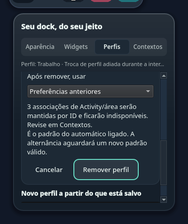
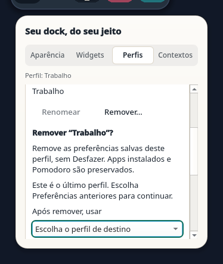
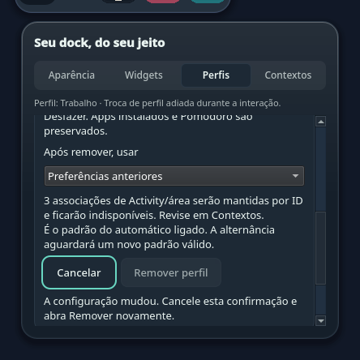
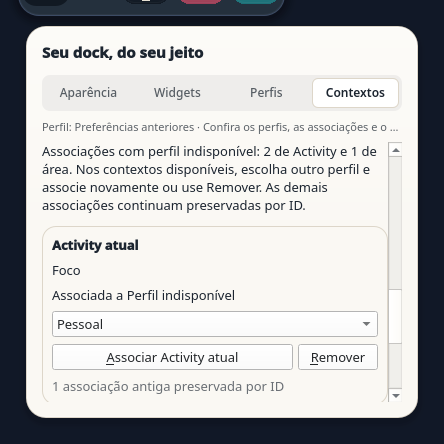

# Manual dock profiles / Perfis manuais do dock

Orla Dock profiles are alpha. P1/C1 are partial; this covers the dock. Current Source reads profile JSON `0.1-experimental` and `0.2-experimental`, independently versioned from Orla. New documents use `0.2-experimental`; loading an existing document does not migrate it. Grip reordering, profile rename and removal below are development increments, not part of the published 0.2.9 assets. Portable UI checks and installed/native qualification are separate.

## English

1. Open dock settings: the tabs are **Aparência** (Appearance), **Widgets** and **Perfis** (Profiles). The current UI labels are Portuguese.
2. In **Perfis**, **Criar Trabalho, Pessoal e Jogos** makes independent Work, Personal and Games copies of your saved flat preferences. **Preferências anteriores** (Previous preferences) stays active; initialization does not change the visible dock.
3. Choose a profile, then press **Usar perfil** (Use profile). Moving the selector or its arrow keys only changes the pending choice. To clone the saved active presentation and activate the clone immediately, enter a unique name and press **Criar e usar** (Create and use).
4. In **Perfil ativo**, open **Renomear** (Rename), edit the name and press **Renomear** to save or **Cancelar** to discard. The pending selector choice does not change this target. Apply or cancel an appearance preview first. A changed profile or saved revision keeps the draft but blocks saving: cancel and reopen Rename. Changing tabs keeps the draft; closing settings discards it. Previous preferences cannot be renamed.
5. Customize apps and appearance for that profile. Appearance is a preview until **Aplicar** (Apply); **Cancelar**, Escape or closing settings discards it. Apply or Cancel before creating/switching profiles. Changing tabs keeps the draft. Undo belongs to the current profile and is cleared when the profile changes.
6. In **Widgets**, toggle visibility or move widgets with the up/down buttons. In a managed profile, drag a row by its grip to another visible row: the line shows the destination and releasing saves once. Escape during the held gesture cancels it; a later Escape closes settings. Scroll before starting a new drag to reach other rows. These changes, calendar-event visibility and the current-desktop window filter save immediately. Appearance Cancel does not undo them. Previous preferences allows visibility changes but keeps the original widget order; use a profile to reorder.
7. Select **Preferências anteriores** and press **Usar perfil** to return to the flat settings. Managed-profile edits do not replace those saved flat fields.

Each profile stores pinned apps, theme/icon/motion/custom appearance, the order and visibility of seven known widgets (clock, Pomodoro, music, system battery, QuotaLantern, PeriGauge and FalaTrace), calendar-event visibility and the current-desktop window filter. Calendar visibility does not select calendars or connect an account; KDE PIM owns that setup. The window filter does not switch desktops.

The Pomodoro remains one global timer: switching profiles, including hiding its widget, keeps its object and deadline within the same dock. Native resume across process restarts has not been tested. Integration providers and media state are shared rather than copied into profiles.

Limits: up to 16 named profiles (Previous preferences is separate), unique names of up to 48 characters with no control characters, and up to 32 launcher URLs per profile: local `.desktop` apps or the exact KDE default-app aliases `preferred://browser`, `preferred://mailer`, `preferred://terminal` and `preferred://filemanager`. Default-app bindings remain unchanged when cloning or switching profiles. Leading/trailing name whitespace is trimmed on creation and rename. Rename changes only the active managed profile’s name, preserving its ID, preferences and context associations. Repeating the same valid name causes no write. Import/export controls are not provided yet. Missing apps stay in saved preferences; passive reload does not replace the saved list with only apps currently resolved by KDE. Validated URL spelling is preserved while Qt URL identity is used for app operations. Profiles contain data, not imported community themes or executable plugins.

Empty `profilesJSON` uses the flat settings; there is no implicit migration. Invalid, oversized or future-format profile JSON is preserved and disables presentation writes. On startup the dock falls back to the flat presentation; invalid replacement while running retains the last validated presentation. Report the error rather than editing KConfig while Plasma is running. If a saved custom appearance is invalid when cloning, the new profile uses the earlier theme/icon/motion preferences and shows a message; the original flat value is preserved.

Optional context-driven profile selection is implemented in current Source; see [Contexts](contexts.md) for opt-in, precedence, session-only manual override and native limits. Bar/launcher/event-surface selection, native popup/focus gestures and full release qualification remain open. See [validation](validation/profiles-0.2.5.md).

## Português brasileiro

1. Abra as configurações do dock: **Aparência**, **Widgets** e **Perfis**.
2. Em **Perfis**, **Criar Trabalho, Pessoal e Jogos** faz três cópias independentes das preferências salvas. **Preferências anteriores** permanece ativo; inicializar não muda o dock visível.
3. Escolha um perfil e pressione **Usar perfil**. O seletor/setas só muda a escolha pendente. Para copiar a apresentação salva do perfil ativo e ativar a cópia, digite um nome único e pressione **Criar e usar**.
4. Em **Perfil ativo**, abra **Renomear**, edite o nome e pressione **Renomear** para salvar ou **Cancelar** para descartar. A escolha pendente no seletor não muda esse alvo. Aplique ou cancele antes uma prévia de aparência. Se o perfil ou sua revisão salva mudar, o rascunho é mantido, mas a gravação fica bloqueada: cancele e abra Renomear novamente. Mudar de aba mantém o rascunho; fechar as configurações o descarta. Preferências anteriores não pode ser renomeado.
5. Personalize apps e aparência do perfil. A aparência fica em prévia até **Aplicar**; **Cancelar**, Escape ou fechar descarta a prévia. Aplique ou cancele antes de criar/trocar perfil. Mudar de aba mantém o rascunho. Desfazer pertence ao perfil atual e é limpo ao trocar.
6. Em **Widgets**, altere a visibilidade ou use os botões subir/descer para mudar a ordem. Em um perfil gerenciado, arraste a linha pela alça até outra linha visível: o traço mostra o destino e soltar salva uma vez. Escape durante o gesto cancela; outro Escape fecha as configurações. Para alcançar outras linhas, role antes de iniciar outro arraste. Essas opções, eventos do calendário e filtro pela área atual salvam imediatamente; Cancelar aparência não as desfaz. Preferências anteriores permite mudar visibilidade, mas mantém a ordem original; use um perfil para reordenar.
7. Escolha **Preferências anteriores** e pressione **Usar perfil** para voltar às preferências flat. Alterações nos perfis não substituem esses campos salvos.

Cada perfil guarda apps fixados, tema/ícones/movimento/aparência personalizada, ordem e visibilidade dos sete widgets conhecidos (relógio, Pomodoro, música, bateria do sistema, QuotaLantern, PeriGauge e FalaTrace), eventos do calendário e filtro pela área atual. Mostrar eventos não escolhe calendários nem conecta contas: isso pertence ao KDE PIM. O filtro não troca a área de trabalho.

O Pomodoro continua global: selecionar outro perfil, mesmo ocultando seu widget, mantém objeto e prazo no mesmo dock. A retomada nativa entre processos não foi testada. Providers e estado da mídia continuam compartilhados.

Limites: até 16 perfis nomeados, além de Preferências anteriores; nomes únicos com até 48 caracteres e sem caracteres de controle; até 32 URLs por perfil, de apps `.desktop` locais ou dos atalhos padrão do KDE `preferred://browser`, `preferred://mailer`, `preferred://terminal` e `preferred://filemanager`. Copiar ou trocar um perfil preserva o vínculo com o app padrão. Espaços no início/fim do nome são removidos ao criar ou renomear. Renomear altera apenas o nome do perfil gerenciado ativo, preservando ID, preferências e associações de contexto. Repetir o mesmo nome válido não grava. Ainda não há controles para importar ou exportar. Apps ausentes permanecem salvos; recarregar não substitui a lista pelos apps resolvidos pelo KDE. A grafia validada das URLs é preservada; operações de apps comparam identidade de URL pelo Qt. Perfis são dados: não importam temas comunitários nem executam plugins.

`profilesJSON` vazio usa as preferências flat, sem migração implícita. JSON inválido, grande demais ou de formato futuro é preservado e bloqueia gravações da apresentação. Na inicialização, o dock usa flat; substituição inválida durante execução mantém a última apresentação validada. Relate o erro em vez de editar KConfig com o Plasma aberto. Se a aparência personalizada salva for inválida ao copiar, o novo perfil usa as preferências anteriores de tema/ícones/movimento e mostra um aviso; o valor flat original é preservado.

## Remove the active profile / Remover o perfil ativo

In **Perfil ativo**, open **Remover…**, choose another profile or **Preferências anteriores** explicitly, then confirm **Remover perfil**. This deletes the saved active profile, including its presentation; there is no Undo. The pending profile selector does not change the target. Opening, choosing a destination and cancelling do not save. Rename and removal are separate edits: finish or cancel one before opening the other. Escape cancels the inline confirmation, tabs retain it, and closing settings discards it. A changed owner, revision, appearance preview or reference impact blocks the old confirmation; cancel and reopen it.

The warning counts saved Activity/desktop associations, including unavailable contexts, and identifies an automatic default even when automation is off. References remain byte-for-byte unchanged. A removed associated target stays unavailable, with no fallback or name matching. Removing the automatic default pauses enabled automation until a valid default is chosen; repairing it keeps a manual selection in the same context. The Contexts tab explains missing profiles and the recovery actions for available contexts.

Removing the last profile saves an initialized empty `0.2-experimental` document with Previous preferences active. It does not clear `profilesJSON` or recreate Work/Personal/Games. Creating a new profile uses a custom ID and excludes live IDs and IDs retained in validated associations or the automatic default. This does not retain a history of every unreferenced removed ID. A nonempty `0.1-experimental` document keeps its version on removal; removing its last entry upgrades only that document to `0.2-experimental`. Older builds that only understand `0.1-experimental` protect the newer bytes and fall back rather than editing them: rollback does not restore the newer editing controls.

Em **Perfil ativo**, abra **Remover…**, escolha explicitamente outro perfil ou **Preferências anteriores** e confirme **Remover perfil**. Isso apaga o perfil salvo e sua apresentação, sem Desfazer. O seletor pendente não muda o alvo. Abrir, escolher destino ou cancelar não grava. Termine ou cancele Renomear antes de abrir Remover, e vice-versa. Escape cancela a confirmação; abas a mantêm e fechar as configurações a descarta. Se perfil, revisão, prévia ou impacto das referências mudar, cancele e abra novamente.

O aviso conta associações de Activity e área, inclusive contextos indisponíveis, e informa se esse é o padrão automático mesmo com o modo desligado. As referências são preservadas sem remapeamento por nome. Um alvo removido permanece indisponível, sem fallback. Remover o padrão pausa o automático até escolher outro válido; essa correção mantém a seleção manual no mesmo contexto. A aba Contextos explica a recuperação das associações dos contextos disponíveis.

O último perfil deixa um documento vazio e inicializado `0.2-experimental`, com Preferências anteriores ativo. Não limpa `profilesJSON` nem recria os IDs Trabalho/Pessoal/Jogos. Criar outro usa ID próprio, excluindo os IDs vivos e retidos nas associações validadas ou no padrão. Não há histórico de todos os IDs antigos sem referências. Documentos `0.1-experimental` não vazios mantêm sua versão; somente a remoção do último exige `0.2-experimental`. Builds antigos protegem esses bytes e usam o fallback: voltar ao build antigo não restaura os controles novos.

Source verification (16 October 2026): profiles, automatic selection, dock UI,
contexts and appearance passed 192 tests per style (Fusion/KDE), with two
TaskManager skips per style requiring Wayland/X11. Design checks found no issues;
seven design guards passed. Removal has 16 final captures at 350/420 px in both
schemes. These checks do not qualify an installed Plasma panel or native removal.

| Confirmation / Confirmação | Recovery / Recuperação |
| --- | --- |
|  |  |
|  |  |

## Experimental internal selection contract

`ProfileState.select(id, expectedScope, expectedRevision, continuationGuard)` accepts
an optional synchronous predicate. Existing three-argument calls retain their
behavior. A supplied non-function is rejected; an eligible call evaluates the
predicate once, after the transition hook and immediately before the saved-document
assignment. Only boolean `true` accepts it; a throw or any other value refuses the
selection. A same-profile no-op still checks the predicate and changes no saved data.

For example, `profiles.select("work", profiles.activeProfileId, profiles.revision,
() => false)` refuses the request without changing the saved document. Writable
state, scope and revision are rechecked after the predicate, so a reentrant manual
selection, edit or invalid document is preserved instead of being overwritten.
The caller must validate its own captured context, binding and request generation;
this method does not infer those authorities or roll back callback side effects.

`ProfileState.removeCurrent(replacementId, expectedScope, expectedRevision,
continuationGuard)` requires that synchronous predicate. It removes only the
captured active managed profile and selects an explicitly supplied survivor or
`legacy` in one `profilesJSON` assignment. The predicate runs once after the
transition hook; only boolean `true` accepts. Owner, raw bytes, writable state,
scope and revision are checked again after it. The caller owns confirmation,
reference-impact and session validation. Callback side effects are not rolled
back, and a successful return does not establish ownership after setter callbacks.

The opt-in context controller consumes this guard in current Source. It validates
its captured context, bindings, owners and manual override immediately before the
single assignment. Its tests use synthetic Qt configuration, not a live KConfig
transaction or a Plasma/Wayland focus qualification. See [Contexts](contexts.md).

O automático por contexto está implementado no Source, com ativação opcional e limites em [Contextos](contexts.md). Jornada nativa do automático, troca de Activity, escolha de barra/launcher/eventos e qualificação completa continuam pendentes. Consulte a [validação](validation/profiles-0.2.5.md).
