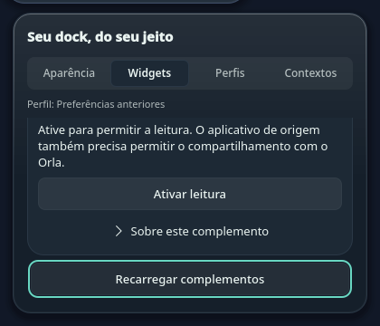
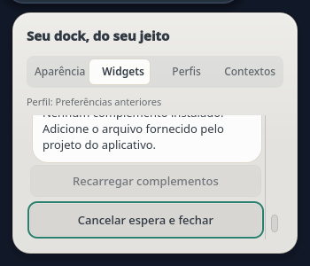

# Núcleo experimental de complementos — validação

Registro de 21/10/2026. O escopo é o host de dados e seu instalador,
correspondentes aos bytes incorporados até `5b840f7`. O formato continua
`0.1-experimental`. Este registro não encerra a entrega da interface ou do
ecossistema de plugins.

## Source e testes privados

- Parser, armazenamento e CLI: 33 testes do projeto e 12 probes independentes
  passaram. A revisão independente não encontrou bloqueadores nesse escopo.
- Serviço e worker: 24 testes do projeto e nove probes independentes passaram,
  com barramento simulado e processos confiáveis do próprio host.
- As quatro suites do núcleo incorporado passaram juntas: 57 testes.
- Instalador: 61 testes do projeto e 12 probes independentes passaram. Os
  61 testes também passaram após a incorporação no checkout principal.
- O pacote `.plasmoid` foi construído e seus cinco módulos Python do host
  conferidos por hash. Não contém manifesto de complemento de produtor.

Os testes verificam aprovação dos bytes exatos, consentimento separado,
atualização/rollback desativados, recusa de estado corrompido, campos e arquivos
limitados, falhas antes/depois da publicação, geração, saída privada, prazo,
encerramento do worker e rejeição de callbacks antigos. Eles não demonstram
recuperação após queda de energia nem isolamento contra outro processo malicioso
do mesmo usuário.

## D-Bus real, isolado

Em Fedora 44, Python 3.14.8 e PySide6/Qt 6.11.2, foi criado um barramento privado
com HOME e diretórios XDG temporários. Nenhuma chamada usou o barramento da
sessão do desktop ou um coletor real.

A introspecção mostrou somente os oito métodos previstos na interface
`org.orla.Addons1`: ListAddons, InspectAddonFile, InstallAddon, EnableAddon,
DisableAddon, RemoveAddon, RollbackAddon e SnapshotFor. Argumentos e retorno
string corresponderam ao contrato; o QDBusMessage de contexto não apareceu
como argumento público. Não apareceu interface adicional de métodos internos.

Quatorze chamadas reais cobriram listagem, inspeção, instalação desativada,
ativação explícita, leitura sintética de 0%, desativação, atualização, rollback,
remoção, seleção vazia e recusa de seleção inválida. Uma alteração no código
instalado temporário encerrou o processo antigo, que foi recolhido.

A primeira execução recusou corretamente uma pasta sintética de produtor
criada por engano com modo 0755. O diagnóstico identificou `export_invalid` /
`unsafe`. Uma execução nova com a pasta 0700 passou sem alteração no serviço;
a falha original foi preservada como falha de preparação da fixture.

## Transporte QML real, isolado

Uma execução separada usou Plasma Workspace 6.7.5, PySide6/Qt 6.11.2,
o candidato `AddonTransport.qml` e o mesmo núcleo, em outro barramento privado.
Treze chamadas cobriram os oito métodos, com as assinaturas `()`, `(s)`,
`(ss)` e `(as)`. O teste verificou a resposta string real, sua representação
no tipo QML e a extração por `ThemeFile.replyText`, incluindo seleção vazia,
instalação desativada, leitura sintética de 0%, atualização, rollback e remoção.
A recusa de seleção inválida retornou o envelope previsto; um serviço ausente
acionou o callback de erro. Não houve avisos QML; o serviço foi recolhido.

As duas falhas anteriores de preparação — cópia incompleta do serviço e pasta
sintética com permissão 0755 — foram preservadas. A execução corrigida mudou
somente a preparação privada, sem alterações no código do produto.

O transporte é candidato de uma camada posterior. Esta verificação não cobre
seu gerenciador de estado, seletor de arquivos, coordenação com Settings,
interface instalada ou compatibilidade com Qt 6.12.

## Instalação e ativação sob demanda reais

O pacote foi instalado com `kpackagetool6` em XDG temporário cujo caminho
continha espaços. A instalação registrou o host sem iniciá-lo e sem registrar
a ponte legada opcional. A primeira ListAddons ativou o serviço.

O argv do processo ativado confirmou o interpretador esperado, `-I -B`, o
caminho instalado completo e `--serve`. Assim, o teste verificou a interpretação
real de Exec e a propagação do ambiente de ativação, além da representação
textual do comando.

Uma atualização real preservou os bytes e mtime do registro de ativação,
substituiu o Source instalado e encerrou seu processo antigo. A chamada
seguinte ativou outro processo e retornou o mesmo catálogo privado. A remoção
real apagou o pacote e o registro próprio; preservou integralmente o registro
de complementos e as preferências sintéticas.

## Limites da validação original do núcleo

Não houve instalação na sessão de uso, interação com o seletor de arquivos,
validação de foco Plasma/Wayland, coleta de hardware, execução do PeriGauge,
acesso a contas, teste de login/reboot ou publicação de release. A composição
da interface, a coordenação de seus pedidos concorrentes, a validação do
produtor e a instalação local completa são etapas separadas.

Os limites experimentais de retenção e recuperação estão no
[guia de extensões](../EXTENSIONS.md).

## Cliente e coordenação — prova privada de 21/10

A camada de interface acrescenta gerenciamento de complementos em
Configurações → Widgets: escolher arquivo, conferir metadados, instalar,
ativar leitura, desativar, remover com confirmação e voltar à versão anterior.
Instalação, atualização e rollback mantêm a leitura desativada. Não há pacote
de produtor distribuído por padrão, código comunitário executável ou catálogo.

Uma prova separada usou o transporte KDE real, o serviço real, o gerenciador
QML, o coordenador e o adaptador de dados de produção, em D-Bus privado,
com manifesto e exportação sintéticos. Treze chamadas diretas cobriram os
oito métodos tipados; outras 16 chamadas passaram pelo fluxo coordenado.
As seis mutações do gerenciador foram confirmadas. A abertura aguardou a
leitura fisicamente pendente antes de listar metadados, retomou uma leitura
válida de 0% após fechar e limpou os dados ao desativar/remover. Não houve
avisos QML; o serviço foi recolhido e os 545 arquivos de entrada permaneceram
iguais. Isso não usou o barramento da sessão de uso nem hardware.

Essa composição exigiu normalizar a string encapsulada na resposta nativa do
Qt, proteger notificações anteriores à conclusão do componente e cancelar
callbacks da apresentação antes de acessar objetos já destruídos. Os
resultados anteriores com falha foram preservados. Cancelar/Recarregar
reservam espaço para o contorno de foco completo no viewport real, em vez
de alterar fontes, alvos ou o orçamento do popup.

O encerramento do coordenador também tem regressões próprias: resultados
atrasados e duplicados são ignorados após sua destruição, inclusive quando
um observador o retira durante a publicação. A instância substituta continua
operante, mantém seu foco e aceita uma nova leitura válida. Essas provas
usam objetos Qt reais e transporte simulado; o teste de interoperabilidade
privada acima cobre a instância viva, sem promover esse caso de destruição
a uma prova de fechamento nativo do Plasma.

O bloco portátil proposto do CI passou localmente em Qt/PySide 6.12.0 e
Python 3.14.8: 129 testes do núcleo, 38 do cliente e 117 de apresentação,
coordenação portátil e dados, sem falhas ou skips. Os nove testes do painel
real exigem os módulos KDE e ficam na validação local com Qt 6.11.2;
não são omitidos por um novo skip. O resultado local não é CI hospedado.

Capturas sintéticas do componente pai, com dados fictícios e renderização
offscreen, mostram os contornos de foco nas duas paletas:

## PeriGauge — ciclo UPower privado de 21/10

O executável revisado do produtor completou um único ciclo real privado,
com UPower: coleta e cache, consentimento separado, publicação da projeção,
leitura exata pelo host, reutilização sem renovar a validade, expiração real
de 30 segundos e desativação com remoção da exportação. O estado inicial e
final permaneceu desativado. O host privado também confirmou ausência de
leitura para pacote não instalado, desativado ou oculto pelo perfil, e
completou desativação/remoção. Os 19 processos próprios foram recolhidos.

A configuração e o serviço instalados do produtor não foram alterados.
As leituras privadas foram retidas somente para diagnóstico local; nenhum
nome ou identificador de hardware integra este registro ou as capturas.
Esse ciclo não qualifica HID, Buds, notificações, saúde do hardware, operação
oculta da interface, uso contínuo, atualização do produtor instalado ou a
interface Orla na sessão de uso. Esses gates continuam separados.

O seletor/modalidade, foco e acessibilidade nativos, troca de perfis em uso,
escala/monitores, reinício/login e atualização completa ainda precisam das
suas provas na instalação. X4, I1 e DX4 permanecem parciais; o formato
continua experimental.

## Instalação local — 21/10

O runtime de `948b4fa` foi instalado na sessão de uso com backup do pacote
anterior. Os 91 arquivos instalados coincidiram com o pacote verificado
(`6b93b96c0606169622605484eb5f9ed5e8ec213683b8e3de9fc34cb8322d7c67`).
Os registros de ativação lazy de temas e addons corresponderam ao instalador;
o registro legado permaneceu igual. O catálogo de complementos ainda não
existia no armazenamento, sem pacote de produtor instalado ou ativado por esta
atualização.

O Plasma foi recarregado uma vez e voltou ativo. O registro desse período não
mostrou erro de carregamento QML, erro de lifetime do coordenador ou saída por
crash. A dock renderizou ao ser mostrada temporariamente, e o auto hide original
foi restaurado no mesmo painel/applet. Isso não qualifica revelar pela borda:
a rota absoluta do dispositivo virtual de teste não foi estabelecida.

A entrada virtual foi encerrada diante de atividade simultânea na sessão,
preservando o foco mais recente. Seletor, modalidade, popups e teclado na
instalação continuam sem qualificação desta rodada. Não houve atualização do
PeriGauge instalado, ativação de exportação, migração de recibos de layout,
reinício do KWin ou reboot. O pacote anterior também foi reconstruído e
conferido para reversão; essa reversão não foi executada.

## Interação nativa na instalação — 21/10

Rodada na sessão de uso, sem uso humano simultâneo, com o runtime instalado de
`948b4fa`: Fedora 44, Plasma/KWin 6.7.5, Qt 6.11.2, Wayland, uma saída 4K em
escala 1,45 e esquema escuro do sistema. A entrada usou teclado, ponteiro
absoluto e ponteiro relativo virtuais próprios, com prazo de 15 minutos; os três
foram liberados e fechados ao final. As capturas mostram a dock real e ficaram
somente na máquina. A visibilidade do painel não foi alterada: o auto hide
original permaneceu configurado durante toda a rodada.

O ponteiro absoluto chegou à posição pedida com erro de 1 px. Empurrá-lo contra
a borda inferior revelou a dock em auto hide; ela voltou a ocultar após fechar
os popups e afastar o ponteiro. Isso qualifica a revelação pela borda que a
rodada anterior deixou pendente.

Qualificado pela interação real:

- O hover destaca o bloco e troca o texto do rótulo. O bloco Orla abre as
  configurações ancoradas nele; a seção Complementos é alcançada pela rolagem.
- Shift+Tab e Tab desenham o contorno completo em **Adicionar arquivo…** e
  **Recarregar complementos**. Espaço abre o seletor nativo do KDE, modal sobre
  o popup, que continua aberto atrás dele.
- Um caminho digitado no seletor e Enter enviam o arquivo. Um arquivo inválido
  mostrou o erro genérico e devolveu o foco visível ao botão.
- Um manifesto sintético válido mostrou a prévia “Ainda não instalado”, a
  permissão somente leitura e um único botão primário, **Instalar complemento**.
  Os detalhes abrem pelo teclado, com autoria, versão, licença e origem
  declaradas e o aviso de que o Orla não verifica quem publicou. Nada foi
  instalado: **Recarregar** descartou a prévia e o armazenamento de
  complementos continuou inexistente.
- Escape fecha o seletor sem fechar as configurações, e depois fecha as
  configurações. O calendário fecha por Escape e por clique fora. A Central de
  Controle mostra o contorno ao navegar por Tab. O widget de periféricos mostra
  o estado sem dados compartilhados.
- O journal do período não registrou erro QML do Orla.

Achados desta rodada:

1. **Seletor parcialmente coberto pela dock.** O KWin centraliza o diálogo
   modal sobre o popup de configurações, que fica junto à borda inferior. Em
   auto hide o painel não reserva espaço e continua visível enquanto o popup
   existe; com o tamanho de diálogo lembrado pelo KDE, a dock cobre **Abrir** e
   **Cancelar**. Enter, Escape, clique duplo no arquivo, o botão de fechar e
   arrastar a janela continuam funcionando. Em um KWin aninhado com D-Bus
   privado, um `FileDialog` com `parentWindow: null` também se tornou transitório
   da janela ativa e foi centralizado sobre ela; remover o pai não resolve. O
   seletor de temas usa o mesmo arranjo e não foi exercido nesta rodada.
   Decisão de 21/10: documentar o contorno nos guias de complementos e de temas
   em vez de mudar de onde o seletor abre.
2. **Contorno ausente após Escape no seletor.** O foco continua em
   **Adicionar arquivo…**, mas o contorno só volta no Tab seguinte. O modelo de
   foco não reacende o contorno depois que a janela perde ativação, e o seletor
   tira essa ativação; os testes fixam essa regra. Ao aceitar um arquivo, o
   contorno volta.
3. **Consumo do host ocioso.** Com o widget de periféricos ativo, a dock pede
   leitura a cada 15 s e o host nunca atinge a saída por ociosidade. Ele
   recalculava o hash dos próprios módulos a cada 100 ms; em D-Bus privado,
   isso custou cerca de 150 ms de CPU a cada 20 s parado. A correção de
   `8c169cb` mantém 100 ms só durante um worker, usa 5 s de reserva parado e
   encerra o host por evento de arquivo: 10 ms a cada 20 s, e saída 34 ms após
   alterar um módulo. O bloco portátil do CI passou localmente em Qt 6.12 com
   286 testes. Instalada depois na sessão de uso, sem recarregar o Plasma: o
   host antigo saiu ao ver o código novo e o seguinte gastou 0 ms de CPU em
   30 s parado, contra 270 ms antes.

Fora do escopo de complementos, a mesma rodada observou dois defeitos anteriores
da dock. O rótulo de hover troca o texto, mas permanece onde apareceu enquanto
continua visível; volta ao lugar certo depois que um popup fecha, e o Qt
Wayland registrou que o popup do rótulo não tinha pai transitório. O cabeçalho do
calendário aparece em inglês acima do mês em português. Os dois foram
corrigidos na camada seguinte (`115399a`, `6a5439d`) e conferidos na
instalação após recarregar o Plasma: o rótulo acompanhou quatro blocos sem o
aviso do Qt Wayland, e o título passou a “Outubro 2026”.

Não houve instalação ou ativação de complemento, produtor ou exportação,
esquema claro nativo, leitor de tela, vários monitores, troca de escala,
reinício ou login. O formato continua experimental.

## Quota por complemento — 22/10

Prova privada (D-Bus isolado, HOME/XDG temporários, dados sintéticos): o
pacote do QuotaLantern foi instalado e ativado pela CLI do Orla, o exportador
real do QuotaLantern publicou uma leitura depois de `--orla-export enable`, e
o serviço real respondeu `SnapshotFor(["quota"])` com `ready` (um provedor
pronto com 0 % e 42 %, um desatualizado sem percentual, um indisponível, o
adaptador de custo de API ausente), sem e-mail, mensagem do provedor nem
valores em dinheiro. O `AddonQuota.js` real aceitou a resposta. Depois de
`--orla-export disable`, o Orla passou a `missing`. A mesma prova encontrou a
quota envolvida no envelope do worker, recusada pelo leitor; corrigido em
`69d8b04`.

Instalação local, sem complemento de quota no registro, observando as chamadas
D-Bus da dock:

1. **Leituras em ciclo.** Ao terminar, cada leitor (bateria e quota) reiniciava
   o outro sem condição: cerca de cinco `SnapshotFor` por segundo, cada um com
   um worker. A dock anterior foi restaurada do backup em seguida. Em `2a6908d`,
   um leitor só é retomado quando a admissão de um worker por vez o recusou; o
   teste novo reproduzia o ciclo antes da correção.
2. **Depois da correção**, em 90 s: a cada 15 s, uma leitura legada de quota
   (`ready`) e exatamente duas do host, quota e bateria, cada uma respondida em
   cerca de 50 ms com `not_installed`. A dock manteve a quota legada e o
   journal do plasmashell não registrou erro da dock.

Na reinstalação, encerrar o host à mão deixou a ativação sob demanda sem
resposta por cerca de 3 min (chamadas expirando em 25 s); um host iniciado à
mão respondeu em 54 ms, e a ativação seguinte voltou ao normal. Em D-Bus
privado, o host atende e sai em poucos segundos após SIGTERM, então o atraso
não foi reproduzido; como o host já sai ao ver os módulos novos, a instalação
não precisa encerrá-lo.

Não houve QuotaLantern real na sessão de uso, conta de provedor, captura
visual da dock com quota por complemento, leitor de tela nem esquema claro
nativo. A rodada seguinte cobriu o QuotaLantern real.

## Quota real na sessão de uso — 22/10

O QuotaLantern de caiolombello/quotalantern#5 substituiu a versão em uso pelo
instalador do próprio aplicativo, que guardou backup e script de reversão. A
exportação foi ativada pela CLI antes de abrir o tray. A primeira publicação
real tinha 659 bytes e dois provedores prontos: um com janelas de 5 h e 7 d,
outro com duas janelas sem duração declarada. A pasta tinha modo 0700, o
arquivo 0600, e não havia e-mail, conta, mensagem do provedor nem valores em
dinheiro.

1. **Armazenamento recusado.** Instalar o complemento pela CLI do Orla falhou
   com `unsafe`: o armazenamento exigia que `orla-desktop`, a pasta-mãe dele
   em `$XDG_DATA_HOME`, tivesse modo 0700, mas outras partes do Orla já a
   criam com 0755. Nenhum complemento podia ser instalado numa máquina com o
   Orla em uso. A tentativa deixou uma pasta `addons` vazia, e por cerca de
   2 min o host respondeu `unsafe` à dock; a quota legada continuou, porque a
   dock só troca de fonte com uma leitura válida. A pasta vazia foi removida.
   Em `31e2c3a`, a pasta-mãe segue a regra das demais acima do armazenamento:
   do usuário e sem escrita para outras contas. O armazenamento continua 0700,
   e uma pasta-mãe com escrita para grupo ou outros continua recusada.
2. **Mudança feita fora das configurações.** Depois da correção, a CLI
   instalou e ativou o pacote, e `snapshot --module quota` respondeu `ready`
   com os dois provedores. A dock tinha fixado a identidade do registro vazio,
   então a primeira leitura deu `source_changed` e as leituras de complementos
   pararam, como previsto. Abrir **Configurações → Widgets → Complementos**
   mostrou o QuotaLantern ativado. **Recarregar complementos** e fechar as
   configurações retomaram as leituras.
3. **Leitura descartada.** Mesmo com `ready` a cada 15 s, a quota continuou
   pela ponte legada. Com bateria e quota visíveis, o leitor que esperava a
   vez começava dentro da liberação do primeiro, e o primeiro descartava a
   leitura que tinha acabado de validar. As respostas reais gravadas
   reproduziram isso offscreen. Em `1971c74`, a vez passa depois que o leitor
   trata o próprio resultado; o teste cobre as duas ordens, e reverter
   qualquer um dos lados o faz falhar.

Com as duas correções instaladas e o plasmashell reiniciado, a captura de
120 s teve uma única leitura legada, já em andamento na partida. Depois dela,
a cada 15 s, a quota veio do complemento (`ready`, cerca de 50 ms), e a bateria
respondeu `not_installed`. O popup de quota da dock mostrou as janelas com
duração e horário de reinício, e o journal do plasmashell não registrou erro da dock.
As capturas têm dados reais e ficaram somente na máquina.

Observações para depois: **Recarregar complementos** volta a rolagem para
cima, e o popup de quota mantém textos do caminho legado (“Reler cache
local”, “Leituras já coletadas”) quando a fonte é o complemento.

Não executado: instalar pelo seletor de arquivos das configurações (a rodada
usou a CLI), desativar a exportação na sessão de uso, esquema claro, leitor de
tela e novo login.
