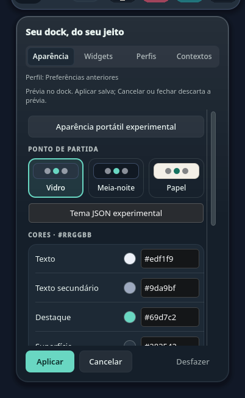
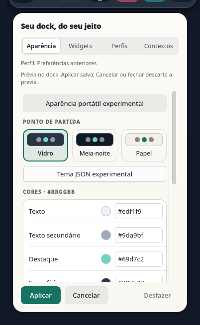
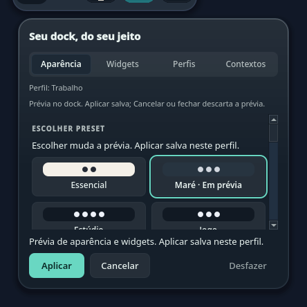
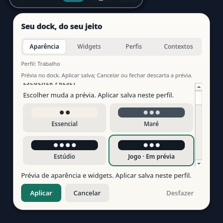

# Aparência portátil — C1/X1 Source

A aba Aparência oferece um módulo recolhível para exportar o estado salvo e importar aparência, ordem e visibilidade dos sete widgets. Colar não altera o dock; **Usar na prévia** valida o documento antes da apresentação temporária. **Aplicar** salva os dois campos juntos, **Cancelar/Escape** descarta a prévia e **Desfazer** restaura o estado anterior enquanto o perfil e sua revisão não mudarem.

O payload usa whitelist e um schema experimental separado do tema com autoria: não contém apps fixados, nome/ID de perfil, eventos, contexto, caminhos, dados de integração ou Pomodoro. A saída é selecionável para cópia manual; importação aceita texto colado. Preferências anteriores podem ser exportadas; a importação exige escolher ou criar um perfil explicitamente. O [guia](../theme-format.md) descreve os limites e o [schema](../../themes/schema/appearance-preset-0.1-experimental.schema.json).

## Verificação

No checkout integrado, 130 testes rodaram em Fusion e os mesmos 130 em `org.kde.desktop`: 129 passaram e um foi pulado em cada estilo, pois TaskManager exige conexão Wayland/X11. As suítes cobrem parser, fluxo portátil, wiring da dock, aparência, temas, perfis, widgets, Contextos, Central de Controle e eventos locais. Depois dos ajustes finais de Backtab e da margem do contorno de foco, os 38 casos afetados passaram novamente por estilo, sem skips. Os sete guards, design check sem issues e build passaram; galeria geral e capturas específicas foram revisadas em claro/escuro.

A revisão funcional independente passou 48 testes por estilo. Reproduziu cancelamentos de Aplicar e Desfazer antes da escrita; a correção impede o setter nesse caso, com zero escritas e bytes preservados. A guarda opcional de continuidade é verificada imediatamente antes da escrita gerenciada; consumidores existentes com três argumentos mantêm seu contrato. Mudanças de scope/revisão e callbacks reentrantes não confirmam uma intenção antiga nem oferecem undo para outro perfil.

Na cópia isolada do autor, a regressão ampliada rodou 174 casos por estilo, com nove skips declarados: quatro precisavam de TaskManager/display e cinco de calendário usavam o wrapper separado. Os cinco casos de calendário passaram pelo wrapper próprio nos dois estilos. A CI acrescenta somente as suítes portáteis `test_appearance_preset` e `test_appearance_preset_parser`, sem módulo KDE, conta, rede ou chamada paga.

## Capturas sintéticas

| Prévia escura | Exportação clara |
|---|---|
|  |  |

Capturas offscreen com dados sintéticos: prévia em 420 px e exportação em 350 px. O rodapé mantém uma única ação primária; Tab/Backtab alcançam exportação, saída, entrada e ações. Texto inválido volta ao campo para correção; rolagem revela o controle e seu contorno inteiro de foco após mudanças de layout. A revisão UI final aprovou os bytes integrados, com zero warnings no teardown. Não são capturas da sessão real.

## Limites

C1/X1 continuam parciais. Importação de arquivo, organização dos apps fixados, importação com reorder nas preferências anteriores e catálogo mantêm suas fatias próprias. Persistência KConfig, clipboard e acessibilidade nativos e o fluxo de importação real ainda não foram qualificados por estes testes offscreen.

## Canary local limitado — 2026-10-13

O commit `768697f` foi instalado na dock da sessão Plasma 6.7.5/Wayland: 66 arquivos, somente os 11 deltas esperados. Na preferência anterior, abrir a seção e usar Tab/Space em Exportar mostrou o JSON selecionável na interface real. Valores dos applets, configurações protegidas, barra, launcher e bancos permaneceram iguais; Plasma terminou ativo, sem crash ou restart automático. Os dispositivos de input próprios foram liberados.

Esse canary confirma abertura e saída visível nas preferências anteriores. Não exercitou clipboard, acessibilidade por tecnologia assistiva, foco de retorno ou Aplicar/Cancelar/Desfazer de um preset em perfil gerenciado. A evidência Source desses fluxos permanece separada.

## Encerramento das fixtures do launcher — 2026-10-13

A CI de `80d6153` passou as verificações de `launcher-behavior`, mas o processo
terminou com SIGSEGV após a suíte. Uma reprodução com o mesmo Source e as versões
da CI falhou na segunda execução. O core identificou o worker `krunner_services`
finalizando dados locais da thread após a destruição do registro global do Qt.
Destruir o objeto do runner não garantia o término dessa limpeza.

A guarda dos testes agora captura somente as threads dos runners próprios e
exige `QThread::wait` bem-sucedido antes de processar a exclusão assíncrona.
O prazo compartilhado de 500 ms foi preservado. Uma regressão com runner real
falhou na guarda anterior e passou com o join; ela observa o estado antes da
limpeza de segurança, sem transformar essa limpeza em PASS. A fixture final
também mantém seus dados vivos em retornos antecipados de assertions.

Build e sete CTests passaram no container com as dependências da CI. Após o
ajuste final da fixture, o checkout integrado com KRunner 6.30 passou build e
sete CTests em 97,17 s; o caso dirigido passou também com estilo KDE. Revisões independentes
aprovaram o join e o ajuste de lifetime. A nova CI hospedada permanece pendente.

Essa mudança é somente de testes. Não qualifica o encerramento do launcher
nativo nem explica retrospectivamente outros crashes sem core. Falhas e
recibos anteriores permanecem preservados; importação gerenciada nativa segue
UNRUN. [Contrato Qt de término da thread](https://doc.qt.io/qt-6.11/qthread.html#isFinished).

## Compatibilidade com apps padrão do KDE — 2026-10-13

Na sessão Plasma 6.7.5/Wayland, `Criar e usar` recusou as preferências anteriores
quando um app fixado usava `preferred://filemanager`. A lista tinha sete entradas
únicas, dentro dos limites; nenhum perfil foi gravado e as configurações
protegidas permaneceram iguais.

O validador passa a aceitar exatamente `preferred://browser`,
`preferred://mailer`, `preferred://terminal` e `preferred://filemanager`.
A URL é preservada, para continuar acompanhando o app padrão do usuário.
As restrições de tamanho, quantidade, duplicatas e URLs locais permanecem.
Targets desconhecidos, caminhos, query, fragmento, credenciais e escapes são
recusados. [Contrato KDE 6.7.5](https://raw.githubusercontent.com/KDE/plasma-workspace/v6.7.5/libtaskmanager/tasktools.cpp).

Uma regressão de criação falhou antes do fix e passou depois, cobrindo também
edição, troca e recarga. A matriz de URLs inválidas confirma recusa sem gravação.
As suítes pertinentes passaram 39 testes em cada estilo, Fusion e KDE, com um
skip de TaskManager em cada rodada; sete design guards e o design check passaram.
A galeria KDE foi revisada nos dois esquemas. A falha histórica da galeria Fusion
não foi repetida nem convertida em aprovação. Revisão independente: zero bloqueios.

| Escuro | Claro |
|---|---|
|  |  |

Capturas sintéticas offscreen; não comprovam foco ou persistência nativos.
Nesta etapa, o fix local e o fluxo gerenciado completo ainda aguardam validação.
A custódia de clipboard recusou o limite de dados e encontrou timeouts de
formatos do provider; os helpers encerraram sem writes. Copiar/colar e
restauração de clipboard não foram qualificados.

## Canary gerenciado local — 2026-10-13

O fix `6152eeb` foi instalado: 66 arquivos, somente `Profiles.js` alterado.
A criação por gesto nativo passou com os sete pins preservados. Foi usado um
único perfil temporário, sem inicialização automática ou alteração dos perfis
anteriores. Valores e grafia dos pins pessoais ficam somente na evidência privada.

No Plasma 6.7.5/Wayland, colar um preset sintético e usar a prévia alterou o dock
sem mudar o documento salvo. Escape e Cancelar mantiveram o salvo. Aplicar
persistiu aparência e widgets juntos, preservando os demais campos; Desfazer
restaurou exatamente o documento anterior. Uma segunda aplicação sobreviveu
a uma recarga controlada, com igualdade entre readback do applet e KConfig.
O canary confirma persistência dos dados nesta sessão, sem inferir quantidade
exata de setters ou undo entre processos.

O perfil e sua chave foram removidos com Plasma parado e guardas do documento
próprio; nenhum arquivo de configuração foi substituído. Todos os valores
parseados de appletsrc/plasmashellrc voltaram ao baseline. Apps, atalhos, barra,
launcher e bancos protegidos permaneceram iguais; a dock manteve o novo Source.
Plasma terminou ativo, sem restart automático; a abertura do popup e a dock
original foram conferidas visualmente depois da restauração.

Limites: o export-copy em perfil gerenciado depois da recarga não foi
qualificado, pois o gesto não confirmou o popup após mudar a largura do dock.
A entrada digitada encontrou composição do teclado US internacional; sua
recusa preservou o salvo. O fluxo positivo usou clipboard com JSON sintético;
a custódia original dos formatos falhou e a restauração integral anterior não
foi qualificada. Foco de retorno, tecnologia assistiva, outras telas/escalas e
número de setters nativos continuam UNRUN. C1/X1 permanecem parciais.
## Catálogo interno — incremento de 13/10/2026

Aparência oferece quatro escolhas optativas antes da seção avançada de JSON.
Selecionar uma usa a transação de prévia existente; Aplicar salva aparência e
widgets juntos, Cancelar descarta e Desfazer restaura os valores anteriores.
Não há criação automática de perfil: preferências anteriores mostram a
orientação e o link para Perfis. Nomes e descrições não entram na exportação.

| Preset | Aparência | Widgets visíveis | Movimento |
|---|---|---|---|
| Essencial | Claro opaco | Relógio, bateria | Reduzido |
| Maré | Vidro translúcido | Relógio, música, bateria | Normal |
| Estúdio | Escuro opaco | Pomodoro, música, relógio, bateria | Reduzido |
| Jogo | Escuro opaco | Música, relógio, bateria | Normal |

Quota, periféricos e gravações continuam ocultos nesses pontos de partida.
Jogo não abre Steam; Maré não promete blur nativo. Os sete IDs de widgets
permanecem no payload. Cópias são independentes e os dados passam pelo parser
existente, sem novo schema, State ou writer.

As regressões falharam antes da implementação, depois reproduziram a seleção
antiga retomando após mudança de perfil e após cancelar/reabrir com o mesmo JSON.
A correção guarda identidade, scope, revisão e draft públicos durante a escolha.
O estado “Em prévia” aparece no próprio botão, com altura constante para não
deslocar o foco. Tab/Shift+Tab, Space/Return e o caminho JSON expandido foram
exercitados no orçamento de 420 px, incluindo prévia inválida e retorno por Tab.

Foram aprovados 69 testes relevantes por estilo Fusion/KDE. Após acrescentar
a assertion da rota expandida, a suíte de presets foi repetida no Source exato:
25 testes por estilo, sem falhas ou skips. Parser teve oito testes aprovados;
design check sem issues, sete design guards e build do applet passaram.
Falhas de lookup/contexto das fixtures e da expectativa de navegação foram
preservadas; não foram qualificadas como defeitos de produto.
A falha Fusion histórica da suíte completa de perfis não foi repetida.

| Escuro — Maré | Claro — Jogo |
|---|---|
|  |  |

Capturas do popup real em harness offscreen, com dados sintéticos. Instalação
deste catálogo e gestos Plasma/Wayland permanecem UNRUN. C1/UX1/X1 continuam
parciais; não há leitura de arquivo, catálogo externo ou marketplace nesta fatia.
