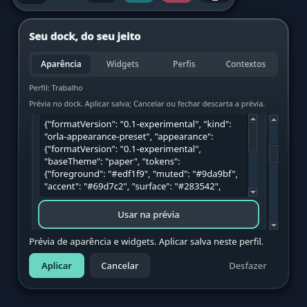
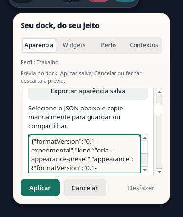

# Aparência portátil — C1/X1 Source

A aba Aparência oferece um módulo recolhível para exportar o estado salvo e importar aparência, ordem e visibilidade dos sete widgets. Colar não altera o dock; **Usar na prévia** valida o documento antes da apresentação temporária. **Aplicar** salva os dois campos juntos, **Cancelar/Escape** descarta a prévia e **Desfazer** restaura o estado anterior enquanto o perfil e sua revisão não mudarem.

O payload usa whitelist e um schema experimental separado do tema com autoria: não contém apps fixados, nome/ID de perfil, eventos, contexto, caminhos, dados de integração ou Pomodoro. A saída é selecionável para cópia manual; importação aceita texto colado. Preferências anteriores podem ser exportadas; a importação exige escolher ou criar um perfil explicitamente. O [guia](../theme-format.md) descreve os limites e o [schema](../../themes/schema/appearance-preset-0.1-experimental.schema.json).

## Verificação

No checkout integrado, 130 testes rodaram em Fusion e os mesmos 130 em `org.kde.desktop`: 129 passaram e um foi pulado em cada estilo, pois TaskManager exige conexão Wayland/X11. As suítes cobrem parser, fluxo portátil, wiring da dock, aparência, temas, perfis, widgets, Contextos, Central de Controle e eventos locais. Depois dos ajustes finais de Backtab e da margem do contorno de foco, os 38 casos afetados passaram novamente por estilo, sem skips. Os sete guards, design check sem issues e build passaram; galeria geral e capturas específicas foram revisadas em claro/escuro.

A revisão funcional independente passou 48 testes por estilo. Reproduziu cancelamentos de Aplicar e Desfazer antes da escrita; a correção impede o setter nesse caso, com zero escritas e bytes preservados. A guarda opcional de continuidade é verificada imediatamente antes da escrita gerenciada; consumidores existentes com três argumentos mantêm seu contrato. Mudanças de scope/revisão e callbacks reentrantes não confirmam uma intenção antiga nem oferecem undo para outro perfil.

Na cópia isolada do autor, a regressão ampliada rodou 174 casos por estilo, com nove skips declarados: quatro precisavam de TaskManager/display e cinco de calendário usavam o wrapper separado. Os cinco casos de calendário passaram pelo wrapper próprio nos dois estilos. A CI acrescenta somente as suítes portáteis `test_appearance_preset` e `test_appearance_preset_parser`, sem módulo KDE, conta, rede ou chamada paga.

## Capturas sintéticas

| Prévia escura | Exportação clara |
|---|---|
|  |  |

Capturas offscreen com dados sintéticos: prévia em 420 px e exportação em 350 px. O rodapé mantém uma única ação primária; Tab/Backtab alcançam exportação, saída, entrada e ações. Texto inválido volta ao campo para correção; rolagem revela o controle e seu contorno inteiro de foco após mudanças de layout. A revisão UI final aprovou os bytes integrados, com zero warnings no teardown. Não são capturas da sessão real.

## Limites

C1/X1 continuam parciais. Importação de arquivo, organização dos apps fixados, importação com reorder nas preferências anteriores e catálogo mantêm suas fatias próprias. Persistência KConfig, clipboard e acessibilidade nativos e o fluxo de importação real ainda não foram qualificados por estes testes offscreen.
