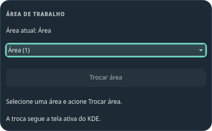
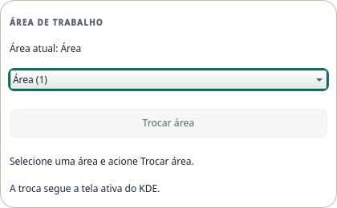

# Seletor de áreas — W1 Source

Na aba Contextos, a lista observada pelo KDE permite escolher uma área e acionar **Trocar área**. Selecionar e navegar são passivos. A área atual acompanha o modelo, incluindo mudanças externas; uma resposta sem efeito não aparece como confirmação. A ação segue a tela ativa do KDE.

O estado transitório mantém intenção, revisão do domínio desktop e geração próprias. Fechar ou trocar de aba invalida antes da animação de saída. Perfis, associações, preferências e Pomodoro permanecem independentes. IDs numéricos não habilitam o escritor; indisponibilidade e erro aparecem em texto.

O adaptador consulta owner/current, envia um Set ao owner único capturado e exige readback e convergência independente do modelo. Cancelamento, callbacks tardios, troca de owner e falhas não certificam a intenção antiga. Respostas QString do módulo Plasma são decodificadas pelo campo documentado, sem coerção genérica.

A prova do adaptador usou o módulo KDE instalado, Qt 6.11.2 e um serviço sintético em D-Bus privado: quatro casos passaram, com uma escrita por caso e zero chamadas ao provider substituto. Isso prova transporte e recusa de falso sucesso; KWin real, TaskManager real, foco após troca, monitores e atalho global permanecem UNRUN. Não houve instalação W1 ou alteração de áreas reais nessa prova.

Controles seguem o design system e foram revisados em claro/escuro. A revisão reproduziu cancelamento reentrante, namespace numérico e confirmação tardia; as versões e primeiras falhas foram preservadas. Passaram 43 testes em Fusion e os mesmos 43 em `org.kde.desktop`, sem skips; design check sem issues, sete guards e build do applet passaram no checkout final. A revisão independente passou as mesmas suítes e reproduziu a confirmação tardia no fixture original, incluindo deriva simultânea e cancelamento. A CI executa somente a suíte portátil; a suíte do adaptador exige o módulo KDE local.

| Escuro | Claro |
|---|---|
|  |  |

Capturas sintéticas offscreen do módulo em 420 px; não mostram a sessão nativa. Galeria geral regenerada e revisada em ambos os esquemas.

## Prova nativa limitada — 2026-10-13

O commit `97c913f` foi instalado na sessão Plasma 6.7.5, atualizando somente a dock: 63 arquivos e os seis deltas esperados. Barra, launcher, bancos de recuperação e valores dos applets permaneceram iguais. Plasma terminou ativo, sem restart automático ou crash.

Como havia uma única área, o ensaio criou uma segunda temporária. Seleção por mouse manteve a original durante dois segundos; o botão Trocar área mudou KWin e TaskManager reais para o destino. O popup fechou na troca. A área atual correta foi conferida ao reabrir, incluindo mudança pelo atalho nativo do KDE. O retorno à original e a remoção da área temporária foram confirmados; os helpers e dispositivos de input próprios foram encerrados.

O roteiro com menu aberto, Down/Enter, Tab e Space não acionou a troca. Seleção e foco intermediários não foram observados nesse roteiro, portanto sua causa ainda não está comprovada. A investigação offscreen também encontrou diferença entre estilos no menu aberto, inclusive com o delegate padrão; isso não comprova falha de ativação do popup nativo nem justifica trocar o delegate. Teclado/foco completos continuam pendentes. Contagem exata de escritas D-Bus e monitores adicionais não foram exercitados.

O hash de `kwinrc` mudou durante o ensaio. Havia um hash, sem cópia integral anterior desse arquivo, e a restauração byte a byte permanece UNKNOWN. Os demais arquivos protegidos passaram. Nenhuma configuração inteira foi substituída para ocultar essa diferença. O recibo distingue essa pendência do retorno confirmado da área original; W1 continua parcial.
