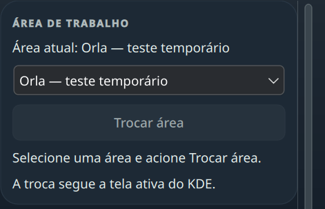

# Seletor de áreas — W1 Source

Na aba Contextos, a lista observada pelo KDE permite escolher uma área e acionar **Trocar área**. Selecionar e navegar são passivos. A área atual acompanha o modelo, incluindo mudanças externas; uma resposta sem efeito não aparece como confirmação. A ação segue a tela ativa do KDE.

O estado transitório mantém intenção, revisão do domínio desktop e geração próprias. Fechar ou trocar de aba invalida antes da animação de saída. Perfis, associações, preferências e Pomodoro permanecem independentes. IDs numéricos não habilitam o escritor; indisponibilidade e erro aparecem em texto.

O adaptador consulta owner/current, envia um Set ao owner único capturado e exige readback e convergência independente do modelo. Cancelamento, callbacks tardios, troca de owner e falhas não certificam a intenção antiga. Respostas QString do módulo Plasma são decodificadas pelo campo documentado, sem coerção genérica.

A prova do adaptador usou o módulo KDE instalado, Qt 6.11.2 e um serviço sintético em D-Bus privado: quatro casos passaram, com uma escrita por caso e zero chamadas ao provider substituto. Isso prova transporte e recusa de falso sucesso; KWin real, TaskManager real, foco após troca, monitores e atalho global permanecem UNRUN. Não houve instalação W1 ou alteração de áreas reais nessa prova.

Controles seguem o design system e foram revisados em claro/escuro. A revisão reproduziu cancelamento reentrante, namespace numérico e confirmação tardia; as versões e primeiras falhas foram preservadas. Passaram 43 testes em Fusion e os mesmos 43 em `org.kde.desktop`, sem skips; design check sem issues, sete guards e build do applet passaram no checkout final. A revisão independente passou as mesmas suítes e reproduziu a confirmação tardia no fixture original, incluindo deriva simultânea e cancelamento. A CI executa somente a suíte portátil; a suíte do adaptador exige o módulo KDE local.

| Escuro | Claro |
|---|---|
|  |  |

Capturas sintéticas offscreen do módulo em 420 px; não mostram a sessão nativa. Galeria geral regenerada e revisada em ambos os esquemas.

## Prova nativa limitada — 2026-10-13

O commit `97c913f` foi instalado na sessão Plasma 6.7.5, atualizando somente a dock: 63 arquivos e os seis deltas esperados. Barra, launcher, bancos de recuperação e valores dos applets permaneceram iguais. Plasma terminou ativo, sem restart automático ou crash.

Como havia uma única área, o ensaio criou uma segunda temporária. Seleção por mouse manteve a original durante dois segundos; o botão Trocar área mudou KWin e TaskManager reais para o destino. O popup fechou na troca. A área atual correta foi conferida ao reabrir, incluindo mudança pelo atalho nativo do KDE. O retorno à original e a remoção da área temporária foram confirmados; os helpers e dispositivos de input próprios foram encerrados.

O roteiro com menu aberto, Down/Enter, Tab e Space não acionou a troca. Seleção e foco intermediários não foram observados nesse roteiro, portanto sua causa ainda não está comprovada. A investigação offscreen também encontrou diferença entre estilos no menu aberto, inclusive com o delegate padrão; isso não comprova falha de ativação do popup nativo nem justifica trocar o delegate. Teclado/foco completos continuam pendentes. Contagem exata de escritas D-Bus e monitores adicionais não foram exercitados.

O primeiro recibo registrou uma diferença em `kwinrc`. A investigação posterior encontrou uma cópia anterior cujo hash coincide com o preflight: a única diferença era a seção de tiling da área temporária. Remover somente essa seção reconstruiu os bytes originais, com o mesmo modo de arquivo. A conferência posterior confirmou área original, configurações protegidas, applets, barra, launcher e bancos preservados. Nenhuma configuração inteira foi substituída. O primeiro recibo permanece como registro do diagnóstico; W1 continua parcial.

## Correção de teclado — Source

O estilo KDE usa um Menu que toma foco ao abrir, mas pula os delegates `NoFocus` do ComboBox. `popup.focus: false` mantém Down/Return no próprio ComboBox, sem substituir o controle ou alterar sua geometria. A regressão com abertura por mouse falhou antes da mudança e passou depois: Down/Return selecionam o segundo destino; um Tab chega ao botão; Space solicita uma única troca no fixture. Seleção por mouse também permanece passiva. Passaram 45 testes em cada estilo, sete guards, design check e build; a galeria foi revisada em claro/escuro. A revisão independente também passou Space/Escape, End/Return e Tab/Backtab nos dois estilos.

## Fluxo corrigido na sessão KDE — 2026-10-13

O commit `6a205d6` foi instalado, com uma única alteração no pacote da dock. Na sessão Plasma 6.7.5/Wayland, em uma tela com escala 2, abrir a lista por mouse, pressionar Down/Enter, um Tab e Space mudou para o destino. A seleção permaneceu passiva por dois segundos antes da ação. KWin e `TaskManager::VirtualDesktopInfo` reais convergiram para a área escolhida, com owner estável; ao reabrir, a interface mostrou o destino como atual.

O retorno pelo atalho existente Ctrl+F1 e a remoção da área temporária foram confirmados. Somente sua seção de tiling residual foi removida, restaurando bytes e modo de `kwinrc` a partir da cópia feita antes do ensaio. Configurações protegidas, valores dos applets, barra, launcher e bancos permaneceram iguais; Plasma ficou ativo, sem crash ou restart automático. Todos os observers e dispositivos de input próprios foram encerrados.

Recorte nativo limitado ao módulo, com nome sintético da área temporária. Essa prova qualifica a troca pelo fluxo exercitado; foco de retorno, contagem exata de escritas D-Bus, outros monitores e um novo atalho global Orla permanecem UNRUN. W1 continua parcial.

## Uma solicitação por ação e foco em B — 2026-10-14

O ensaio usou a dock instalada e uma janela própria em todas as áreas, na sessão Plasma 6.7.5/Wayland. Como havia somente uma área, foi criada uma segunda temporária. A instrumentação acrescentou observação a dois arquivos da dock e foi retirada ao final; nenhuma mudança de produto ficou instalada neste ensaio.

Depois de abrir Configurações e Contextos por mouse, Tab levou o foco ao seletor. Abrir a lista, Down/Enter e aguardar manteve a área original, sem escrita no intervalo monitorado. Um Tab levou ao botão habilitado, com `activeFocus` e `visualFocus`. Os envelopes dos anéis, incluindo suas margens, ficaram dentro do viewport: folga mínima de 10 pontos no seletor e 9 no botão. Isso verifica estado e geometria; a pintura raster do anel não foi conferida neste episódio.

Um Space produziu exatamente um `Properties.Set`, com o destino escolhido. A contagem veio de `BecomeMonitor` com regras restritas ao sender real do Plasma, owner único do KWin, propriedade `current` e sinais de mudança/owner; ambos os PIDs foram conferidos. O recibo final registrou uma escrita, uma transição A→B, zero mensagens inválidas e zero mudanças de owner, com as identidades preservadas. KWin e `TaskManager::VirtualDesktopInfo` reais convergiram para B. O retorno de limpeza ocorreu depois de encerrar esse monitor e pertence a outro intervalo.

Após a troca, o KWin mostrou a janela do desktop do Plasma como ativa. Em um fluxo separado, um clique na janela própria em B, a reabertura de Configurações e um Escape devolveram o foco à mesma janela própria. Esse resultado qualifica Escape após reabertura; não qualifica retorno automático à janela anterior durante a troca de área nem reentrada no dock apenas por teclado.

O observer QML atingiu seu limite de dez minutos antes do Space. Seu último registro permaneceu igual ao estado anterior à ação; portanto o contador de callbacks de clique, o estado QML após a troca e o fechamento lógico da intenção ficaram **UNKNOWN neste corpus**. A contagem D-Bus e a observação independente de KWin/TaskManager continuam válidas. Não houve repetição da ação para obter outro registro.

A primeira preparação recusou a assinatura signed esperada pelo helper antes de criar qualquer área. O Get real retornou `a(uss)`; a candidata seguinte corrigiu somente as três assinaturas correspondentes, com 19 testes puros dos helpers privados e revisão independente. A estrutura unsigned também corresponde ao [marshaller do KWin 6.7.5](https://raw.githubusercontent.com/KDE/kwin/v6.7.5/src/virtualdesktopsdbustypes.cpp).

O helper de limpeza retornou à área original e removeu a temporária, mas recusou o resíduo de tiling: o formato observado era `[Tiling][desktop][output]`, conforme o [TileManager do KWin 6.7.5](https://raw.githubusercontent.com/KDE/kwin/v6.7.5/src/tiles/tilemanager.cpp). Uma recuperação nova removeu apenas o bloco completo observado, de 189 bytes, reconstruindo os 506 bytes originais e o modo de `kwinrc`. A revisão identificou e corrigiu a falta de rechecagem após a última leitura assíncrona; 13 testes puros do helper privado passaram antes da execução. A primeira falha, o banco inicial e os recibos anteriores foram preservados.

A conferência final confirmou a área e o inventário originais, pacotes de produção da dock/barra, configurações, valores dos applets, layout, launcher, CLI e bancos de recuperação preservados. Plasma terminou ativo, sem restart automático. Os dez episódios de input liberaram seus dispositivos; fixture, observers e plugins próprios foram encerrados ou descarregados. Outros monitores, Activity, indisponibilidade induzida e um atalho global novo do Orla continuam sem qualificação. **W1 permanece parcial.**
