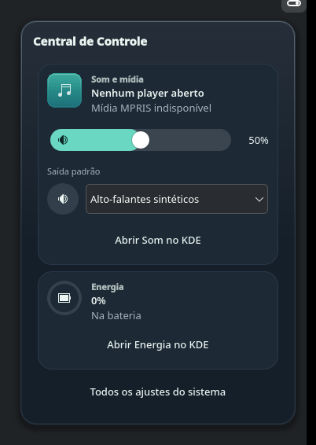
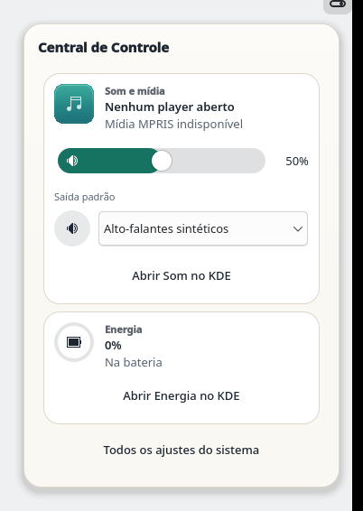
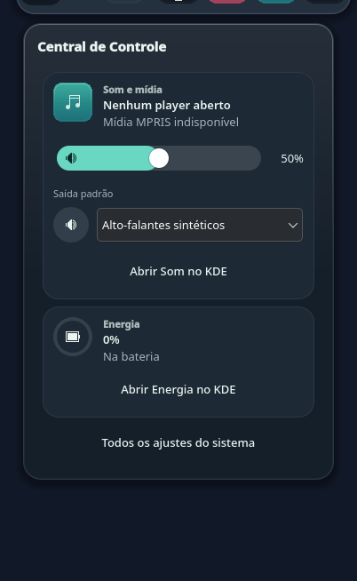
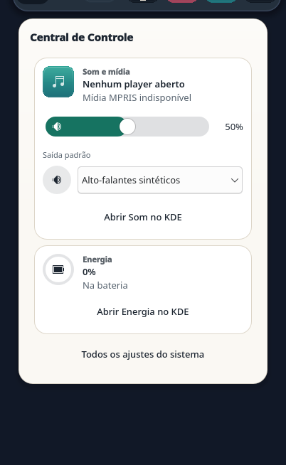
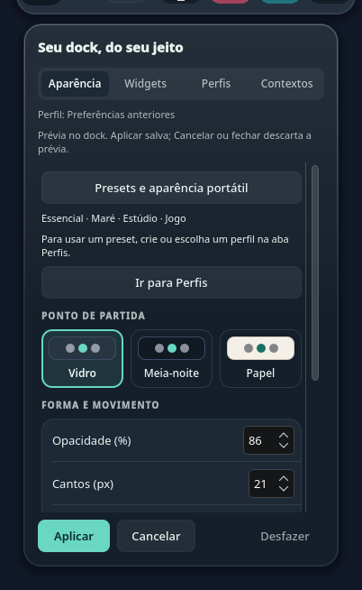
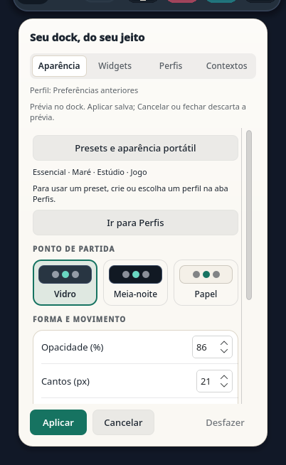

# Central compartilhada — incremento Source S1

13/10/2026. Implementação experimental para CC0/CC1-A/T1; os marcos completos
continuam abertos. Os assets públicos 0.2.9 permanecem imutáveis.

## Comportamento e limites

O dock mantém uma única view `ControlCenter`, um `AudioControlState`, o loader
de áudio e a conexão de confirmação com o HUD. A entrada opcional da barra
carrega o cliente canônico do pacote do dock; ela encaminha intenções, sem
construir outro backend. Uma intenção aceita ainda pode falhar antes da abertura.

Sem dono, com vários docks registrados ou com versão/URL/engine incompatível,
a entrada permanece indisponível. Não há eleição automática de dock. Esse
protocolo interno experimental não é o SDK público de extensões.

A transferência invalida pedido e gesto de áudio antes de fechar. Ela espera
`closed` e o diálogo nativo invisível antes de trocar host e reabrir. Referências
tipadas, gerações e guardas de reentrada preservam pedidos sucessores e impedem
combinar âncoras de janelas diferentes. Fechar/remover uma entrada libera apenas
seu cliente. Ocultar o botão do dock preserva uma abertura originada pela barra.

Abrir não chama setters. Readback tardio de uma operação cancelada não confirma
uma nova abertura. Uma ação nova só gera confirmação/HUD após convergência do
estado observado; isso não atribui causalidade exclusiva ao serviço.

## Verificação

| Execução final local | Resultado |
|---|---|
| Registry + Session, PySide/Qt 6.12 | 49 PASS (20 + 29) |
| Composição + eventos + Central + dock, Qt 6.11.2/Fusion | 65 PASS, 3 TaskManager SKIP |
| Mesma bateria, `org.kde.desktop` | 65 PASS, os mesmos 3 SKIP |
| Barra completa, Qt 6.11.2 | 30 PASS em cada estilo |
| Layout, incluindo manifests antigos e módulo novo | 124 PASS |
| Session, cinco suítes no mesmo processo | 145 PASS, zero janelas restantes |
| Revisão independente dirigida às falhas corrigidas | 8 PASS, zero bloqueios Source |
| Design/empacotamento | check sem issues, 7 guards PASS, release fixture PASS |

- G0: sete subprocessos e 43 observações de identidade, engines, URLs, overlays,
  versões e destruição. O resultado delimita o contrato Qt; não identifica o
  pacote carregado pela sessão Plasma real.
- Registry/Entry: versão e dono único, destruição, invalidação de host/janela,
  clientes independentes, erro assíncrono e recusa de reentrada durante release.
- Session: close/hide assíncronos, último pedido, guarda entre notificações e
  callbacks, falha de abertura, cancelamento antes de close, readback tardio,
  perda de referências, teardown e restauração de foco que respeita foco novo.
- Composição local offscreen: view/áudio idênticos pelas duas entradas, zero
  escritas ao abrir, confirmação/HUD únicos, falha compartilhada, retirada da
  barra e destruição do dono. Usa KDE QML local e provedores sintéticos.
- Barra/layout: módulo direito opcional, cliente indisponível/foco/teclado,
  release exato sob reentrada, dois applets com o mesmo plugin e IDs distintos,
  manifests antigos, desativação e restauração.
- CI portátil executa Registry/Session no Qt 6.12. A composição com KDE QML tem
  suíte própria; ausência desses módulos é explicitamente diferente de PASS.
  Os três casos do TaskManager omitidos offscreen exigem Wayland ou X11.
- Design check, guards, galeria claro/escuro, pacote e exclusão das fixtures
  dependentes de `bar/` do ZIP verificam o contrato visual e a distribuição.

As falhas de reentrada e foco foram reproduzidas antes das correções e revisadas
independentemente. Sincronização dos testes aguarda sinais/estado, preservando
as verificações de geometria, Escape e foco. Nenhum delay foi inserido no produto
para acomodar os testes.

## Galeria

Capturas sintéticas offscreen, sem dados de usuários, hardware ou sessão Plasma
real. O pequeno trecho no topo do crop pertence à âncora sintética.

| Escuro | Claro |
|---|---|
|  |  |
|  |  |
|  |  |

## Gate seguinte: S2 nativo

### Referência da janela do painel — correção em 13/10

A sessão real confirmou o registro canônico e o estado compartilhado pela
barra e pelo dock. A atualização gerenciada acrescentou a entrada ao mesmo
painel, mantendo os cinco IDs anteriores e o banco original de recuperação.
A abertura ainda não foi qualificada: o primeiro roteiro parou na guarda de
hover; o segundo confirmou hover e envio do clique, mas não observou popup.
Foco no botão e acknowledgment do dispositivo não comprovam `clicked`.

Uma regressão isolada reproduziu uma causa de falha de abertura: `Window` do
QML rejeita os hosts C++ `QQuickWindow` e `QQuickView` usados pelos painéis.
A atribuição interrompia `ControlCenterEntry.open()` antes de encaminhar ao
dono; a captura da exceção na barra podia deixar o botão sem ação nem erro.
A referência agora usa `QtObject`, mantendo a identidade exata da janela e
as guardas de visibilidade, destruição e release. O teste público reutiliza
o cliente e verifica abrir, liberar, reabrir e cancelar ao ocultar cada host.

O teste falhou nos dois hosts antes da correção. Depois passaram 57 testes
(Registry 21, Session 29, composição 7) em Fusion e os mesmos 57 em
`org.kde.desktop`, sem skips ou warnings. A galeria foi regenerada e revisada
em claro e escuro; não houve mudança de composição visual. Essa prova usa
hosts C++ offscreen. Abertura/foco com o código corrigido e áudio real
têm provas nativas separadas, descritas abaixo.

### Abertura pelas duas entradas — prova nativa delimitada

Na sessão Plasma 6.7.5/Wayland, Qt 6.11.2, uma tela de 2648 × 1490 DIP com
escala 2, o roteiro final de 18,61 s observou abertura, Tab e Escape tanto pela
barra quanto pela dock retrátil. Tab levou foco ao volume pela barra e ao mudo
pela dock; Escape ocultou o popup, desativou o áudio e devolveu foco à entrada
correspondente. A janela de 378 × 542 DIP ficou dentro da tela: alinhada à
barra direita e centralizada sobre o botão da dock, com transient parent
correspondente ao painel de cada abertura.
O registro canônico manteve dono único e as mesmas referências de popup,
view e estado de áudio. Abrir e navegar produziram zero setters/retries.

Os roteiros anteriores pararam na guarda de hover da dock, antes de enviar
um clique a ela. O roteiro final incluiu dois movimentos na borda inferior,
separados por 125 ms, compatíveis com a pressão exigida pelo KWin, e só clicou
após observar hover real. Isso qualifica o fluxo final; não prova que todas
as falhas anteriores tinham a mesma causa. Transferência com popup já aberto
continua um gate próprio. Foram observadas duas criações
cumulativas do backend para duas aberturas sequenciais; não se mediu a
quantidade de backends simultâneos. Os dispositivos virtuais foram liberados e os arquivos
de configuração, launcher, atalhos e recuperação permaneceram preservados.

### Áudio e pacote final — prova nativa delimitada

O roteiro de áudio final durou 18,36 s e acionou mudo com Space e um passo de
volume com seta no controle focado. O serviço real confirmou cada efeito no
mesmo alvo observado. O teste restaurou exatamente o mudo e os valores brutos
dos canais originais, confirmou o fechamento por Escape e o foco no botão da
barra, e liberou os dispositivos virtuais. Houve duas intenções de escrita
pela interface e zero retries. A prova guarda apenas resultados e observações
tipadas; nomes de dispositivos e valores privados permanecem em memória.
Isso comprova efeito/readback nessa configuração, sem causalidade exclusiva
ou garantia de compare-and-swap. A seleção de outra saída permanece UNRUN.
O primeiro roteiro de áudio parou na guarda de hover antes de qualquer clique
ou escrita; seu resultado foi preservado.

A instrumentação temporária foi removida após essas provas. Os pacotes finais
correspondem ao Source `204c16b` e mantêm a correção da janela. A verificação
após recarga confirmou os seis itens da barra, dock, launcher, atalhos,
configuração e banco de recuperação preservados. Essa recarga verifica pacote
e composição instalada; não repete a prova de interação sem instrumentação.

Após a prova de 13/10, ainda faltavam transferência com popup aberto, retirada
da entrada da barra, seleção de saída, microfone, brilho, rede, Não perturbe,
múltiplos docks/monitores e os demais critérios CC0/CC1/T1. Um install ou PASS
offscreen não encerra esses gates.

### Transferência e entrada opcional — correção e prova em 14/10

O primeiro episódio encontrou uma falha: um pedido pela barra chegou com o
popup da dock ainda visível, fechou-o, mudou o host e reabriu no topo, mas a nova
abertura logo se encerrou. O backend anterior ainda tinha uma referência Qt
válida quando o seguinte terminou de ser criado. O resultado foi preservado;
o caminho inverso e a desativação ficaram UNRUN nesse episódio. Os pacotes e
configurações foram restaurados antes de corrigir o Source.

A reprodução com o `Loader` real no Qt 6.11.2 mostrou que `item` fica null e
`Component.onDestruction` ocorre antes da destruição efetiva do QObject. Assim,
contar apenas esses callbacks pode ocultar sobreposição. A sessão agora captura
uma referência tipada ao backend nativo antes de fechar e espera sua liberação.
Também espera o diálogo anterior ficar invisível e inativo antes de mudar o host.
As retomadas são enfileiradas por sinais; não foi acrescentado um delay em ms.
O backend pode ser recriado, enquanto popup, view e estado de áudio permanecem
os mesmos. Backends injetados persistentes não participam dessa barreira opcional.

| Verificação da correção `38e2b6c` | Resultado |
|---|---|
| Registry + Session + composição, Qt 6.11.2/Fusion | 61 PASS, zero skips/warnings |
| Mesma bateria, `org.kde.desktop` | 61 PASS, zero skips/warnings |
| Regressões novas | Backend ainda vivo; cancelamento; destruição do dono; janela oculta ainda ativa |
| Revisão independente | Pedido sucessor durante destruição e diálogo sem API `active`: PASS |
| Design e pacote | Check, sete guards, build e galeria claro/escuro revisada: PASS |

As regressões de backend vivo e janela oculta/ativa falharam antes das respectivas
guardas. Testes sintéticos não certificam comportamento do compositor.

Galeria da correção, com dados sintéticos e sem mudança de composição visual:

| Escuro | Claro |
|---|---|
|  |  |

O episódio nativo seguinte, com a correção, passou em Plasma 6.7.5/Wayland e
Qt 6.11.2, numa tela de 2648 × 1490 DIP; os itens observados reportaram DPR 2.
O intervalo entre o início do input e o fechamento final foi de 269,55 s:

- Dock → barra → dock: os dois pedidos chegaram com popup e diálogo ainda
  visíveis. Cada mudança de host ocorreu após `closed`, invisibilidade,
  inatividade e liberação do backend anterior. A referência foi liberada enquanto
  o diálogo ainda estava ativo nas duas transferências; a segunda guarda impediu
  reabrir nesse intervalo. Ambas as novas aberturas permaneceram visíveis, com
  âncora/transient parent corretos e as mesmas referências de popup/view/áudio.
- Cinco criações e cinco inícios de destruição de backend, máximo de um span
  `completed` → início de destruição. Nenhuma referência ao backend anterior
  estava presente no `completed` seguinte; ao final ela estava null e o áudio
  inativo. Isso qualifica os QObjects observados, não todas as conexões, threads
  ou recursos globais de áudio.
- Desativar apenas `showControlCenter` do applet direito por `writeConfig` e
  `reloadConfig` do Plasma preservou a abertura originada pela dock, fechou a
  abertura da barra e permitiu reabrir pela dock enquanto a entrada estava
  desligada. A preferência foi restaurada ao valor original; todas as demais
  configurações e os bancos permaneceram iguais. O checkbox na janela de
  configuração não foi exercitado neste episódio.
- Tab focou o volume; Escape fechou sem escritas. O item de foco do painel ficou
  no botão da dock e o KWin voltou à janela própria de teste. Não se afirma que
  o painel foi reativado nem que houve nova reabertura pelo teclado.
- Zero setters/retries; leitura real confirmou default, alvo, mudo e valores
  brutos dos canais inalterados. Não houve seleção de saída ou outra operação
  de hardware, acesso ao clipboard ou captura de dados pessoais.

A instrumentação foi removida e somente os três arquivos da correção ficaram
instalados: dock com 67 arquivos e barra com 14. Launcher, CLI, atalhos,
configurações e recuperação permaneceram preservados; o Plasma terminou ativo,
com resultado success e zero restarts. Os helpers e dispositivos próprios foram
encerrados. Essa recarga confirma o pacote final, sem repetir a interação após
remover o probe.

Transferência e desativação têm esse aceite delimitado. Permanecem abertos o
checkbox nativo, seleção de saída, transferência durante operação de áudio
pendente, outros monitores/ambientes e os demais critérios CC0/CC1/T1.

### Encaixe dos controles na barra — 14/10

O painel real tem 32 pontos de altura, com uma área útil de 24 para os applets.
Os botões exigiam 28/32 mesmo nessa área menor. A regressão reproduziu o
excesso; o Source `800a9c8` limita as alturas de layout ao espaço recebido e
reduz o padding vertical para preservar o ícone e o texto. O indicador de erro
também tem altura limitada. A preferência continua 28/32; o mínimo anunciado
ao Plasma passa a 24, sem modificar a configuração do painel.

A ordem da leitura em `controlHeight` é deliberada: uma reprodução independente
com o BarHarness real, Qt 6.11.2 e ambos os estilos encontrou binding loop no
startup ao ler `height` antes de `implicitHeight`. Ler `implicitHeight` primeiro
eliminou os avisos. As falhas iniciais e as variantes privadas foram preservadas;
o mecanismo interno de inicialização permanece uma inferência.

| Verificação do Source final | Resultado |
|---|---|
| Barra, Fusion / KDE | 33 PASS em cada estilo, sem warnings |
| Composição compartilhada, Fusion / KDE | 7 PASS em cada estilo |
| Alturas 24/28/32/64, normal e compacta | Controles e ícones contidos; texto do menu cabe |
| Teclado em host curto | Menu Space/Escape, Tab para Central, Space e clique inferior |
| Design | Check, sete guards e galeria claro/escuro revisada: PASS |
| Revisão independente | Source e preparação nativa: zero bloqueadores |

Capturas offscreen com dados sintéticos, foco na Central e host de 24 pontos:

| Escuro | Claro |
|---|---|
|  |  |

O episódio nativo passou em uma sessão Plasma 6.7.5/Wayland:

- Menu Orla e Central mediram 32 × 24, dentro do host. O ícone do menu mediu
  20 × 20; o canvas da Central, 24 × 20, com desenho centralizado pelo menor
  lado. Todos os 19 registros observados mantiveram controle e canvas contidos.
- Um clique por controle em `y=27`, junto à borda inferior, produziu exatamente
  um callback `clicked` e abriu seu popup. Tab/Escape na Central e ↓/Escape no
  menu fecharam ambos. Ao final, o foco lógico do menu ficou em seu botão e o
  KWin voltou à mesma janela própria; isso não prova reativação do painel.
- Não houve uso de clipboard, screenshots, ações de sessão ou acionamento de
  controles de hardware. Os quatro helpers de input confirmaram liberação dos
  dispositivos; a janela própria encerrou com código zero e os scripts KWin
  próprios foram removidos.
- O consumidor inicialmente presumiu ordem cronológica do journal. Os
  registros chegaram invertidos; ordenar pela sequência de cada contexto
  corrigiu a leitura, sem repetir input. Também foi preservada uma falha do
  audit ao exigir exit zero do journal vazio; a leitura final estava vazia,
  sem erro em stderr e com exit 1. Não se encontraram avisos de BarView no PID
  do episódio; isso não é uma auditoria de todos os logs do Plasma.

A retirada do probe deixou exatamente os dois arquivos de produção da barra,
com 14 arquivos no pacote. Dock, launcher, CLI, atalhos, mapas/modos das
configurações e bancos ficaram iguais. Plasma terminou ativo, com success e
zero restarts; a geometria final confirmou painel 32/hosts 24. Essa recarga
confirma o pacote sem repetir a interação após retirar o probe.

Preferência compacta na UI nativa, entrada por teclado/anel de foco na barra,
fontes ampliadas, esquema claro nativo, outras telas/escalas e os demais gates
de T1/UX0 permanecem UNRUN. O conteúdo do indicador de erro não foi exercitado
na sessão real.

### Dock retrátil e retorno ao aplicativo — 14/10

Uma nova prova com o Source `8f730b8`, sem instalar ou alterar código de UI,
usou KWrite 26.08.1 real com perfil XDG, D-Bus e arquivo sintético próprios.
A tela observada mediu 2648 × 1490 DIP; as capturas mediram 3840 × 2160 pixels.
O painel gerenciado continuou em `autohide`. Um observador temporário do KWin
leu apenas os PIDs conhecidos, UUIDs, frames, foco, ponteiro e o getter público
`hidden`; não alterou janelas, painéis ou preferências.

Com o KWrite maximizado, o mesmo painel passou de `hidden=true` para
`hidden=false` após um gesto contínuo na borda inferior. A captura confirmou
vidro e ícones. O dispositivo temporário permaneceu ativo durante essa parte;
o bridge contém pausas de 120 ms entre movimentos relativos, mas o log desta
sessão não mede a cadência recebida pelo KWin.

Um clique no ícone da Central abriu uma janela de aproximadamente 378 × 542
DIP, centralizada sobre esse botão. O recorte confirmou o título estático
“Central de Controle”, sem registrar mídia ou nomes de dispositivos. Escape
ocultou essa superfície e devolveu foco ao mesmo UUID do KWrite. Após uma
leitura fresca do aplicativo ativo, Ctrl+End, um marcador próprio, Enter e
Ctrl+S produziram exatamente marcador + LF uma vez: 45→67 bytes. Afastar o
ponteiro voltou a ocultar o painel; `hidden=true` e o recorte vazio concordaram.

| Recorte da sessão real | Captura |
|---|---|
| Dock revelada sobre aplicativo próprio maximizado | [Vidro e ícones](../screenshots/shared-control-center/native-dock-reveal.png) |
| Dock oculta após afastar o ponteiro | [Região novamente livre](../screenshots/shared-control-center/native-dock-hidden.png) |
| Popup aberto pelo botão da dock | [Título da Central](../screenshots/shared-control-center/native-dock-cc-heading.png) |

Em fullscreen, F11 manteve o mesmo aplicativo ativo e o gesto na borda deixou
o painel em `hidden=true`, com região vazia. Isso é compatível com
[a política de bordas de clientes do KWin 6.7.5](https://raw.githubusercontent.com/KDE/kwin/v6.7.5/src/screenedge.cpp),
que bloqueia esse caso. A configuração em disco foi lida sem alterações:
delay 75 ms, cooldown 350 ms e pushback 1; seu estado carregado no compositor
não foi lido. Revelar a dock sobre fullscreen, como desejado para o Orla,
continua sem implementação qualificada. O teste não habilitou preferências
para contornar essa limitação.

Os dois probes anteriores ficaram inconclusivos: região vazia ou indicador
de aproximação não comprovavam revelação. Artefatos e erros iniciais foram
preservados; o contraste posterior não atribui retrospectivamente uma causa
às tentativas anteriores. A leitura do código de borda justificou o novo gesto,
sem alterar configuração nem produto.

O bridge contínuo encerrou pelo TTL antes do envio do marcador: seu log tem
dez comandos executados, nenhum de digitação e liberação confirmada. O arquivo
permanecia igual ao preimage; a prova do marcador usou um novo bridge e leitura
fresca de foco. Sete episódios de input confirmaram liberação; os dezesseis
observadores próprios foram descarregados. KWrite voltou ao frame original
antes da limpeza supervisionada; ele e seu D-Bus privado terminaram com exit 0.
BEFORE e AFTER ficaram exatos nos 1.363 arquivos e 232 diretórios protegidos
verificados, incluindo Source, instalação, configurações e bancos de layout.
A revisão independente não encontrou bloqueadores neste aceite delimitado.

R1/CC0/CC1-A/T1/UX0 permanecem parciais. Esta prova não exercitou hardware,
transferência pela barra, os demais popups, foco por Tab nos controles, esquema
claro nativo, outra escala/tela, perfil normal do usuário ou menus do T3.

## Hidden dialog keyboard ownership — 15 October 2026

The production four-opening fixture reproduced a blocked second Control Center
opening. Giving the host actual keyboard focus did not fix the old gate:
`QGuiApplication.focusWindow()` was the host, while the hidden native dialog
still reported `active=true` and `activeFocusItem=null`. Conversely, during hide
the dialog could still own keyboard focus and retain a non-null focus item.
Private signal traces recorded both states without changing production UI.

This agrees with [Qt 6.11's `QWindow::isActive()` contract](https://doc.qt.io/qt-6.11/qwindow.html#isActive):
activity includes the parent/transient family. The Session now uses the native
QQuickWindow's `activeFocusItem` for this keyboard barrier and wakes its deferred
queue when that item clears. A visible native dialog still blocks transfer;
an undefined focus-item property keeps the existing active-only fallback for
older boundaries. Generation checks, backend retirement and newer-focus rules
are unchanged. This is a fix for this dialog flow, not a universal equivalence
between QML item focus and compositor focus.

Two causal regressions failed before the fix and passed after it. The portable
case holds a hidden dialog with non-null focus despite `active=false`, then
allows one transfer after null focus despite `active=true`. The production
fixture establishes exact host keyboard ownership before each opening and
retains its original placement, 40 ms wait, lifecycle, Tab and Escape assertions.
It opens settings and Control Center twice each.

Locally, `test_qml`, `test_shared_control_center_registry`,
`test_control_center_session` and `test_shared_control_center` passed 91 entries
per Fusion/KDE style: 88 passed and three skipped. Qt/PySide6 were 6.11.2. Design
check, seven design guards and the 68-file applet build passed. These are
offscreen/fixture results; they do not qualify real Plasma host transfers,
multiple outputs or focus return in the user's session. The earlier failed
popup result remains historical evidence. Private RED, GREEN, signal traces,
review and regression receipts are under `.runtime/popup-diagnosis-20261015/`.

The tested 68-file package was installed with a backup and one controlled shell
stop/start. Only `ControlCenterSession.qml` changed in the applet. Readback
confirmed package hashes, the full configuration map, inventory, protected
files and the same resident launcher. This installation result alone is not
physical popup/focus qualification.

### Installed opening, Escape and reopening

After installation, a fresh physical-input episode passed two openings and two
Escape closes in Plasma 6.7.5/Wayland, Qt 6.11.2, one output at scale 1.45. Each
opening first revealed the auto-hide dock through its existing bottom edge.
Accessibility located `controlCenterButton` inside the owned panel, then both
`controlCenterContents` and its `controlCenterAllAction` descendant with positive
geometry. The pane measured 318 × 449 DIP in both openings. No title, media or
device names were read or captured.

Before each Escape, a fresh KWin observation confirmed the active window belonged
to the known Plasma process while both CC markers were showing. Both markers
became non-showing after Escape. The dock hid again after the final pointer
departure, and the last observed active-window UUID equaled the initial UUID.
Full configuration bytes/map, package, inventory, protected files and the
resident launcher remained unchanged. Temporary input devices, accessibility
flags, observer and bus resources were released or restored.

Earlier attempts remain failed: one queried Component geometry on already-hidden
accessible nodes, which no longer implement that interface; another completed
one CC/Escape cycle but did not reveal the auto-hide panel before reopening.
The final reader asks for geometry only when showing, and the same bounded edge
sequence is used before both clicks. No production change or preference change
was made to accommodate either test issue.

This qualifies those two dock-origin openings and closes. It does not establish
native lifecycle/setter counts, independent keyboard-owner identity, the KWin
popup window's identity/absence, bar-to-dock transfer, backend actions, other
outputs or schemes. Final receipt:
`.runtime/popup-diagnosis-20261015/root-native-r3/RESULT.json`, status
`PASS_INSTALLED_CC_OPEN_ESCAPE_REOPEN_ESCAPE`. The final regenerated dark/light
CC gallery captures were visually reviewed and are byte-identical to the
[published dark](../screenshots/visual-system/popup-dark-control-center.png) and
[light](../screenshots/visual-system/popup-light-control-center.png) captures.

## Newer host focus after native popup close — 15 October 2026

A separate Settings popup defect was reproduced offscreen and in an isolated
real Wayland/KWin session. A synchronous public `closed` observer established
`QGuiApplication.focusWindow() == host` and `host.activeFocusItem() == addButton`.
After the observer returned, DockPopup's deferred callback moved focus back to
the old Settings anchor. Both failed receipts retain the actual keyboard-owner
and focus-item observations. This controlled reentrant schedule does not claim
to reproduce ordinary physical pointer timing in the installed panel.

`DockPopup` now invalidates restoration on visibility, anchor and host changes.
Its deferred callback requires the original live window/anchor, the same closed
opening, and no distinct live focused control. Synchronous cancellation remains
authoritative: the shared Session clears `anchorControl` in `closed`, suppressing
the generic callback during Control Center transfers. The design system records
this focus contract for future UI contributions.

The same Wayland challenge passed after the fix: the new control remained focused
and the old anchor did not regain focus. `test_qml` includes the causal regression.
The dock, Registry, Session and composition suites passed 92 entries per
Fusion/KDE style (89 passed, three TaskManager skips). Design check, seven guards,
gallery and the 68-file applet build passed. The four Settings/Control Center
captures are byte-identical to the pre-fix local gallery; the current Settings
captures below were visually reviewed in both schemes.

| Dark | Light |
|---|---|
|  |  |

An additional Source-owned Wayland fixture passed dock → bar → dock requests
through the canonical Entry/Session while the old dialog was still visible and
owned keyboard focus. Public signal observations verified `closed`, native hide
and exact keyboard departure before each host change. The same popup/view/audio
state/dialog remained, the transient parent matched each requested window, and a
newer control chosen during final close retained focus. Audio/actions were
synthetic: their call lists stayed empty, and the native audio loader was absent.
Real audio backend QObject lifetimes/setters and the installed session's exact
keyboard-owner identity remain unqualified by this fixture.

Two early transfer-fixture attempts remain failed. The diagnostic identified a
Python conversion failure reading the typed `contents` QML alias; checking that
alias's actual identity in QML fixed the observer without changing the product.
Private receipts are under `.runtime/cc-transfer-20261015/`: Settings RED/GREEN
in `root-focus-probe-r1/r2`, transfer diagnosis in `r3/r4` and the passing
transfer fixture in `r5`. The final Source status is
`PASS_SOURCE_WAYLAND_TWO_WAY_CC_TRANSFER_AND_NEWER_FOCUS`.

The tested package was installed with backup and one controlled shell stop/start.
Only `DockPopup.qml` changed among the 68 applet files. Readback confirmed the
complete configuration map, panel inventory, protected files and resident launcher
preserved. This installation is separate from the physical interaction evidence.

### Installed public rehosting and Tab

After installation, a fresh episode passed three physical entry clicks in the
order dock → bar → dock. Each opening had one positive-geometry CC pane and inner
action at the requested panel region. A physical Tab was followed by a changed
`STATE_FOCUSED` technical control under that pane. Escape closed the final popup,
and the dock hid after pointer departure. Full configuration bytes/map, dock and
bar packages, exact bar roles, inventory, protected files and launcher were
preserved. Temporary input devices, accessibility flags, observer and bus resources
were released/restored. Automatic locking remains disabled.

The first physical attempt also reached all three hosts and focused controls,
but failed before final Escape: moving to the current cursor position emitted no
new motion event. Cleanup hit the same observer error. An independent guarded
episode closed only the owned CC popup and verified rehide, resources and full
preservation. The revised reader skips that redundant move, still requires a
fresh one-pixel nudge and all keyboard/context guards, and passed the complete
flow on a new baseline. The failed receipt remains failed.

This proves public rehosting and the observed Tab consequences in one installed
Plasma/Wayland output. It does not prove old visibility at request acceptance,
queued transfer ordering, exact `QGuiApplication.focusWindow()`/keyboard-seat
ownership, or real backend lifecycle/setter counts. No unique KWin popup match
was available, so that identity remains unqualified. Source-owned Wayland facts
above remain separate. Final status:
`PASS_INSTALLED_CC_PUBLIC_REHOSTING_AND_TECHNICAL_TAB`, receipt
`.runtime/cc-transfer-20261015/root-native-r2/RESULT.json`; independent cleanup:
`root-independent-cleanup-r1/RESULT.json`.

## Native audio pending transfer — 15 October 2026

`tests/native/run_control_center_audio.py` now provides a reproducible isolated
Wayland/KWin, D-Bus and PipeWire session for the production Control Center.
`control_center_audio.py` loads the existing dock/bar fixtures, keeps their fake
settings actions and replaces only the audio override with QML `null`. That
activates the actual `NativePulseAudio` loader and PlasmaPA client. It neither
installs code nor sends input to the installed desktop.

The private PipeWire configuration loads no ALSA, Bluetooth, network, device
enumeration or session-manager modules. Its only outputs are two
`support.null-audio-sink` nodes, explicitly advertised with `node.virtual=false`.
This is a synthetic protocol descriptor: PlasmaPA derives `virtualDevice` from
the Pulse hardware flag, which PipeWire supplies when `node.virtual` is false.
The production eligibility filter is unchanged. These fixtures certify no
physical device. The mapping was checked against
[PulseAudioQt 1.8.1](https://raw.githubusercontent.com/KDE/pulseaudio-qt/v1.8.1/src/device_p.h),
[PipeWire 1.6.9's node classification](https://raw.githubusercontent.com/PipeWire/pipewire/1.6.9/src/modules/module-protocol-pulse/manager.c)
and [its Pulse sink flags](https://raw.githubusercontent.com/PipeWire/pipewire/1.6.9/src/modules/module-protocol-pulse/pulse-server.c).

The fresh process uses an explicit private Pulse socket, client configuration
with autospawn disabled, a private PipeWire core, four private XDG directories
and an unavailable system bus. The runner captures Source hashes, compares
known host configuration/package file hashes and modes, and releases only
processes matching its UID, birth time and unique runtime marker through pidfds.
Output directories cannot be reused; unsafe path characters are rejected before
creation. It redacts the home path from owned logs after process cleanup.

The native fixture establishes a pending 80% volume gesture and accepts the
canonical bar request in one JS frame, before pumping Qt events. It observes:

- Pending request and gesture cleared before `aboutToHide`, and again before
  the transfer call returns.
- The actual backend `QObject.destroyed` signal before changing host and
  publishing its successor. A null loader item is recorded separately and
  does not count as destruction.
- Late real readback of 80%, independently checked with `pactl` on the private
  server, without any old confirmation, non-null event presentation or
  accessibility announcement.
- A new 60% request confirmed once, one event presentation and one announcement;
  the independent server readback is 39,322 raw on both channels. Queue occupancy
  alone is not used to infer a single HUD history.
- Return to the dock with the same view and `AudioControlState`, then final
  close. Three backend QObjects were published and three destroyed, with at
  most one published backend alive. Counters and observer errors are checked
  through engine teardown.

Fusion and `org.kde.desktop` runs passed with Qt/PySide6 6.11.2, KWin/PlasmaPA
6.7.5, PulseAudioQt 1.8.1 and PipeWire 1.6.9. Each ended with zero QML warnings,
zero lifecycle violations, no tracked live backend and no owned process left;
the host file fingerprints and Source hashes remained equal. The 76 portable
audio/Session/Registry checks passed in each style. Design check reported zero
issues and all seven design guards passed. No product UI, token or geometry
changed, so this increment reuses the existing visual captures.

The runner and its fixtures require the Source-only bar, so the alpha bundle
excludes all four new native-audio files. The release test reproduced their
accidental inclusion before the exclusion and passed after it, retaining its
byte-for-byte repeat-build and checksum assertions. Published assets are unchanged.

A private negative control removed only `beginClose()`'s audio invalidation.
The same native test failed with `audio_not_cancelled_before_close`, despite
eventual cancellation and otherwise successful readback; cleanup still passed.
This establishes sensitivity to the pre-close ordering regression. No mutation
was applied to the working tree or installed applet.

An earlier attempt remains failed: assigning Python `None` to the QML `var`
override produced `undefined`, so the real backend was never loaded. Assigning
actual JS `null` corrected the fixture. This was not a reproduced product bug.
Private receipts live under `.runtime/cc-audio-20261015/`; the public runner's
two JSON results distinguish probe failure from supervisor/cleanup failure.

This closes the isolated real-protocol fixture gap. It does not qualify an audio
operation pending during transfer in the installed panel, physical input,
physical hardware, native setter counts, all PulseAudioQt global connections or
threads, other outputs, or the complete CC0/CC1/T1 acceptance. The current applet
installation and public 0.2.9 assets were not changed in this increment.

## Installed optional dock entry — 15 October 2026

The global `showControlCenter` checkbox passed an installed-session cycle on
Plasma/KWin 6.7.5, Qt 6.11.2 and KConfig 6.30.0, with one Wayland output at
scale 1.45. The applet and bar matched the unchanged Source packages, with
68 and 14 files respectively. This was physical pointer/keyboard input to the
production UI, with bounded own-process accessibility and KWin observations.

The exercised sequence is also the manual reproduction procedure:

1. Open dock Settings → Widgets, leave preferences untouched and close it.
2. Reopen and uncheck the global Control Center option. Check the unchecked
   control, effective setting and saved configuration; the dock entry disappears.
3. Open the Control Center from the right bar entry while the dock option stays
   off. Tab changes the focused technical control; Escape closes the popup.
4. Restore the option through the same dock checkbox. Close and reopen Settings
   to confirm it remains checked, then close the popup.
5. Confirm the original configuration and final hidden dock state.

The complete configuration map admitted only three predeclared states: the
original explicit true, that same map with only this key set to false, or that
same map with only this key absent (the false default). Strict Boolean effective
readback was checked separately from cached key membership. KConfig can retain a
reverted key in memory after removing it from the serialized file; this is
supported by [revertEntry in KConfig 6.30.0](https://raw.githubusercontent.com/KDE/kconfig/v6.30.0/src/core/kconfigdata.cpp),
its [key-list predicate](https://raw.githubusercontent.com/KDE/kconfig/v6.30.0/src/core/kconfig.cpp)
and [separate disk write map](https://raw.githubusercontent.com/KDE/kconfig/v6.30.0/src/core/kconfigini.cpp).
The successful off state had no disk key, cached membership true, effective
false and an unchecked checkbox. No other deletion or configuration drift was
accepted. The original baseline and layout recovery banks were never rewritten.

All 12 bar-phase witnesses retained that off state and an absent dock entry.
The actual CC pane and inner action appeared at the bar; Tab changed focus from
the all-settings action to the volume slider. Restoration and the final reopen
were checked through the UI. The episode used 11 clicks and 32 relative nudges
(263 total displacement), within the 48/600 input bounds and 150-second helper
TTL. The first-to-last input command span was 60.116 seconds.

Final readback matched the complete original configuration map and bytes.
Configuration mode, panel inventory, exact bar roles, installed packages,
protected files, layout banks and resident launcher remained equal. The dock was
already stably hidden after closing Settings; no extra final leave gesture was
dispatched or claimed.
Temporary devices, accessibility flags, observer and bus resources were
released/restored. Automatic locking remained disabled. The existing product
Source and visual/layout definitions were reused, without installation or shell
reload.

Three earlier native attempts remain failed. The first stopped before preference
input because the reader expected `selected`; the installed TabButton exposes
`checked`, and the named content viewport has the intended AT-SPI `panel` role.
Two no-edit diagnostics confirmed these states and actual checkbox containment.
The second attempt toggled off, then incorrectly waited for cached key presence
to equal disk presence. A separate, guarded single-key scripting recovery
restored the original preference and full configuration; that recovery does not
count as a UI cycle. The third stopped before any click when reveal changed the
dock width. The final visitor waits for two equal guarded geometry reads before
target input, retaining the existing fresh pre-click checks and deadlines.

Seventeen final synthetic configuration cases and 12 synthetic UI-admission
cases passed. The latter include clipped/foreign/ambiguous targets and a causal
check that an always-admitting substitute is rejected by the harness. An earlier
synthetic harness caught its own assertion; its receipt is superseded and is not
used as evidence. All native failures and the independent recovery are retained.

Private receipts are under `.runtime/cc-config-20261015/`: the final native result
is `root-native-r4/RESULT.json`, status
`PASS_INSTALLED_DOCK_CC_GLOBAL_CHECKBOX_CYCLE`; final fresh preservation readback
is `root-publication-r1/FINAL-VERIFICATION.json`. Configuration cases are in
`root-contract-r5`, and UI cases in `root-admission-r4-corrected`. These local
receipts are distinct from the repository's portable/offscreen CI tests.

This qualifies the dock's global immediate preference, persistence across close
and reopen, and bar access while that dock entry is disabled. Native bar
configuration Apply/Cancel, restart persistence, multiple outputs, exact native
setter counts, independent keyboard-seat identity/focus return, pending audio
and backend lifecycle in the installed panel remain separate gates. CC0/CC1/T1
remain partial. The existing visual captures and public release assets are
unchanged.

## Native bar context-menu observation — 15 October 2026

A no-edit attempt on the installed right-hand CC applet failed at
`context_observation_deadline`. KWin observed a popup transient for the exact
bar, while the AT-SPI application-child traversal found no menu. The original
receipt's `popupAbsentFinal=true` only described that incomplete traversal: an
independent, input-free KWin snapshot confirmed the same popup still visible.
The resource-release and complete original-configuration preservation checks
remain valid; visual cleanup was not established by the failed visitor. That
receipt is retained unchanged.

[Qt 6.11.2](https://github.com/qt/qtbase/blob/v6.11.2/src/gui/accessible/qaccessibleobject.cpp) excludes `Qt::Popup` from `QAccessibleApplication` child enumeration.
The [native libplasma 6.7.5 menu](https://github.com/KDE/libplasma/blob/v6.7.5/src/plasmaquick/plasmoid/plasmoiditem.cpp) is a parentless QWidget with a QWindow transient
parent; that relationship does not add it to the enumerated application children.
Qt's AT-SPI bridge also ignores PopupMenuStart/End. The independent recovery used
own-application showing/focus/children events and bounded actual parent traversal
to retain a direct PopupMenu reference. Hovering the freshly identified popup
produced that reference; the unique allowlisted Configure item was then hovered,
its focused state rechecked, and Escape dispatched. No Configure activation,
preference input or click occurred during recovery.

The passing episode captured 12 own events and one direct menu root, using five
relative nudges with total displacement five. A fresh post-Escape KWin observation
and post-nudge snapshot excluded both the original UUID regardless of transient
parent changes and any replacement popup parented to the bar. Full configuration
bytes/map, installed packages, roles, launcher, protected files and layout banks
remained equal; devices, event listeners, accessibility settings, observer and
bus resources were released/restored. This used the preceding 68-file package,
before the optional-module UI increment, without installing or reloading it.

An earlier recovery candidate stopped before hover because its full-frame
containment check rejected a fractional right edge slightly outside the output.
The passing candidate admits only a hover point strictly inside both the exact
known popup and output; action targets remain fully contained. Ten synthetic
event/cleanup cases and three point-admission cases passed. The parent-only
absence predicate's reparenting counterexample was detected and corrected before
the passing execution. Failed attempts remain separate from this recovery.

Private evidence: `.runtime/bar-config-20261015/root-context-native-r1/RESULT.json`,
`root-menu-snapshot-r1/RESULT.json`, `root-recovery-native-r1/RESULT.json` and
`root-recovery-native-r2/RESULT.json`. The last status is
`PASS_INDEPENDENT_BAR49_MENU_RECOVERY`. This qualifies observation and cleanup of
that menu, not opening the configuration dialog, its size-key footprint, native
Apply/Cancel, preference persistence after restart or independent keyboard-seat
ownership. Those bar-configuration gates remain open.

## Installed bar configuration: opening and accessible Cancel — 15 October 2026

With the 70-file dock from `655b5ec`, unchanged 14-file bar and a freshly verified
original configuration, synthetic Wayland input opened the right-hand Central de Controle
applet's context menu and activated its uniquely identified Configure action.
One new own-process configuration window appeared. Its named controls showed
Central de Controle enabled and Menu Orla disabled, matching that applet's role;
Apply was disabled and Cancel enabled under the same accessible window ancestor.
No preference, preset, Apply or OK action was performed.

The pointer-driven Open/Cancel canary **did not pass**. Its first episode stopped
before Configure because synchronous AT-SPI reads advanced while asyncio had not
yet delivered the KWin observer record. The initial absence flag survived the
cleanup exception and was not valid final evidence. A separate input-free KWin
snapshot confirmed the menu still visible; an independent, exact-UUID recovery
then closed it through focused Escape, with zero clicks or Configure activations.
Original configuration bytes/map, packages, launcher and banks remained equal.
The failed receipt is retained unchanged. A causal test of the actual async join
fails before the scheduling correction and passes with queued/delayed records;
ambiguous records still fail and no input is retried by that join.

The second episode reached the actual configuration page, then stopped at its
coordinate/ancestor guards. The reader reported its frame as `(0,0,810,630)` and
Cancel as `(710,588,92,34)`, while KWin independently placed the client at
`(918,459.275862...)` with size `(810.344827...,630.344827...)` at output scale
1.45. These observations do not establish a coordinate transformation or justify
rounding. The reader also counted the desktop, dock and bar as accessible frames,
and the configuration's Appearance category matched its dock-settings header
heuristic. Zero-frame and header-name-only absence rules therefore cannot be
used for this native page. These are limitations of the canary, not demonstrated
product defects.

A separate recovery re-read the two role controls, unique clean Cancel/disabled
Apply and their shared ancestor, then dispatched exactly one native accessibility
press action on Cancel. A fresh independent KWin snapshot confirmed the exact
configuration UUID removed, with no own normal window or popup remaining. The
known configuration controls disappeared. The immediate whole-map readback was
equal to the original; dock/bar packages, roles, launcher and protected layout
banks were preserved and accessibility settings restored. This was a point-in-time
readback, not a final persistence proof. It qualifies the accessible Cancel action
and cleanup, not a mouse click, keyboard-seat ownership or focus return.

The ConfigDialog group was absent in those initial readbacks. A later independent
final check found exactly `DialogWidth=810` and `DialogHeight=630` under the target
applet's ConfigDialog group. All other semantic fields, packages, roles, launcher
and protected banks still matched the original. The final full map is therefore
**not identical**. Those integers do not equal the independently observed fractional
KWin client pair; no rounding or coordinate transformation was accepted. The
predeclared size-correlation gate remains unqualified. The original baseline and
all earlier receipts are immutable. No repair removed those keys or rewrote the
original banks.

The page's [native Apply/Cancel controls](https://github.com/KDE/plasma-desktop/blob/v6.7.5/desktoppackage/contents/configuration/AppletConfiguration.qml)
were identified from the installed shell and its PT-BR translation catalogue,
without guessing object names. Twenty-seven synthetic predicate cases and three
observer contrasts cover the prepared canary's safeguards; they do not validate
its real coordinate model. Before another pointer visit, establish that model
independently, retain the initial accessible-frame baseline, and identify the
configuration by its exact ancestor and role controls. Apply/off-on persistence,
size writes, other outputs and the full bar-configuration gate remain open.

Private evidence under `.runtime/bar-open-cancel-20261015/`: `root-native-r1`
and `root-native-r2` remain FAILED; `root-snapshot-r1` confirmed the first leftover;
`root-recovery-r1` passed menu recovery; `root-before-config-cancel` and
`root-after-config-cancel` are independent input-free snapshots;
`root-config-recovery-r1/RESULT.json` is `PASS_INDEPENDENT_A11Y_CLEAN_CANCEL`.
Both recoveries restored resources; neither changes the failed visitor's status.
The late diff and final projection are `root/LATE-CONFIG-DIFF.json` and
`root/FINAL-STATE.json`. The accessible recovery receipt's original-map flag is
valid only for its immediate readback, and is not proof of final equality.

## Bar settings presentation — 15 October 2026

`BarSettings` now groups content and appearance in rounded modules using the bar's
palette and Orla tokens. Native controls retain the seven `cfg_*` contracts, schema
defaults and existing object names. Menu customization and composition help start
collapsed; expanding them writes no preference. Disabled menu fields retain their
values, and selecting no icon explains the existing always-visible name fallback.
The preset still changes exactly icon, label visibility, compact height and active
application name; its summary now describes those changes before use.

The bar is an independent applet, so a local native GroupBox uses the Card module
pattern without importing files from a separately installed dock. The content uses
the [Qt 6.11 ScrollView vertical sizing pattern](https://doc.qt.io/qt-6.11/qml-qtquick-controls-scrollview.html).
Focus moves before descendants are hidden. Deferred reveal work reads the current
focused control; it cannot restore a superseded target. Expanding help reveals the
text and disclosure together when they fit, or aligns the start of oversized content.

Verification:

- `python3 bar/run_tests.py`: 39 passed; `--style org.kde.desktop`: 39 passed.
  Six new offscreen tests cover passive disclosures, preserved dependent values,
  collapse/newer focus, expanded help, Tab/Backtab skipping hidden fields, and
  navigation reachability/viewport bounds at 320×240, 520×560 and 1280×720.
  Reachability is not a proof of every possible focus traversal sequence.
- The initial passive-disclosure test failed before implementation. A later test
  exposed help below the viewport; the updated reveal logic passes it. The same
  iteration caught ItemDelegate's absent Tab stop and added an explicit focus policy.
- `python3 scripts/design.py check`: zero issues; seven design-system guards passed.
  The full gallery rendered both schemes; all eight affected captures were viewed.
  Review corrected centered disclosure alignment and increased the preset target.

Configuration content captures use synthetic data and the KDE control style:

| State | Dark | Light |
|---|---|---|
| Common choices, 520×560 | [capture](../screenshots/bar-settings/bar-dark-settings.png) | [capture](../screenshots/bar-settings/bar-light-settings.png) |
| Narrow, 320×560 | [capture](../screenshots/bar-settings/bar-dark-settings-narrow.png) | [capture](../screenshots/bar-settings/bar-light-settings-narrow.png) |
| Expanded menu | [capture](../screenshots/bar-settings/bar-dark-settings-expanded.png) | [capture](../screenshots/bar-settings/bar-light-settings-expanded.png) |
| Focused name, 320×240 | [capture](../screenshots/bar-settings/bar-dark-settings-short-focus.png) | [capture](../screenshots/bar-settings/bar-light-settings-short-focus.png) |

This Source change was not installed in the live session. The fixture renders only
the settings content: Plasma still owns Apply/Cancel. Native embedding, dismissal,
seat/focus, fractional geometry and persisted Apply/off-on remain unqualified. The
previous installed-state two-key ConfigDialog delta and original banks are untouched.
