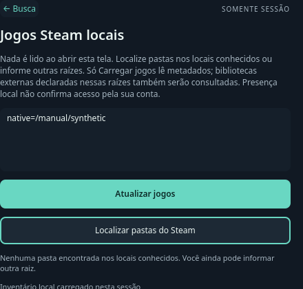
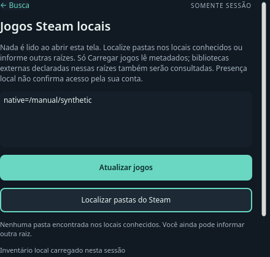
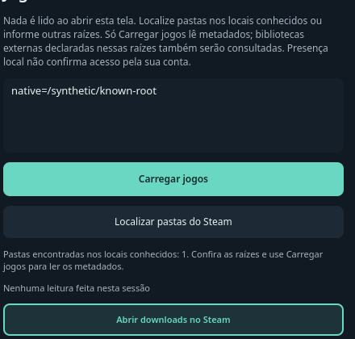
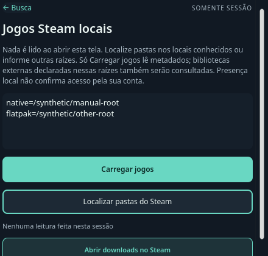

# Descoberta opcional de pastas Steam — Source

Incremento de S1 em 13/10/2026, empilhado sobre os presets de aparência.
Abrir Steam no launcher continua passivo. **Localizar pastas do Steam** consulta
quatro entradas conhecidas, resolve aliases e preenche raízes canônicas sem
duplicatas. Não enumera jogos, lê arquivos, inicia helper ou abre o cliente.
**Carregar jogos** continua sendo uma ação explícita separada.

Sem resultados, o campo manual é preservado. A mensagem da descoberta é
independente do estado do inventário; localizar depois de uma consulta não apaga
jogos, revisão ou status. Durante operação ou fechamento, a ação fica bloqueada.
O campo, os controles nativos e o contorno de foco seguem o sistema visual Orla.

## Verificação

- Checkout integrado: configure e build completos com Qt 6.11.2 passaram.
  CTest Steam passou, 1/1 em 15,79 s; as 24 entradas QtTest incluem localização,
  deduplicação, entradas inválidas, isolamento, scan e encerramento do helper.
- Dois casos da UI compilada passaram nos estilos Fusion e `org.kde.desktop`
  (quatro entradas por estilo, incluindo início/fim). Cobrem carregamento
  explícito, Escape e bloqueio das ações concorrentes.
- Vinte testes Python Steam e sete design guards passaram; design check sem
  issues. A galeria KDE completa foi revisada nas schemes clara e escura.
  O launcher mantém sua scheme escura nas duas.
- Revisão independente aprovada: 24 entradas Fusion e quatro KDE passaram;
  arquivos congelados permaneceram iguais. O recibo privado corrigido esclarece
  o hash do inventário sem alterar o candidato ou apagar o recibo anterior.
- No candidato isolado, os testes do painel em 440/660 px e as capturas focadas
  passaram nos dois estilos. A galeria Fusion completa falhou duas vezes antes
  de alcançar Steam, em `StopIteration` do render da dock não alterada.
  Essa falha permanece registrada; não há PASS agregado da galeria Fusion.

| Fusion — 440 px | KDE — 440 px |
|---|---|
|  |  |

Capturas sintéticas offscreen, com o botão focado e o estado sem pastas.
Não mostram bibliotecas pessoais nem a sessão KDE real.

## Limites e próximo gate

Os demais CTests e a UI completa do launcher não foram repetidos nesta fatia.
Descoberta real, instalação deste incremento, foco Plasma/Wayland, cliente,
handler, conta, execução de jogos e disco externo permanecem UNRUN.
Presença da pasta não comprova instalação do cliente, conectividade ou
titularidade. As quatro consultas síncronas podem demorar em filesystem
indisponível; esta fatia não oferece deadline de descoberta.

Próximo gate: instalar um build com helpers versionados, exercitar o gesto de
localizar/carregar na sessão KDE e conferir seleção por teclado sem executar
jogos. Depois, qualificar separadamente dois jogos e a matriz de bibliotecas.
S1 continua parcial; este incremento não modifica os assets públicos 0.2.9.

## Navegação por teclado — incremento de 13/10

O candidato permanente de `45beecf` foi instalado com helpers versionados.
Meta abriu o launcher e a entrada Steam abriu seu painel na sessão Wayland.
O gesto de Tab encontrou um defeito real: o campo de raízes inseriu tabulações
em vez de transferir o foco. A tentativa foi encerrada sem descobrir pastas,
ler a biblioteca ou encaminhar uma URI Steam; o texto temporário foi removido.

A correção intercepta Tab antes do editor e define uma sequência de ida e volta
entre Busca, raízes, Carregar, Cancelar, Localizar e Downloads. Controles
indisponíveis são pulados; Cancelar continua acessível durante uma leitura.
O controle focado é revelado no viewport, inclusive quando a mensagem da
descoberta muda a altura do conteúdo. Busca e raízes têm contorno de 2 px.

As regressões reproduziram primeiro a inserção de Tab e, depois, Downloads
parcialmente oculto após Localizar. Os dois defeitos foram corrigidos.
Os testes direcionados passaram nos estilos Fusion e KDE: dez entradas por
estilo, nas larguras de 440 e 660 px e altura de 420 px. Navegam com Tab e
Shift+Tab, sem forçar foco intermediário ou rolagem; verificam o texto intacto,
limites de cada ancestral com clip e ausência de ações implícitas.
Space aciona somente callbacks e helpers próprios nas fixtures.
A suíte Steam completa passou nos dois estilos: 30 entradas por estilo,
sem falhas ou skips, em aproximadamente 17,4 s Qt por execução.
Design check passou sem issues e os sete design guards passaram.

| Downloads focado — Fusion | Localizar focado — KDE |
|---|---|
|  |  |

Capturas sintéticas offscreen. O launcher usa a mesma scheme escura sob
ambas as schemes do sistema. As demais superfícies não mudaram neste lote.
Os testes offscreen não qualificam foco Plasma/Wayland nem execução de jogos.

## Instalação e descoberta nativas — canary delimitado

O commit `c71ab6d` foi compilado em versão permanente completa, com 277 arquivos
Source congelados e os três helpers nessa versão. Build passou; CTests de
comportamento e Steam passaram 2/2. O primeiro possui um skip intencional da
fixture de aplicativo; Steam teve 30 entradas aprovadas. UI compilada passou
nos dois estilos e os novos casos de teclado também passaram em KDE.
Uma invocação de teste com nome de executável errado falhou antes de iniciar
Qt; foi preservada e somente essa etapa pendente foi executada com o nome certo.
Não houve repetição da preparação, build ou CTests já aprovados.

Após revisão independente dos guards e rollback, somente os dois wrappers
foram atualizados atomicamente; o serviço foi preservado. O processo ativo
correspondeu ao ELF `03bea97d9a91db1ba097719e31e6c9a89dbc925a27d3b3bef07dc11dff63136f`,
com owner D-Bus e atalho gerenciado corretos. Plasma não foi reiniciado.

Na sessão Plasma 6.7.5/Wayland, Meta abriu Orla e a entrada Steam abriu o painel.
Tab transferiu foco do campo vazio até Localizar sem inserir texto, mantendo o
controle inteiro visível. Space localizou **uma raiz**; ao focar Downloads,
a mensagem ainda indicava que nenhuma leitura havia sido feita.
Shift+Tab retornou a Carregar; Space leu os metadados. A UI mostrou
**12 jogos, 0 avisos e 1 raiz**. Downloads voltou a ficar inteiramente visível
ao receber foco depois da atualização. As capturas privadas dessa leitura
excluem caminhos, títulos e nomes dos jogos.

O launcher permaneceu ativo e saudável, sem reinícios. Os 66 arquivos do dock,
14 da barra e todos os valores parseados dos dois arquivos de configuração
Plasma permaneceram iguais. O perfil temporário anterior continuou ausente;
dispositivos de input foram liberados e não restaram processos desses helpers.
Escape foi enviado para voltar à busca e ocultar o launcher; não houve uma
testemunha separada de retorno de foco nesta fatia.

Seleção visual de um jogo por setas, execução, handler de Downloads, conta,
Flatpak, disco externo e outros monitores permanecem UNRUN. Os números acima
são o inventário de metadados mostrado pela UI, sem comprovar acesso pela conta.
S1 continua parcial; assets públicos 0.2.9 permanecem inalterados.
