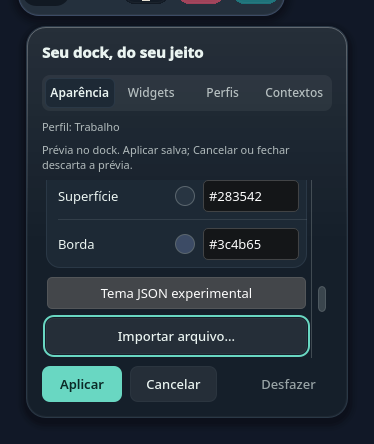
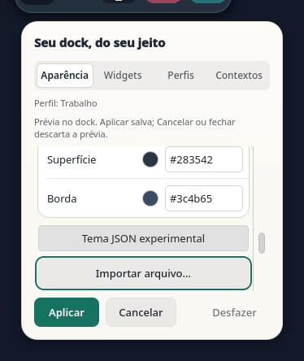
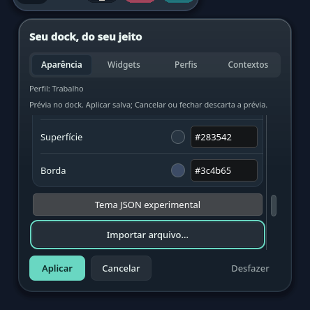
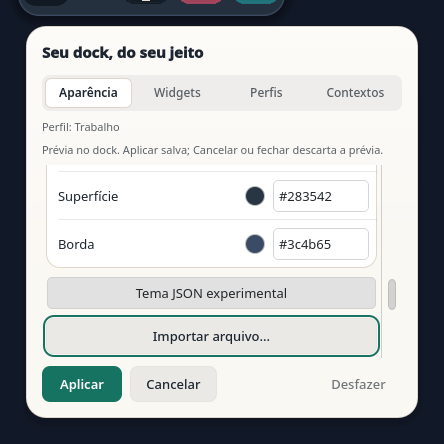

# Importação local de temas — 16/10/2026

Escopo: checkout de desenvolvimento, com versão do pacote ainda `0.2.9`.
O pacote de desenvolvimento foi instalado localmente após as verificações abaixo.
Nenhuma release nova foi publicada.

## Comportamento

**Importar arquivo…** abre um seletor modal associado à janela de configurações.
Aceitar inicia uma leitura limitada; o resultado preenche o JSON pendente.
**Usar na prévia** continua obrigatório antes de **Aplicar**. Falhas preservam a
última prévia válida; fechar, mudar de aba ou editar invalida o resultado antigo.

O serviço de temas é independente dos plugins de projetos e do launcher. O
instalador registra ativação lazy somente com as dependências disponíveis,
preserva registros estranhos e repete a atualização do D-Bus numa reinstalação.
O leitor distribuído e o parser canônico são os mesmos já usados pelo kit CLI.

## Verificação executada

| Verificação | Resultado |
| --- | --- |
| CLI, instalação, parser, leitor, serviço e kit (`test_package_cli test_themes test_theme_file test_theme_service test_release`) | 71 testes passaram |
| Estado, picker, aparência, presets, dock e design, estilo Fusion | 129 testes; OK, 3 skips existentes |
| Estado, picker, aparência, presets e design, estilo KDE | 95 testes passaram |
| `scripts/design.py check` | Sem ocorrências |
| Galeria | Claro/escuro; botão e foco inspecionados em 350 e 420 px; erro em 420 px |
| Pacote construído | 78 arquivos; bytes/modos conferidos com Source; SHA-256 `adef6b0b1534c42dd1f2a40de2951bc1f2e15e4155c75f4e05a58d937b42c406` |

A prova real de D-Bus privado usou um diretório de instalação com espaços e
ativação lazy. O bridge QML recebeu o tipo STRING do Plasma, extraiu seu texto
sem coerção genérica e passou pelo estado real: JSON pendente/zero writes →
prévia/zero writes → aplicar/um write → desfazer/dois writes, restaurando a
configuração sintética. Sem warnings, processos ou socket restantes. Essa prova
foi offscreen e não incluiu o seletor ou input Wayland.

Os testes causais corrigiram publicação após cancelamento, timeout com owner
destruído, prévia antiga apagando entrada mais recente, encerramento de stdout
excessivo e retry do registro após perda de dependência ou downgrade.

## Wayland isolado e atualização local

Os componentes de produção `AppearanceState`, `AppearanceEditor`,
`ThemeFilePicker` e `ThemeFileTransport` passaram juntos em uma janela de teste
com configuração sintética em memória, KWin/Wayland e D-Bus privados. A cópia
dos 78 arquivos do pacote permaneceu idêntica ao Source.

O seletor Qt Quick abriu como filho da janela original. Um clique no arquivo
sintético foi enviado somente ao compositor privado, após conferir os
retângulos do cliente e do item, escala 1 e posição real do cursor. O aceite
acionou o serviço lazy real: JSON pendente sem mudar a aparência → **Usar na
prévia** com metadados e aparência efetiva alterados → **Cancelar** com retorno
ao estado inicial. Todas as observações mantiveram zero gravações.

O roteiro usou sete ações Press, quatro SetFocus e um clique de ponteiro.
O botão de prévia inicialmente estava abaixo da rolagem; sua ação pública de
foco fez o próprio editor revelá-lo. Visibilidade, habilitação e foco foram
conferidos antes do Press. Nenhum método de produção foi substituído. O host
terminou sem warnings; serviço, helper, processos e sockets privados foram
encerrados, sem erros de limpeza.

A instalação local atualizou somente o dock e acrescentou o registro exato
`org.orla.Themes.service`. Houve um stop/start controlado do Plasma e backup
do pacote anterior, sem necessidade de rollback. O inventário de painéis,
configuração, barra, launcher, integrações opcionais e bancos originais foram
preservados. As cinco chaves de perfis/automação continuaram ausentes no disco,
com automação efetivamente OFF; sessão desbloqueada e bloqueio automático
desativado foram conferidos após a recarga.

Esse aceite é dos componentes na fixture Wayland. A composição completa com
`DockView`/`DockPopup`, Escape, seat físico, diálogo de plataforma KDE e
persistência de Aplicar no Wayland mantêm gates próprios. Aplicar/Desfazer
continuam comprovados pelo bridge real em execução offscreen descrito acima.

## Tentativas preservadas e falha preexistente

Um prototype instrumentado, em KWin/Wayland e D-Bus isolados, abriu o seletor
Qt Quick como filho da janela original. Cancelar preservou janela, draft e
configuração; os processos próprios terminaram normalmente. Os bookends Main
confirmaram o mesmo processo Plasma, bancos/configuração/launcher preservados,
automação OFF e sessão desbloqueada. Não houve input no compositor Main.

Esse primeiro roteiro não qualificou o aceite: a lista expõe somente SetFocus
pelo AT-SPI, e focar o item não habilitou Aceitar. O teste encerrou pelo Cancelar
normal, mantendo o erro original. Os roteiros posteriores corrigiram somente
premissas do teste sobre decoração da janela e visibilidade de controles
recortados pela rolagem. As tentativas e seus primeiros erros foram preservados;
o aceite atual por clique está delimitado na seção anterior.

O teste de áudio KDE `test_audio_output_pointer_failures_restore_confirmed_presentation`
falhou em `pendingKind` tanto no checkout atual quanto na base `8d74a055` em
processos isolados. A assinatura é preexistente; a causa específica continua
indefinida e áudio não foi alterado neste incremento.

## Capturas sintéticas

| Largura | Escuro | Claro |
| --- | --- | --- |
| 350 px |  |  |
| 420 px |  |  |
