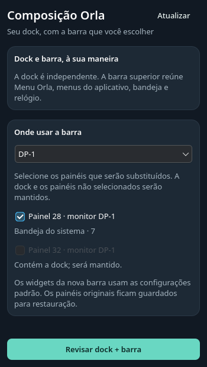
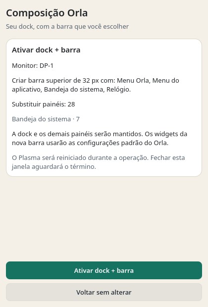
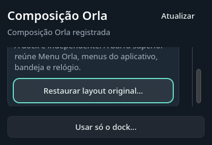
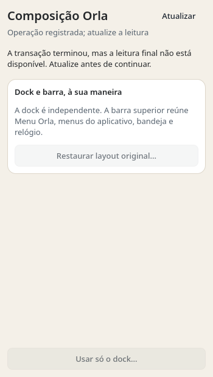
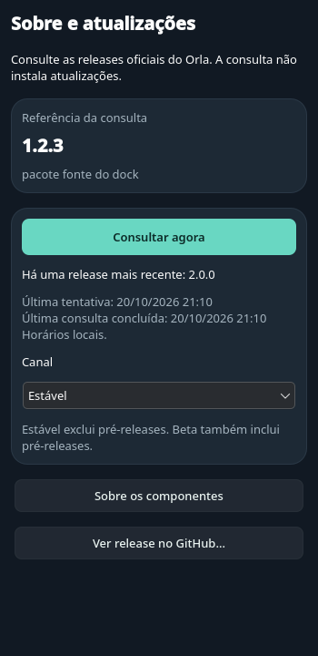
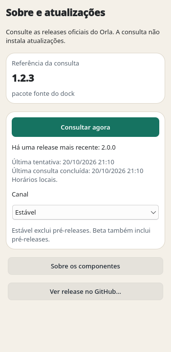

# Composição opcional — validação de código e interface

20/10/2026. PySide6/Qt 6.11.2, renderização offscreen/software. Este registro
qualifica a janela e a ligação ao gerenciador existente com runtime sintético.
O incremento do bundle abaixo qualifica também a carga sem checkout. Não qualifica
o comportamento nativo de Plasma/Wayland. A instalação gerenciada privada tem
um incremento separado ao final, ainda em revisão independente.

## Comportamento verificado

- Ler, selecionar, revisar e abandonar não alteram configuração, bancos ou journal.
- Uma confirmação consome um plano em memória; dupla confirmação, plano antigo e
  drift de bytes/modos, inventário, recibo, serviço e raízes são recusados.
- O host Qt executa apply → disable → restore nas funções reais, usando FileStore
  e arquivos privados com FakeRuntime; recupera os bytes originais e despacha uma
  aplicação e uma remoção. Há cobertura adicional de schema2 e falha/recuperação.
- Fechamento pendente bloqueia novos trabalhos até join. Falhas não expõem caminhos
  ou identificadores privados. Erros de compatibilidade e widgets têm orientação.
- Inserção, reordenação e remoção de monitores mantêm seleção visual e alvo iguais.
- Em 350×240, o conteúdo continua rolável e o controle com foco é revelado após
  layout/redimensionamento. O teste preserva a falha histórica encontrada em KDE.
- Uma transação registrada com leitura final indisponível, ou Plasma parado,
  não anuncia barra ativa nem oferece ações normais; releitura não repete execute.

## Verificações

```sh
QT_QPA_PLATFORM=offscreen QT_QUICK_BACKEND=software QT_QUICK_CONTROLS_STYLE=Fusion \
  python3 -B -m unittest discover -s tests -p 'test_workspace*.py'
QT_QPA_PLATFORM=offscreen QT_QUICK_BACKEND=software QT_QUICK_CONTROLS_STYLE=org.kde.desktop \
  python3 -B -m unittest discover -s tests -p 'test_workspace*.py'
QT_QPA_PLATFORM=offscreen QT_QUICK_BACKEND=software \
  python3 -B -m unittest discover -s tests -p 'test_panel_layout*.py'
PYTHONPATH=tests QT_QPA_PLATFORM=offscreen \
  python3 -B -m unittest test_package_cli test_release test_design_system
python3 scripts/design.py check
```

Resultados: 31 testes de composição em cada estilo; 177 do backend; 50 de CLI,
bundle e design. Todos passaram. Design check: zero problemas. O build do plasmoid
continua com o mesmo SHA256 do pacote anterior; nenhum payload novo foi instalado.

A galeria usa `Gallery.workspace` do gerador existente: 36 capturas, nove por
combinação de estilo/esquema, sem warnings QML. As capturas finais foram vistas;
foco, legibilidade e geometria foram também medidos pelos testes. Foram corrigidos
viewport colapsado, foco invisível após resize, alvo de monitor divergente e rótulo
cortado. A revisão independente final não encontrou bloqueadores neste escopo.

## Capturas sintéticas






## Ainda aberto

Não foram executados NativeRuntime, IPC real, recarga de plasmashell ou ciclo
completo desta janela na sessão do usuário. Os gates próprios anteriores de
SIGINT/SIGTERM/Window.close exercitaram o controller com uma Session bloqueada e
loop Qt real em filhos privados; não provam o ciclo nativo. Entrada instalada no
desktop na sessão do usuário, criação aditiva e reativação direta permanecem no
[roadmap](../../ROADMAP.md). Reativação atual exige restore → novo plano/apply.

## Incremento de distribuição: ZIP relocável

O bundle separado fecha a árvore de imports da janela: 16 arquivos regulares 0644
e manifesto. A verificação cobre determinismo, hashes/commit externos, schema,
entradas duplicadas/extras/ausentes, modos, symlinks e limites de expansão. Os
testes usam fixtures sintéticas para adulterações e o payload real para integração.

O payload real foi extraído de bytes verificados, movido para um caminho com
espaços/Unicode e aberto de outro diretório. `--version` e `--diagnose` passaram;
a árvore permaneceu idêntica, sem bytecode novo. Um teste Bubblewrap ocultou o
repositório e removeu a rede: o diagnóstico carregou a interface real sem fallback
para Source. Esse teste é explicitamente pulado quando Bubblewrap está ausente.

Pacotes instalados com os nomes `workspace` e `scripts` não substituem os imports
locais do bundle; o teste preserva a colisão encontrada na inspeção final.
Um Python privado sem Qt ainda consulta versão e informa `qt_runtime_missing`.
Versão Qt incompatível impede iniciar o host; erros de inicialização são
sanitizados. O diagnóstico usa XDG privado, barramentos ausentes e controller
inerte: não instancia NativeRuntime nem testa a sessão Plasma. As configurações
XDG do chamador foram preservadas. A resolução de estado relativo também passou
com os defaults do usuário, antes de construir a interface.

Verificação do incremento pelos comandos acima: 60 testes de composição em
Fusion e 60 em KDE; 177 do backend; 50 de CLI/release/design; design check sem
problemas. Os processos das suítes Qt registraram um `ResourceWarning` de sete
objetos Python não coletáveis ao terminar; não houve falha de teste. Nenhum QML
foi alterado neste incremento; a galeria anterior continua sendo a referência visual.
A revisão independente final não encontrou bloqueadores: 96 testes focados
passaram, além de cinco variantes de colisão com pacotes instalados. Remover
qualquer um dos dois marcadores de pacote em cópias privadas reproduziu a falha;
no bundle final, todos os helpers inspecionados vieram da árvore local. Esse
resultado substitui o aceite inicial, que não havia detectado a colisão.

Não foram instalados bundle, atalho ou serviço na sessão do usuário. O ZIP não
inclui Qt ou widgets; hashes do manifesto não autenticam o autor. O instalador
com ownership, seletor de geração, update/rollback e barreira de fechamento
é tratado no incremento abaixo, separado do ciclo nativo completo.

## Incremento de distribuição: instalação própria

O gerenciador experimental oferece install/status/doctor/launch/update/rollback/
recover/uninstall, ferramentas locais fixadas, wrappers e entrada no menu. A
implementação passou em 59 testes focados de instalação, pacote e entrada. Os
casos incluem colisões e drift, checkpoints de recuperação, histórico imutável,
update com uma geração anterior, quoting de caminhos e sinais/lease com filhos
sintéticos. A revisão independente encontrou uma falha reproduzida em escrita
parcial de registros imutáveis. A correção publica somente registros completos
e sincronizados, sem substituir histórico existente; falhas parciais de recibo,
intent e conclusão passaram em recuperação/retry ou replay conforme a fase.
Os 69 testes focados passaram após a correção. Root executou também a descoberta
completa `test_workspace*.py`: 100 testes em Fusion passaram, sem falhas ou skips,
com XDG privado e barramentos ausentes. A nova revisão independente aprovou o
contrato delimitado, sem achados restantes: repetiu os 69 testes focados e
acrescentou três testes com dez cenários de falha, além da prova instalada sem
Source/Qt. Registros finais realmente corrompidos continuam sendo recusados.

Root instalou o ZIP real do commit `5b0ab82b023ad1d2ef4b12c2bc63f288454c29ea`
em diretórios privados dentro de Bubblewrap, com Source oculto, rede ausente e
barramentos ausentes. Após remover bootstrap e ZIP, os comandos instalados
status, doctor, recover sem pendência e uninstall passaram. Doctor carregou a
interface real offscreen em Qt/PySide6 6.11.2; informou runtime ready,
serviceContacted=false e nativeValidated=false. Configuração, bancos e auditoria
sintéticos preservaram conteúdo, modo e identidade. Esse fluxo foi repetido com
as ferramentas corrigidas e passou novamente. O teste de release passou
com a nova suíte excluída do arquivo específico do plasmoid.

Duas tentativas anteriores do harness foram preservadas: a primeira recusou um
ancestral com UID remapeado pelo namespace; a segunda não criou um mountpoint
sobre a raiz somente leitura. A execução final usou um bind privado sobre um
mountpoint existente, sem relaxar verificações do instalador ou mudar o produto.

Não há promessa de recuperar toda instrução interrompida: criação anterior ao
checkpoint de identidade recusa adoção, e remoção parcial das ferramentas exige
o par confiável original. Não foram testados falta de energia, filesystem remoto
ou execução em Python mínimo. Não houve instalação na sessão do usuário, recarga
de Plasma ou validação do fechamento real da janela instalada.

O driver/provision passou em revisão independente com 28 testes privados. O
supervisor foi corrigido e aprovado após 69 testes simulados: exige EOF, valida
registros a cada leitura e preserva a primeira falha diante de problemas posteriores
de transporte, log e limpeza. Os 101 arquivos de Source e os 110 arquivos do ISO
foram reconferidos; imagem Fedora e checksum assinado também passaram antes do boot.

O primeiro boot de preparação falhou com status 153 em 15,551 s. Imagem e logs
permanecem preservados; a investigação offline não estabeleceu a causa exata.
Uma geração nova retirou um limite global de arquivo inadequado e tornou a captura
durável antes do marcador. Após revisão independente e novo gate de assinatura,
hashes e imagem limpa, a preparação passou em 105,362 s, com QEMU 0 e EOF.
A auditoria Root confirmou as nove versões exigidas, os registros de hash e de
assinatura dos 530 RPMs e a correspondência do binário systemd à atestação.

O ciclo final dessa geração parou em 12,144 s antes de produzir o resultado do
driver: o KWin registrou File size limit exceeded, com status 153. O supervisor
preservou o KeyError original por ausência de result.json e encerrou seu QEMU.
Imagem e evidência dessa tentativa também foram mantidas, sem retry ou reparo.
A retirada do segundo limite global e a mensagem de falha por estágio passaram
em 80 testes do autor e 41 métodos focados da revisão independente, sem bloqueadores.
Uma geração nova passou na preparação em 163,753 s, com QEMU 0 e EOF; a auditoria
reconfirmou as nove versões, 530 registros de assinatura e o binário systemd.

Essa tentativa final avançou até o controlador, mas parou na leitura inicial em
15,493 s: estado UNKNOWN e mensagem genérica, sem exceção original disponível.
O driver registrou ATTEMPTED/FAIL_STOPPED; o ledger não contém recuperações.
A imagem e os arquivos foram preservados, e o QEMU próprio foi encerrado. Não
houve retry, reparo ou confirmação de operações após a falha. O diagnóstico dessa
leitura está em andamento; a causa não foi presumida a partir do texto sanitizado.
NativeRuntime e a composição continuam sem aceite nativo; preparação aprovada não
é prova do fluxo de aplicar, desativar e restaurar.

A CI do PR do instalador revelou uma condição da fixture de colisão: o Qt estava
somente no venv que executava os testes e não era herdado pelo venv aninhado. A
fixture passou a fornecer explicitamente os caminhos do runtime ativo. Uma regressão
reproduziu a falha antes da correção; os nove testes de entrada passaram depois,
assim como a revisão independente e os dois controles de colisão por remoção de
marcadores. O código de produção e as exigências de diagnóstico não foram alterados.
O resultado da nova CI permanece separado desses testes locais.

## U1 fase B — entrega instalada, qualificação privada

O candidato usa exatamente 21 arquivos de payload e manifesto no formato
`orla-workspace-package-0.2`. São os 16 anteriores mais Updates.qml e a
CLI/contrato/estado/controller de updates. O novo gerenciador fixa o hash do
verificador 0.2; estado, âncora, escrita imutável e supervisão mantêm o contrato 0.1.

A entrada `main.py --updates` verifica a árvore inteira antes de Qt e carrega a
QML de produção com referência do manifesto, sem construir NativeRuntime,
importar a composição ou fazer refresh. O digest usa os dados já verificados,
serializados canonicamente. Versão continua Qt-free; diagnóstico carrega as duas
superfícies com controllers inertes, sem cache, consultas ou serviço.

A entrada principal Sobre e atualizações usa o wrapper absoluto com `--updates`;
a ação Composição Orla usa o mesmo wrapper sem flags. Permanecem três saídas
registradas no recibo. O comando direto sem flags preserva a composição. Há
recusa de flags misturadas e do payload incompleto/adulterado, inclusive dos dois
marcadores de isolamento dos módulos Python.

O teste usa ferramentas antigas retidas antes das edições e seus hashes exatos.
O gerente antigo recusa o formato expandido antes de qualquer escrita; o novo
recusa o arquivo antigo. Recover/uninstall antigos, reinstalação com par novo
confiável e recuperação de interrupção preservam a âncora, a auditoria e o
histórico antigo, incluindo bytes, modos e inodes. Update/rollback/recuperação
entre gerações 0.2 passam; operações entre formatos permanecem recusadas.
Esse teste de confiança usa `ORLA_OLD_WORKSPACE_TOOLS` apontando para a evidência
privada; é explicitamente pulado se esse par histórico não estiver disponível.

A GUI real offscreen manteve a lease durante consulta sintética bloqueada e
fechamento por SIGTERM. Recover/update/rollback/uninstall recusaram com
`busy_close_workspace` até a coleta do processo e de seu filho; após fechar,
o retry passou. Matar somente o supervisor sintético também preservou a lease
herdada pela GUI até terminar a limpeza. Nenhum NativeRuntime foi substituído
para ocultar uma construção: o caminho de updates recusa imports de composição
nas verificações da janela real.

O ZIP determinístico foi verificado, movido e executado com Source oculto, cwd
alheio, rede isolada e buses ausentes. Consulta offline injetada e reabertura do
histórico passaram. Em outro fluxo privado, instalou-se o arquivo com o par novo
independendente; após apagar bootstrap e ZIP, a entrada desktop abriu a GUI real,
bloqueou uninstall enquanto aberta e terminou por sinal. Status/doctor/recover/
uninstall instalados passaram. Doctor carregou ambas as QML reais; referência,
serviço não contatado e `nativeValidated=false` foram preservados.

O primeiro harness de namespace expôs UID de `/home` remapeado, recusado pelo
cache. Corrigiu-se o mount privado, sem relaxar checks. A primeira descoberta
integrada também detectou uma dependência nova de `sys.modules` que quebrava o
carregamento por arquivo da fixture de venv. A adição foi corrigida; a classe
original, incluindo o ajuste de venv aprovado, permanece byte-idêntica ao baseline.

Verificação final: **112 testes Workspace em Fusion e 112 em org.kde.desktop**,
mais **30 de updates em cada estilo** e **68 de CLI/release/design**; total de
**352 execuções de testes aprovadas**, sem skips locais. Design check: zero
problemas. Python 3.14.8, PySide6/Qt 6.11.2. As descobertas completas mantiveram o
ResourceWarning histórico de sete objetos não coletados no shutdown; não houve
falha de teste. Os 11 casos novos foram incorporados às suítes existentes já
excluídas do ZIP do dock, preservando o release.py congelado e a descoberta da CI.


Esta é evidência de candidato privado: o commit do artefato de qualificação é
sintético, não um commit publicado. Root deve revisar, integrar os patches e
reconstruir o artefato final com sua identidade real. A apresentação/galeria da
fase A permanece congelada e sua aprovação é independente; não se geraram novas
capturas nesta fase de entrega. Não houve publicação, rede real, instalação ou
abertura na sessão do usuário, IPC/serviço real, NativeRuntime, hardware ou VM.
Plasma/Wayland/AT e proveniência da dock instalada/em execução seguem abertos;
U1 permanece parcial e U2 não é concluído por esta entrega.

## Observação separada da tela Source em Wayland

Root abriu a tela de updates do candidato integrado na sessão KDE/Wayland, com
Qt/PySide6 6.11.2 e DPR 1,45. A janela de produção ficou visível, foi capturada
apenas em seu próprio conteúdo e fechou normalmente, sem avisos. A referência
Source exibida foi 0.2.9; não é prova da versão instalada ou carregada da dock.
Nenhuma consulta ou ação de composição foi solicitada pelo harness. Os arquivos
monitorados de applets, atalhos globais e KWin mantiveram bytes, modo e inode.

A observação qualifica somente essa abertura/renderização Source. Entrada do
bundle instalado, consulta real, teclado físico/retorno de foco, AT, esquema claro,
múltiplos monitores e o ciclo nativo da composição permanecem separados.

## Galeria da tela de updates

Capturas sintéticas da QML de produção, em Qt 6.11.2 com estilo KDE. Versões,
resultado e horários são dados de fixture; não representam uma consulta real nem
uma release do Workspace. A galeria clara/escura foi revisada junto aos testes de
teclado, foco, disclosure passivo e datas locais.




